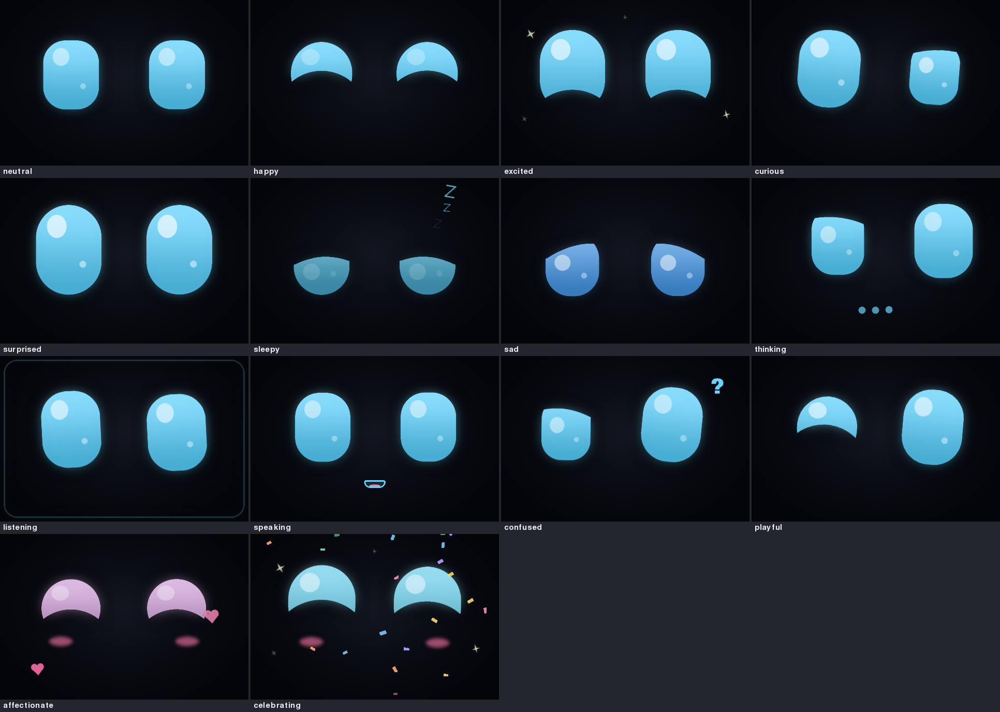
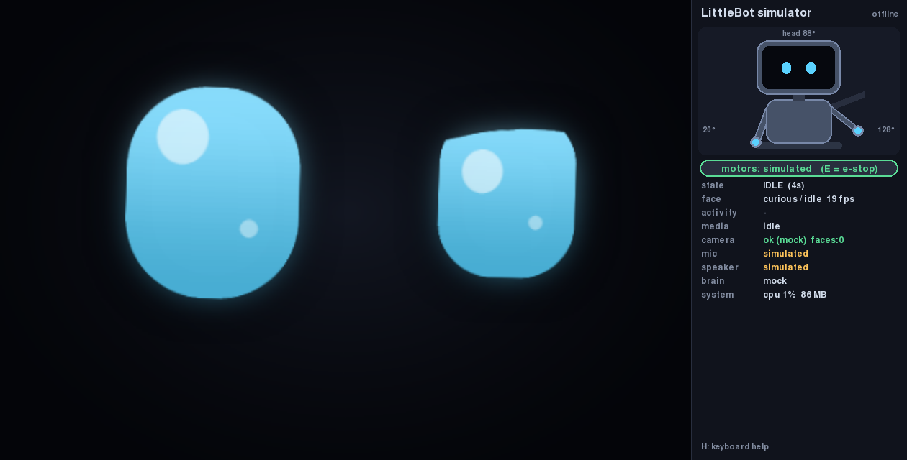
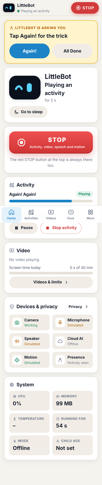

# LittleBot 🤖

A small, gentle, expressive companion robot for a young child: big animated eyes, songs and
scripted developmental play with a caregiver, parent-approved videos, optional AI conversation for
older children, and a phone-friendly parent dashboard. Built for a Raspberry Pi 5 (2 GB) with a
480×320 screen, USB camera, USB microphone and USB speaker, and future head/arm servos.

> **LittleBot is a supervised prototype.** It is not a babysitter, not a child-safety device and not
> a substitute for a caregiver. Software tests do not establish physical toy safety
> (see `docs/MOTION_SAFETY.md` and `HARDWARE_ARRIVAL_CHECKLIST.md`).

**Honest status:** everything runs in desktop simulation and offline-demo modes with 2,500+ passing
tests; nothing has run on the Pi or on real devices yet. See **`PROJECT_STATUS.md`**.



| Desktop simulator | Parent dashboard (phone) |
|---|---|
|  |  |

## Quick start (desktop simulation)

```bash
git clone <this repo> LittleBot && cd LittleBot
python3 -m venv .venv && . .venv/bin/activate
pip install -e ".[vision,audio,dev]"        # Linux: also `sudo apt install libportaudio2 espeak-ng`
                                             # add ",live" for live voice (or use ".[all]")
python -m littlebot                          # face window + simulator panel + dashboard
```

Then open **http://127.0.0.1:8765** and enter the one-time **setup code** shown on LittleBot's screen
(and in the console) to create the parent password.

Other ways to run it:

```bash
python -m littlebot --mode offline     # no internet, keys, camera or mic needed
python -m littlebot --demo             # loop the face demo sequence
python -m littlebot --headless         # dashboard only, no window
python -m littlebot --lan              # let phones on your home Wi-Fi reach the dashboard (opt-in)
python -m littlebot --mode pi          # on the Raspberry Pi (fullscreen, real USB devices)
python scripts/face_preview.py         # just the face, nothing else
```

Mode differences (camera, microphone, voice, cloud) are in `ARCHITECTURE.md`; all settings live in
`config/*.yaml` (override per machine in the git-ignored `config/local.yaml`, or with
`LITTLEBOT__SECTION__KEY=value` environment variables) — no code edits needed.

### In the face window

Press **H** for the full list. Highlights: **1–0 / J K L V** expressions, **B** blink, arrows gaze,
**P** peekaboo, **C** caregiver "done", **SPACE** push-to-talk, **W** wave, **X** STOP everything,
**E** motion emergency stop, **G** debug overlay, **F** fullscreen, **M** demo, **Q** quit.
In simulation, **click** the face to put a pretend person there (the eyes follow), right-click to
remove them.

## What's inside

| Area | Highlights |
|---|---|
| **Face** | 14 expressions, natural blinking, gaze tracking, breathing, speaking/listening/thinking animations, hearts/sparkles/confetti, sleeping; ~1 ms per frame on a desktop. |
| **Activities** | 43 short, caregiver-assisted activities for 6 months – 5 years: peekaboo, clapping, waving, animal sounds, first words, musical turn-taking, imitation, hide-the-toy, 10 public-domain songs, colours, shapes, counting, letters, body parts, matching, memory, movement and dancing, stories, feelings, problem-solving, pretend play. No scoring, no "diagnosis". Write your own in YAML (`docs/ACTIVITY_GUIDE.md`). |
| **Parent dashboard** | Phone-first web app: status, big STOP, activities with caregiver prompts, approved videos and limits, face controls, child profile, AI settings, privacy switches, motion simulator, devices, simulator. Setup-code first run, hashed password, CSRF protection, localhost-only unless you opt in. |
| **Videos** | Parent allowlist of YouTube videos/playlists played through YouTube's official embedded player, with session/daily limits, no autoplay into unapproved content, off by default under 18 months. |
| **Audio** | Gentle synthesised sound effects and melodies, espeak-ng voice (Piper / OpenAI optional), half-duplex listening so LittleBot never hears itself, hard volume ceiling, nothing recorded or stored. |
| **Camera** | Local face detection (YuNet, Haar fallback) at reduced resolution; eyes follow the child; wakes when someone arrives; no recognition, no images stored or sent. |
| **AI conversation** | Mock (offline) by default. Claude or OpenAI (paid API key), or **Sign in with ChatGPT** on the parent's own plan, when a parent enables it. A playful companion for the child and a home assistant for the grown-ups (weather, news, facts, parenting questions). Replies are validated in code, which blocks only what could harm a small child (grooming, personal-info questions to the child, dangerous instructions, sexual content, gore, self-harm, slurs, a child's medicine dose), with rate and budget limits. |
| **Live voice (GPT-Live)** | A real-time spoken conversation with ChatGPT's voice, on the parent's ChatGPT plan. Only a parent can start it, from the dashboard, while staying with the child. Time limit and idle hang-up. What the voice says is checked against the same safety rules while it speaks (a hit cuts it off and alerts the parent). Nothing is recorded. Uses undocumented OpenAI endpoints; not yet tested against OpenAI or on the Pi (`docs/CHATGPT.md`). |
| **Motion** | Head + two arms in simulation: gestures, smooth limited motion, latched emergency stop. Real servos stay disabled until wired, calibrated and armed by a parent. |
| **3D-printable body** | Two parametric OpenSCAD enclosures with ready-to-print STLs: v1 "TV head" (compact, 11 parts) and v2 "companion" (35 cm character with LED ears, camera pod and a wheel-ready base). Both include automated interference / pinch checks (`hardware/README.md`). |

## Testing

```bash
.venv/bin/python -m pytest -q          # ~3½ minutes; no hardware, network or keys needed
```

## Documentation map

| Document | What it covers |
|---|---|
| `PROJECT_STATUS.md` | What works, what is mock-tested, what awaits hardware |
| `NEXT_STEPS.md` | Prioritised remaining work + the prompt to resume development |
| `HARDWARE_ARRIVAL_CHECKLIST.md` | Step-by-step for the day the parts arrive |
| `ARCHITECTURE.md` | Design and module interactions |
| `docs/PI_SETUP.md`, `docs/DISPLAY_SETUP.md`, `docs/POWER.md` | Raspberry Pi installation, the 480×320 screen, power |
| `docs/TROUBLESHOOTING.md`, `docs/PERFORMANCE.md` | Fixing problems, measuring the Pi |
| `docs/DASHBOARD_GUIDE.md`, `docs/ACTIVITY_GUIDE.md` | For parents |
| `docs/AI_SAFETY.md`, `docs/MOTION_SAFETY.md`, `docs/YOUTUBE_ON_PI.md` | Safety and feasibility notes |
| `docs/CHATGPT.md` | Sign in with ChatGPT and live voice: setup, safety, privacy, troubleshooting |
| `docs/VOICES.md` | Recognising family voices (opt-in, on the robot): setup, privacy, troubleshooting |
| `docs/DEV_CONVENTIONS.md`, `docs/modules/*.md` | For developers |
| `hardware/README.md` | The two 3D-printable enclosures: parts, hardware lists, assembly, safety |

## API keys or ChatGPT sign-in (optional)

Copy `.env.example` to `.env` and add `ANTHROPIC_API_KEY` and/or `OPENAI_API_KEY`. These are separate,
paid developer accounts — a Claude.ai / Claude Code subscription does not include API access. Keys stay
on the robot and are never shown in the dashboard. Cloud AI stays off until you enable it on the AI page.

No API key? On the dashboard's AI page, **Sign in with ChatGPT** to use your own ChatGPT plan for
replies and live voice. It is unofficial (undocumented OpenAI endpoints that may change) and counts
against your plan's limits. See `docs/CHATGPT.md`.
