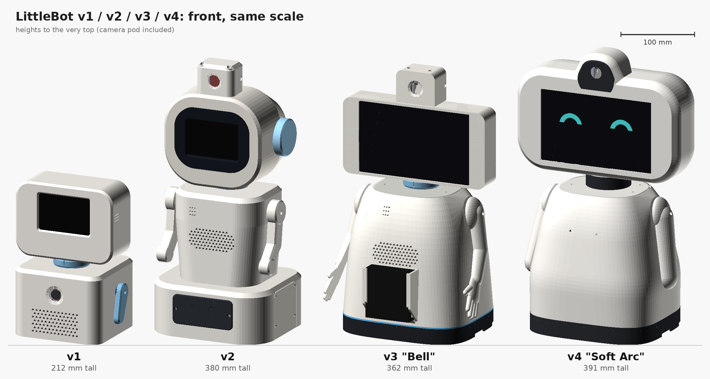
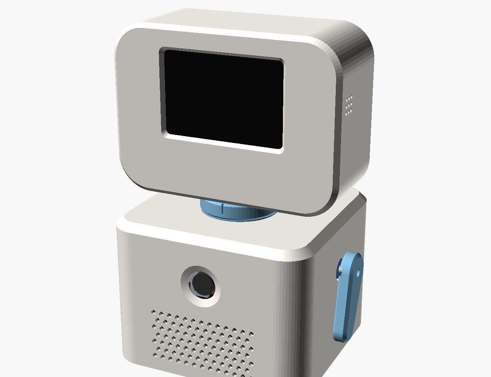
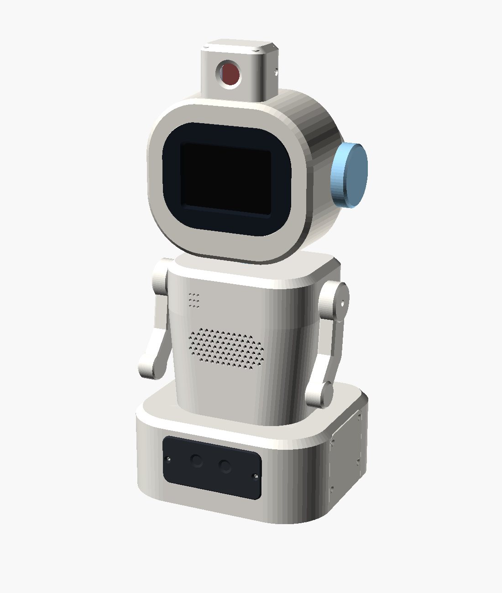
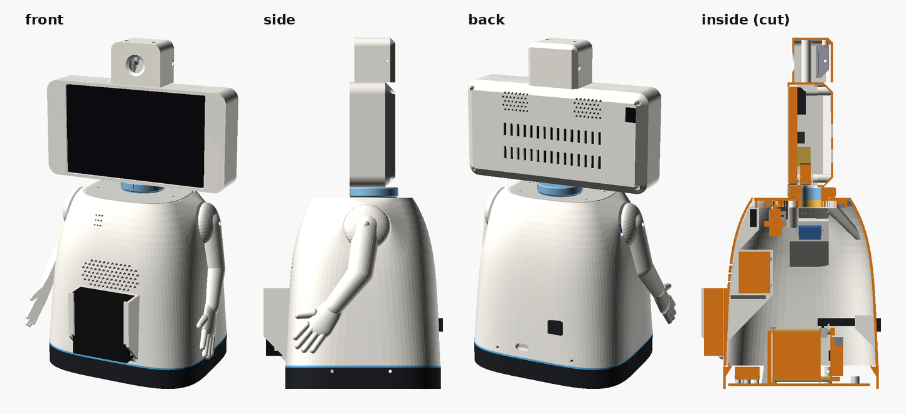
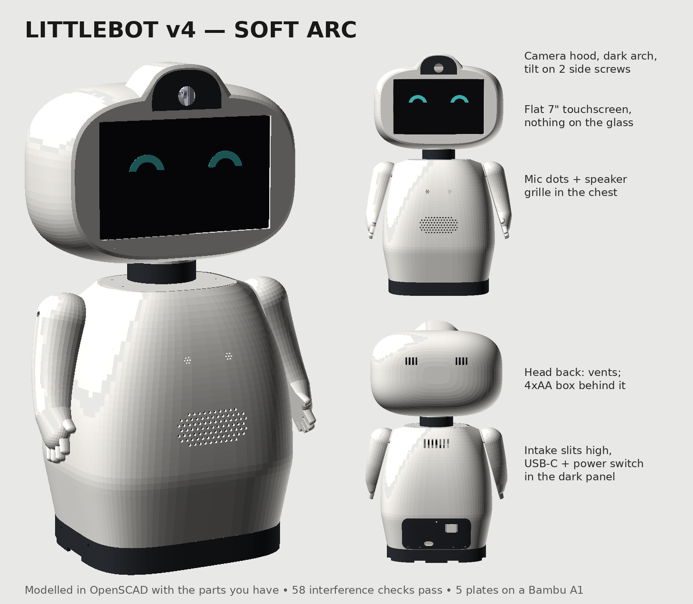

# LittleBot hardware: 3D-printable enclosures

Four complete designs. All are parametric OpenSCAD models with ready-to-slice STLs and automated interference checks. v1 and v2 hold the same parts:
- Raspberry Pi 5 (4 GB; every RAM size has the same board) + official Active Cooler and the MPI3508 3.5" HDMI screen. In v1 the screen is **plugged straight onto the Pi's GPIO header** and the stack sits in the head. In v2 (since 2026-10-30) the Pi sits on a **Waveshare UPS HAT (E)** battery in the base and the screen is alone in the head, connected by an HDMI cable, a power cable and 6 touch wires;
- InnoMaker U20CAM-1080P camera;
- Adafruit mini USB mic (3367) + mini USB speaker (3369);
- 3 × MG90S servos (head turn + two arms) and a PCA9685.

v3 and v4 keep v2's base (Pi 5 on the UPS HAT, PCA9685), neck and camera, and swap the 3.5" screen for the 52Pi EP-0177 7" touch screen with speakers. v4 lifts v2's neck 45 mm for a taller body.



Side and back views, same scale: [side](comparison/littlebot_v1_to_v4_side.png), [back](comparison/littlebot_v1_to_v4_back.png).

| | [v1 "TV head"](enclosure/README.md) | [v2 "companion"](enclosure_v2/README.md) | [v3 "Bell"](enclosure_v3/README.md) | [v4 "Soft Arc"](enclosure_v4/README.md) |
|---|---|---|---|---|
| Look |  |  |  |  |
| Size | 130 × 126 mm footprint, 212 mm tall, head 146 mm wide | 176 × 152 mm footprint, 340 mm tall (380 with the camera pod) | 186 × 182 mm body, 362 mm tall with the camera pod, head 213 mm wide | 208 × 182 mm body, 437 mm tall, head 242 × 158 × 131 mm |
| Parts | 11 STLs (12 prints) | 24 STLs (26 prints) + 2 for the wheel phase | 9 new parts on 4 A1 plates + v2's floor, neck and camera bracket | 12 parts on 5 A1 plates (v3's neck plate + v2's floor, neck, camera bracket) |
| Head | screen + Pi stack in the face, mic in the head's side | helmet head, black visor with the screen behind it, LED-ring ears, camera pod on top | the screen's own shape; nothing touches the glass; every plug hidden inside; camera pod on top | round head (flat face, soft bevel), camera hood with a dark arch; the 4×AA box behind its back |
| Neck | geared turntable, head = 0.67 × servo | same | v2's | v2's, under a black neck |
| Body | camera in the chest, speaker + PCA9685 on the floor plate | speaker + mic in the chest; Pi on its UPS battery, PCA9685, wheel wells, sensor/light-bar plate in the base | one-piece bell on a dark base ring; v2's floor inside; 4×AA servo box on the front; arms with hands | smooth egg on a dark base; v2's floor inside; USB-C + power switch in a dark back panel; one-piece arms with hands |
| Future phases | servo supply jack | wheels (TT motors), casters, HC-SR04, ESP32 + TB6612FNG, LED strips | wheels: a new base ring + floor | same as v3 |
| Screws | M2.5 + M3 | one M3 kit (4 lengths); nothing drilled or forced | the M3 kit + 4 M2.5 for the screen | same |
| Checks | 48 | 118 (incl. 12 mm finger-pinch clearance for the arms, every cable route and every screw) | 50 (incl. finger pinch, glass never touched, room to plug in) | 65 |
| Assembly video | none | [`assembly_video/`](enclosure_v2/assembly_video) (renders it) | none | [`LittleBot_v4_assembly.mp4`](enclosure_v4/LittleBot_v4_assembly.mp4): every part, screw, nut and cable |

v1 is quicker to print and smaller. v2 is the more "toy-like" character and is ready for driving around later. v3 has the big touch screen and the fewest parts to print. v4 is the Soft Arc concept: the same insides as v3 in a softer shell.

To regenerate either design after changing a dimension (needs OpenSCAD and Python 3 + numpy):

```bash
cd hardware/enclosure_v2      # or hardware/enclosure
./build.sh                    # STLs + preview images + the part report
./run_checks.sh               # interference checks (+ a self-test and an INFO line)
```

Every dimension was checked against the manufacturers' drawings on 2026-10-23: lcdwiki MPI3508, Raspberry Pi 5 and Active Cooler, InnoMaker, Adafruit, TowerPro. Each README has the table of sources. v1's section *The screen sits on the Pi* covers the stack heights, whether the Active Cooler fits under the screen and which GPIO pins are still free; v2's sections *The screen in the head* and *The Pi and the UPS in the base* cover its layout since 2026-10-30. For the UPS HAT (E), v2 uses Waveshare's outline drawing (board, holes, ports); its standoffs aren't published, so measure the stack's depth before printing v2's floor (its README says how).

Print the small fit-test parts listed in each README first (v1: the face + `pi_carrier`; v2: the servo frame and camera bracket, then the visor + `screen_clamp`), and measure the parts marked "MEASURE".
