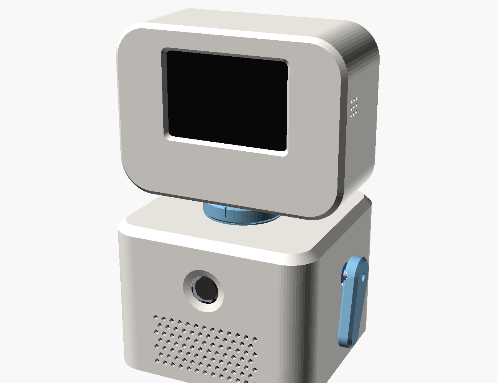
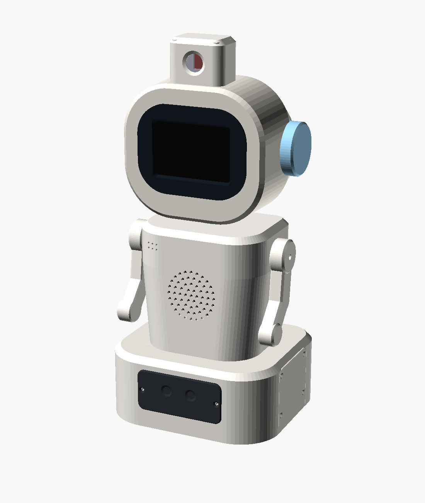

# LittleBot hardware: 3D-printable enclosures

Two complete designs. Both are parametric OpenSCAD models with ready-to-slice STLs and automated interference checks, and both hold the same parts:
- Raspberry Pi 5, MPI3508 3.5" HDMI screen, U20CAM-1080P camera;
- USB mic + speaker;
- 3 × MG90S servos (head turn + two arms) and a PCA9685.

| | [v1 "TV head"](enclosure/README.md) | [v2 "companion"](enclosure_v2/README.md) |
|---|---|---|
| Look |  |  |
| Size | 130 × 126 mm footprint, 212 mm tall | 176 × 152 mm footprint, 340 mm tall |
| Parts | 11 STLs (12 prints) | 22 STLs (23 prints) + 2 for the wheel phase |
| Head | screen face, camera in the chest | helmet head, black visor, LED-ring ears, camera pod on top |
| Neck | geared turntable, head = 0.67 × servo | same |
| Base | Pi on the floor plate | Pi upright in the torso; shelf, battery bay, wheel wells, sensor/light-bar plate |
| Future phases | servo supply jack | wheels (TT motors), casters, HC-SR04, ESP32 + TB6612FNG, LED strips, power bank |
| Checks | 35 | 68 (incl. 12 mm finger-pinch clearance for the arms) |

v1 is quicker to print and smaller. v2 is the more "toy-like" character and is ready for driving around later.

To regenerate either design after changing a dimension (needs OpenSCAD and Python 3 + numpy):

```bash
cd hardware/enclosure_v2      # or hardware/enclosure
./build.sh                    # STLs + preview images + the part report
./run_checks.sh               # interference checks
```

Neither design has been test-printed yet. Print the small fit-test parts listed in each README first, and measure the parts marked "MEASURE".
