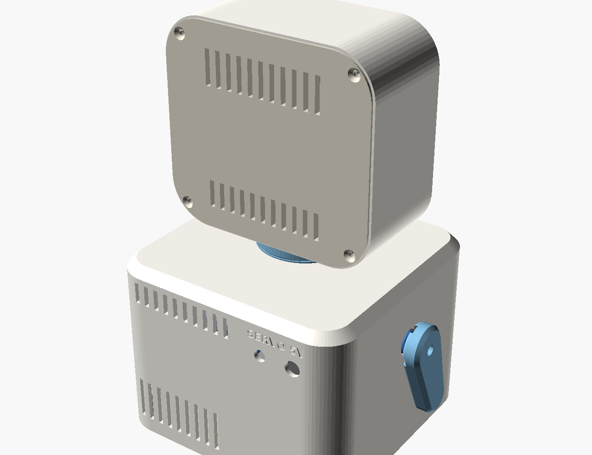
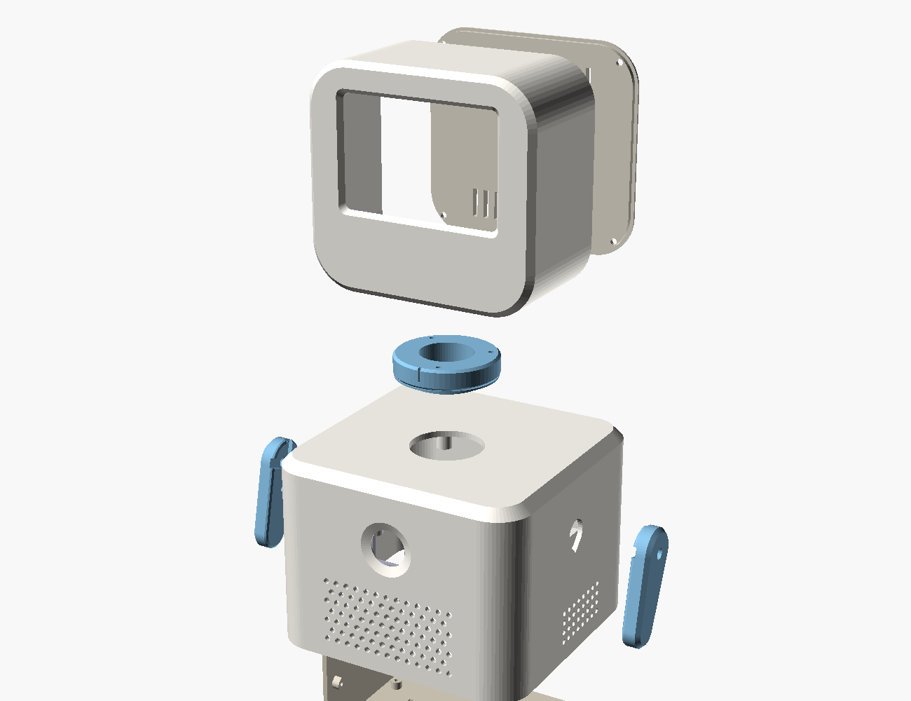
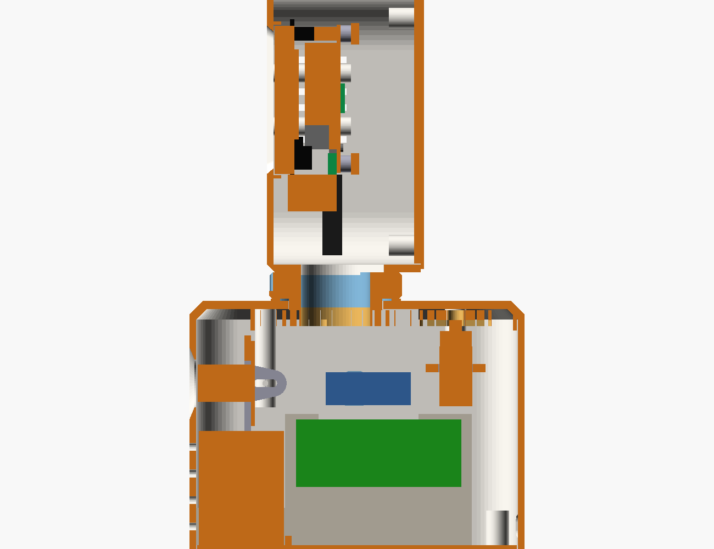
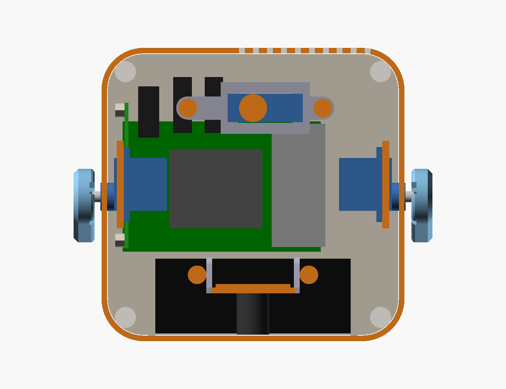

# LittleBot enclosure – version 1 ("TV head")

A parametric, 3D-printable enclosure for LittleBot, designed around the actual parts list
and the planned future servos (head rotation + two arms). Every part fits a 220 × 220 mm
bed (most fit 180 × 180), prints **without supports**, and is generated from one OpenSCAD file.

| Front | Back | Exploded |
|---|---|---|
|  |  |  |

| Side section | Plan section (z = 80 mm) |
|---|---|
|  |  |

Overall: **130 × 126 mm footprint, ~212 mm tall**. Head 114 × 106 × 58 mm.

## Files

| File | What |
|---|---|
| `littlebot_enclosure.scad` | the parametric model (all dimensions at the top) |
| `stl/*.stl` | ready-to-slice parts, already in print orientation |
| `checks.scad`, `run_checks.sh` | automated interference checks (35 checks incl. head ±45° and arm sweeps) |
| `build.sh`, `stl_tools.py` | regenerate STLs + images; size / watertight / bed-fit report |

## Parts to print

| STL | Qty | Orientation (already set) | Notes |
|---|---|---|---|
| `body.stl` | 1 | top face on the bed | top edge is a 45° chamfer so it prints cleanly upside-down |
| `base.stl` | 1 | flat | Pi 5 standoffs, speaker cradle, PCA9685 wall, ballast pockets, feet recesses |
| `head.stl` | 1 | screen side on the bed | best surface finish is on the face |
| `head_back.stl` | 1 | outside face on the bed | |
| `coupler.stl` | 1 | flat top on the bed | the visible neck / turntable |
| `ring_gear.stl` | 1 | flat | 36 teeth, module 1.5 |
| `pinion.stl` | 1 | flat | 24 teeth, holds the head-servo horn |
| `arm.stl` | **2** | outer face on the bed | same part for left and right |
| `servo_frame.stl` | 1 | flat | holds the head servo |
| `camera.stl` | 1 | plate on the bed | tilting / sliding camera bracket |
| `lcd_tabs.stl` | 1 | flat | four display clamp tabs |

**Suggested settings:** PETG (tougher, better near the warm Pi) or PLA+, 0.2 mm layers,
3 perimeters, 20–25 % gyroid infill (gears: 5 perimeters / 50 %), no supports, brim
optional for the body. Print the gears slowly for accurate teeth.

## Hardware (bill of materials)

| Item | Qty | Use |
|---|---|---|
| M3 × 10 screws (self-tapping or machine screws into the printed pilots) | 4 + 3 + 4 | base plate, head → neck, head back cover |
| M3 × 10 | 2 | head-servo frame → pillars |
| M2.5 × 12 | 3 | ring gear → neck (from below) |
| M2.5 × 6 | 4 + 4 + 4 | Pi 5 standoffs, PCA9685, display clamp tabs |
| M2.5 × 8 | 2 | camera bracket pivots (snug = adjustable friction) |
| M2 × 6 + nuts | 4 | camera board → bracket |
| M2 × 6 self-tapping | 6 | servo horns → pinion / arms (the servo kits' small screws) |
| 10 mm self-adhesive rubber feet | 4 | |
| 1 mm foam tape | ~20 cm | display clamp tabs, speaker gasket |
| PTFE tape or a drop of silicone grease | – | neck bearing ring |
| 5.5 × 2.1 mm panel-mount DC jack (8 mm hole) | 1 | separate 5 V servo supply (future) |
| Mini toggle switch (6 mm hole) | 1 | hardware servo power switch (future) |
| Steel washers | ~100 g | optional ballast in the base pockets (lower centre of gravity) |
| 2 short zip ties | 2 | speaker in its cradle |

## Where everything goes

* **Head:** the MPI3508 display, HDMI port pointing **down**. It sits in a locating frame
  behind the screen window, held by four clamp tabs with foam. There are 34 mm of clearance
  below the display. **Warning:** the official Raspberry Pi micro-HDMI cable's HDMI plug is
  about 45 mm long with its strain relief, so it does **not** fit straight down. The head is
  only 58 mm deep, so a plug turned towards the back doesn't fit either. Use a 90° adapter
  that turns the plug **sideways** (along the head's width), or a flat FPC HDMI ribbon kit.
  This route is not covered by the automated checks; v2 is checked with the official cable. Power and (optional) touch go over
  the display's 26-pin header with male–female jumper wires to the Pi GPIO (5 V on pin 2 or 4,
  GND on pin 6).
* **Neck:** the head screws onto a **turntable** that turns on a hollow spigot in the body
  top. All head cables (HDMI + jumpers) pass through the **26 mm bore**. A 36-tooth ring gear
  under the top plate is driven by a 24-tooth pinion on the head servo. The servo never
  carries the head's weight. If the robot is lifted by its head, the ring gear catches
  under the top plate: the servo shaft is not loaded. The head turns **0.67 × the servo
  angle** (gear ratio 24:36), so servo 30–150° ≈ head ±40°. Calibrate the head joint
  with that in mind; the software's limits are in servo degrees.
* **Body, top area:** head servo (frame on two pillars), gear guard (keeps wires out of the
  teeth), both arm servos on vertical ribs with the output shaft through the side walls.
* **Body, front:** camera behind the round chest aperture (pivots ±10° and slides ±3 mm for
  lens length), speaker behind the grille.
* **Body, floor (base plate):** Raspberry Pi 5 with the active cooler. USB-C and micro-HDMI
  face the back, USB ports face the right side (microphone dongle behind the right-side
  holes). PCA9685 on its own wall along the left side.
* **Back:** USB-C power cable opening, servo power jack + switch ("SERVO 5V"), cooling slots.

All openings are 3 mm or smaller (grilles, vents) so little fingers can't reach inside.

## Measure before you print (assumed values)

These came from datasheets or typical parts and **must be checked with calipers** against
your parts. Change them at the top of `littlebot_enclosure.scad`, then run `./build.sh`.

| Parameter | Default | Check |
|---|---|---|
| `lcd_aa_offset` | 3.03 | With HDMI pointing down, is the wide black border on the **left**? If on the right, use −3.03 |
| `lcd_w`, `lcd_h`, `lcd_stack` | 85.51, 56, 7.32 | glass size and glass-front-to-PCB-back thickness (lcdwiki drawing, 2025 revision) |
| `cam_hole_sp` | 28 | camera board M2 hole spacing (board is 32 × 32) |
| `cam_board_y` | 23 | ≈ lens length; the bracket slots allow ±3 mm |
| `sv_spline_h`, `sv_tab_z`, `sv_tab_l`, `sv_hole_sp` | 32, 15.9, 32.2, 27.6 | MG90S clones differ – measure one servo |
| `horn_plate_t` | 1.6 | thickness of the horn's arms |
| `pca_holes` | approx. | PCA9685 board mounting holes |
| `spk_w/h/d` | 84 × 43 × 32 | Adafruit 3369 Mini External USB Stereo Speaker (Adafruit's listed size) |

Fit test first: print `ring_gear` + `pinion` (and check they mesh), and the `servo_frame`
with one servo, before committing to the 8-hour body print.

## Assembly order

1. **Arm servos:** from inside the body, push each servo's top through its rib window so
   the round boss pokes out of the side-wall hole. Screw the tabs to the rib (servo screws).
   Check that the spline sticks out ~4 mm. If it's too short or too long, add washers under
   the tabs, or adjust `arm_gap` and reprint.
2. **Neck:** stick PTFE tape on the coupler's bearing ring, drop the coupler into the top
   hole and screw the ring gear onto its spigot from inside (3 × M2.5 × 12).
3. **Head servo:** fit a cross horn (or a horn trimmed to 14 mm radius) into the pinion's
   pocket, then fix it with 2 small screws through the horn holes (drill 1.3 mm pilots using
   the horn as a template). Centre the servo electrically (90°), point the coupler's front
   mark forward, slide the pinion up into mesh with the ring gear, and screw the
   frame to the pillars.
4. **Camera:** board onto the bracket (M2), bracket between the chest pillars with the two
   pivot screws, tilt to taste.
5. **Base plate:** Pi 5 (+cooler) on the standoffs, speaker in the cradle (foam ring towards
   the grille, two zip ties), PCA9685 on the wall, optional ballast. Plug in cables
   (camera, speaker, mic dongle, HDMI, jumpers) and route the HDMI + jumpers up through
   the neck bore.
6. Screw the base plate into the body (4 × M3, from underneath), add the rubber feet.
7. **Head:** display into its frame (HDMI down), clamp tabs with foam, HDMI + jumpers
   connected. Screw the head onto the coupler from inside (3 × M3; the uneven pattern
   only fits one way), then close the back cover.
8. **Arms:** with the arm servos at their calibrated neutral, push each arm (horn screwed
   into its pocket) onto the spline and drive the centre screw through the arm's hole.

## Safety notes (important – this is for a baby)

* Use LittleBot **only under supervision**. Software tests don't establish physical toy safety.
* All screws are internal or recessed. There are no small detachable parts: the arms and
  head are large, and the clamp tabs are inside the closed head.
* Arms move in a plane 3 mm from the body with a **constant gap** (no closing pinch point).
  The raised arms stay clear of the head (checked over the full sweep). Keep physical motion
  disabled until `docs/MOTION_SAFETY.md` is complete.
* The base is wide and heavy at the bottom; add ballast if your build feels top-heavy.
* Don't use a hot-glued battery inside; power it from a proper supply (see `docs/POWER.md`).
* Check the finished print for sharp edges and layer splits; sand any burrs. PETG is less
  brittle than PLA if it gets dropped.
* Inspect regularly for cracks, especially the arms and neck.
