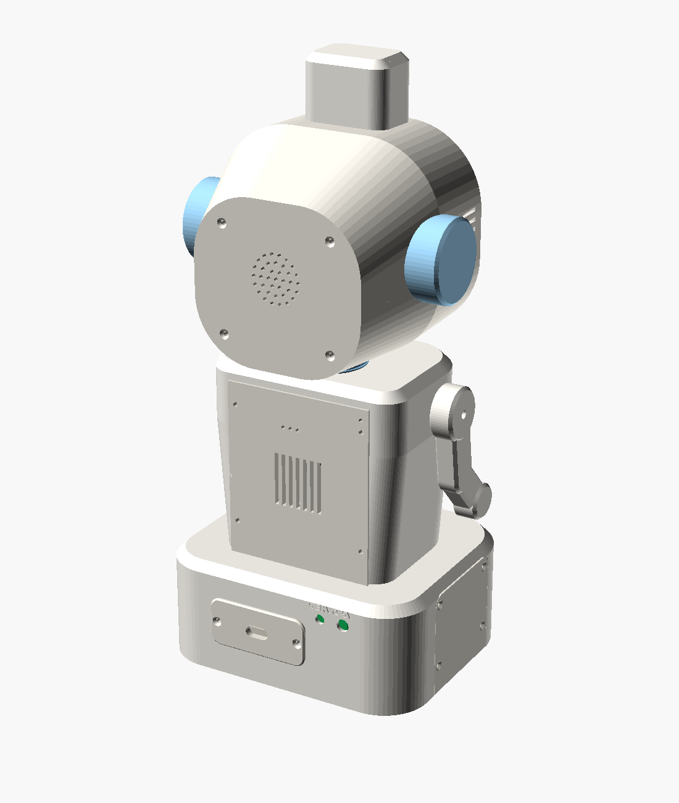
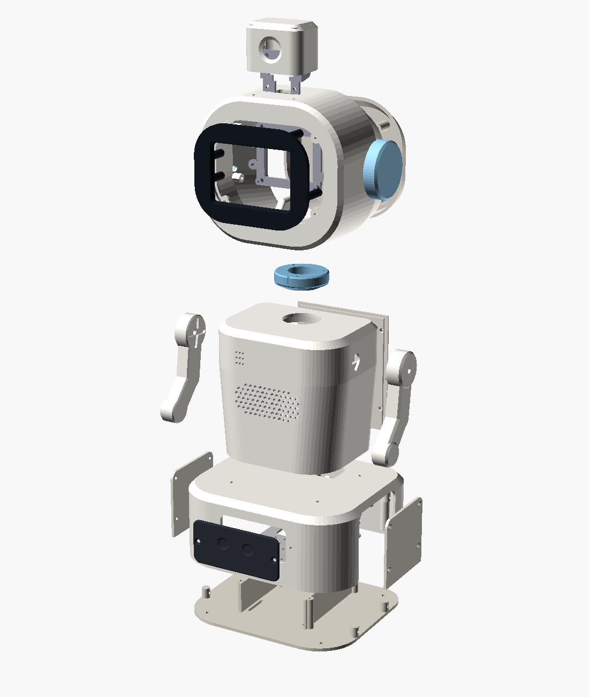
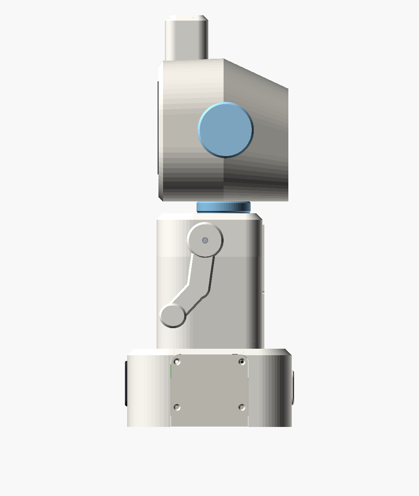
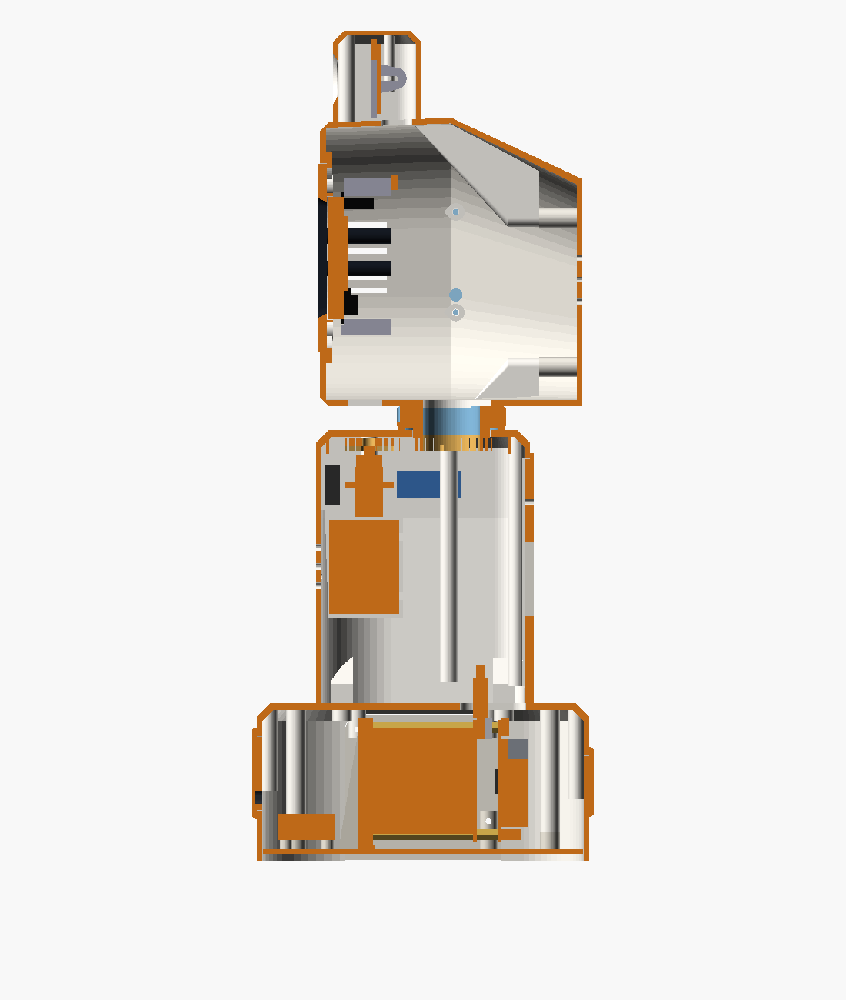
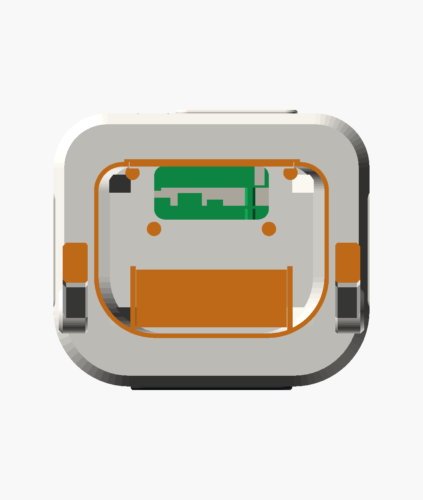
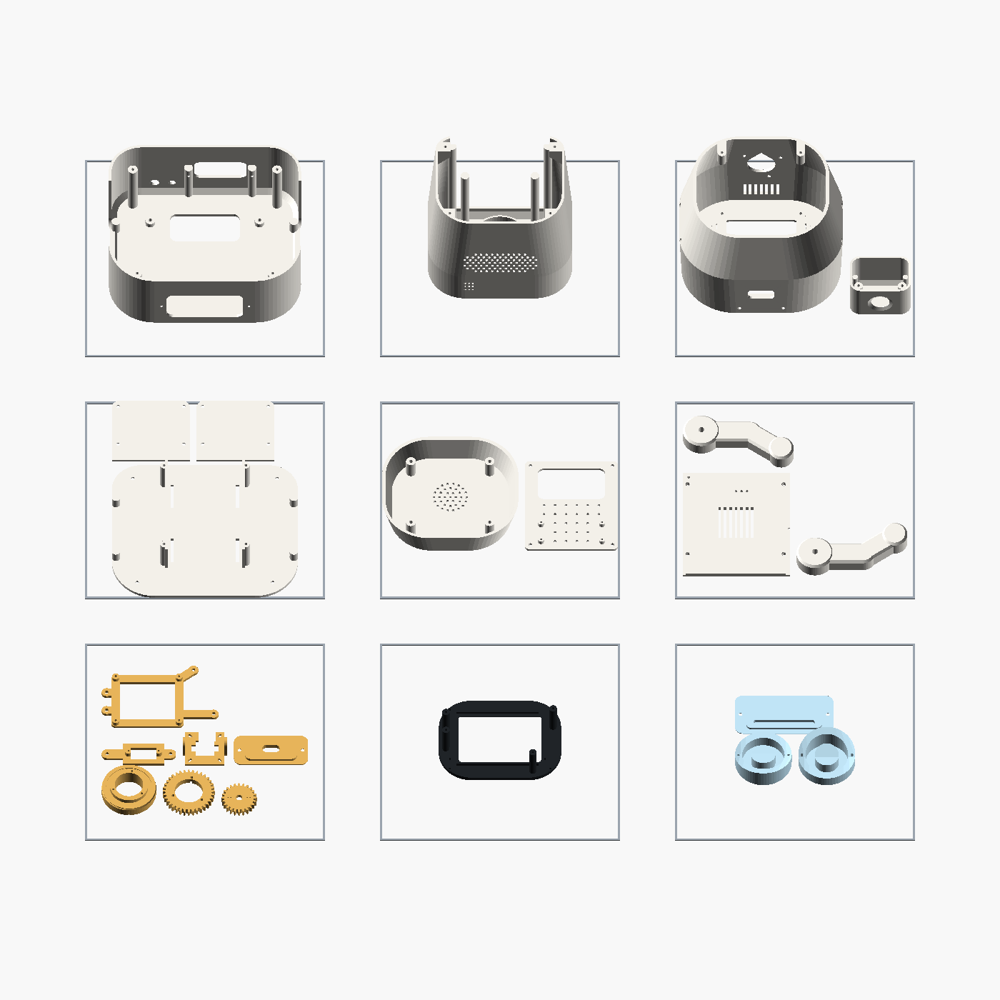
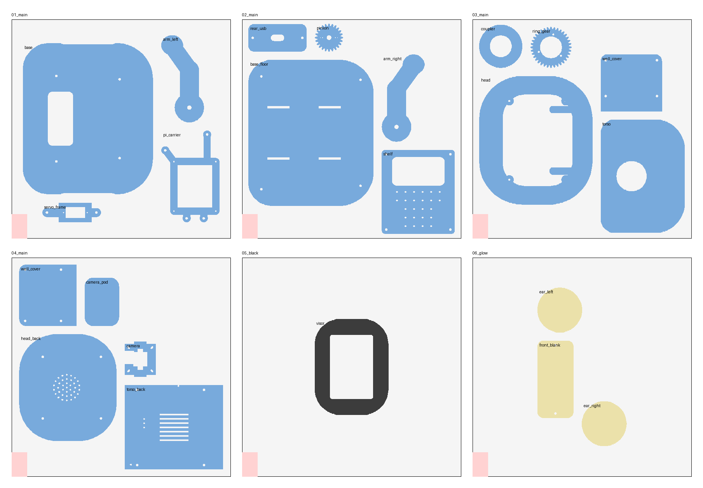

# LittleBot enclosure – version 2 ("companion")

The second design, inspired by the companion-robot reference picture:
- a round helmet head with LED-ring ears, a black visor around the screen and the camera in a pod on top;
- a rounded torso with a chest speaker grille, a microphone and two jointed-looking arms;
- a **mobility-ready base**: wheel wells, a front sensor / light-bar plate, a battery bay, an electronics shelf and a servo power input.

The parts are the same as in v1:
- Raspberry Pi 5 (4 GB; every RAM size has the same board) with the official Active Cooler;
- MPI3508 3.5" HDMI screen, **plugged straight onto the Pi's GPIO header**;
- InnoMaker U20CAM-1080P USB camera;
- Adafruit 3367 mini USB mic and Adafruit 3369 mini USB speaker;
- 3 × MG90S servos and a PCA9685.

The base also has room for the later phases: ESP32, TB6612FNG, TT gear motors + wheels, HC-SR04 distance sensor, LED strips and a battery.

| Front | Back | Exploded |
|---|---|---|
|  |  |  |

| Side | Side section | Plan section (z = 150 mm) |
|---|---|---|
|  |  |  |

**Overall size:** 340 mm tall (about 35 cm, like the reference), base 176 × 152 mm, head 150 × 132 × 120 mm.
- All parts fit a 220 × 220 × 250 mm bed.
- Everything prints **without supports**.
- All parts come from one parametric OpenSCAD file.

v1 (`../enclosure/`) is smaller and simpler (212 mm, 11 parts). v2 is bigger, more of a character, and ready for the wheels.

## Files

| File | What |
|---|---|
| `littlebot_v2.scad` | the parametric model (all dimensions at the top) |
| `stl/*.stl` | ready-to-slice parts, already in print orientation |
| `checks.scad`, `run_checks.sh` | 70 automated interference and finger-pinch checks (head ±60°, arms −90…+100°), a self-test that must find an overlap, and an INFO line on the cooler under the screen |
| `build.sh`, `stl_tools.py` | rebuild the STLs and images. Report per part: size, watertight, number of separate bodies, bed fit, overhang area |
| `make_plates.py` → `plates/`, `pack_plates.py` → `plates_256/` | the parts grouped into print jobs: 9 for a 220 mm bed, 6 for a 256 mm bed (Bambu Lab) |

### What has been verified (by the scripts, not by a real print yet)

- **Every STL:** watertight, a single solid body, fits the bed, and has only small overhangs (screw-hole tops, short bridges). Large overhangs were found and removed.
- **`run_checks.sh`:** no part collides with any electronics dummy or other part.
  - The screen + Pi stack, the Active Cooler, the USB plugs, the USB-C plug and the HDMI adapter all fit in the head without touching the head, visor posts or Pi carrier (`stack_vs_head`, `stack_internal`).
  - The four Pi screws clear the screen, its socket and the cooler (`pi_screws_clear`).
  - The head turns ±60° (the servo's full range) without touching anything.
  - The arms move over −90…+100° without touching anything.
  - Over that arm range the arms stay **≥ 12 mm** from the head and the base.
  - 110° fails on purpose: the arm comes closer than 12 mm to the head.
- **Not verified:** real-world fit. Clearances depend on your printer and the actual parts – see *Measure before you print*.

## Print it in 9 jobs (build plates)

The robot can't be printed as one piece:
- It's 340 mm tall, taller than most printers.
- The electronics have to go inside.
- The head and arms have to move.

Instead, `plates/` groups the parts into **9 ready-made build plates**, one STL per print job. Each fits a 220 × 220 mm bed, and the parts on each plate share a colour:

| Plate | Parts | Filament |
|---|---|---|
| `01_base.stl` | base | main colour |
| `02_torso.stl` | torso | main colour |
| `03_head.stl` | head + camera pod | main colour |
| `04_floor.stl` | floor + 2 well covers | main colour |
| `05_back_cap.stl` | head back cap + shelf | main colour |
| `06_arms.stl` | both arms + torso back cover | main colour |
| `07_small_parts.stl` | neck coupler, both gears, servo frame, camera bracket, rear plate, Pi carrier | main colour, print slowly for the gears |
| `08_visor.stl` | visor (with the four carrier posts) | **black** |
| `09_glow.stl` | both ears + front plate | **white / natural / translucent** |
| later: `10_mobile_floor.stl`, `11_sonar_plate.stl` | wheel-phase floor, HC-SR04 plate | |

Each plate is a single STL with several separate bodies. Most slicers can split it back into objects if you want different settings per part, such as more infill for the gears.

### On a 256 mm bed (Bambu Lab A1 / P1S / P2S / X1C): 6 jobs

`plates_256/` packs the same parts onto **6 plates** (made by `pack_plates.py`):

| Plate | Parts | Filament |
|---|---|---|
| `01_main.3mf` | base, Pi carrier, left arm, servo frame | main colour |
| `02_main.3mf` | floor, shelf, right arm, rear plate, pinion | main colour |
| `03_main.3mf` | head, torso, well cover, neck coupler, ring gear | main colour |
| `04_main.3mf` | head back cap, torso back cover, well cover, camera pod, camera bracket | main colour |
| `05_black.3mf` | visor | **black** |
| `06_glow.3mf` | both ears + front plate | **white / natural / translucent** |

- **Fewer isn't possible:** the base, floor, head and head back cap are each too big to share a 256 mm plate with one another, so the main colour needs 4 plates. All of it on one plate would need a bed of about 465 × 465 mm.
- **Colours stay on separate plates, even with an AMS.** On a mixed plate the printer swaps filament on every layer where both colours are printing: up to 33 mm high for the visor, which means hundreds of swaps, hours of extra time and a lot of purged filament. With an AMS, just load all three colours and it switches between plates for you. If your main colour is white or natural, the ears and front plate can be printed in it too.
- **3MF, one object per part:** each part keeps its name, so in Bambu Studio you can click the **ring gear** and **pinion** and add per-object settings (5 walls, 50 % infill, slower). If Bambu Studio says the file "is not from Bambu Lab", choose to load the geometry. If the parts don't land where they should, press **A** (arrange): they're known to fit.
- The layout keeps 10 mm between parts (room for a brim on the base and torso), 5 mm from the edges, and keeps the 18 × 28 mm front-left corner free, which the X1 and P1 printers reserve.
- For another bed size: `python3 pack_plates.py 300` (writes `plates_300/`). The wheel-phase parts stay in `plates/`.

## Parts to print

| STL | Qty | Notes |
|---|---|---|
| `base.stl` | 1 | prints top-down; its walls form a **skirt** the robot stands on (no feet to come off) |
| `base_floor.stl` | 1 | stationary floor: battery-bay walls, shelf posts, bosses for the well covers |
| `shelf.stl` | 1 | electronics shelf over the battery bay: four M2.5 standoffs for the PCA9685 (55.88 × 19.05 mm) + a 10 mm grid of 2.5 mm holes |
| `well_cover.stl` | **2** | close the wheel wells until the wheels are fitted |
| `front_blank.stl` | 1 | front plate: two "headlight" dimples + **light bar** (1 mm skin over an LED-strip pocket) |
| `rear_usb.stl` | 1 | rear plate with a 16 × 8 mm slot for the power / charging cable (`rear_blank.stl` if you don't need it) |
| `torso.stl` | 1 | prints top-down; open rear (closed by `torso_back`) |
| `torso_back.stl` | 1 | rear cover with vent slots |
| `coupler.stl`, `ring_gear.stl`, `pinion.stl`, `servo_frame.stl` | 1 each | geared neck. Same principle as v1, module 1.25, 36:24 teeth |
| `head.stl` | 1 | prints face down; vent slots on the side (viewer's left) and under the face |
| `head_back.stl` | 1 | back cap with a dot grille |
| `visor.stl` | 1 | print in **black**: the frame around the screen, glass locating ribs and four posts that carry the Pi carrier |
| `pi_carrier.stl` | 1 | frame with four standoffs for the Pi 5; screws onto the visor posts |
| `ear_left.stl`, `ear_right.stl` | 1 each | mirror images; LED-ring pocket behind a 1 mm skin |
| `camera_pod.stl` | 1 | the camera housing on top of the head |
| `camera.stl` | 1 | tilting camera bracket inside the pod (slotted holes for 26–28.5 mm board-hole spacing) |
| `arm_left.stl`, `arm_right.stl` | 1 each | print flat side (the side facing the body) down |
| later: `base_floor_mobile.stl`, `front_sonar.stl` | 1 each | wheel phase: wheel slots + motor/caster grids; HC-SR04 plate |

**Material and settings:**
- **Material:** PETG (tougher, copes better with the Pi's warmth) or PLA+.
- **Settings:** 0.2 mm layers, 3 perimeters, 15–25 % infill. For the gears: 5 perimeters / 50 %, printed slowly.
- **Supports:** none needed. A brim helps the tall base and torso.
- **Colours:** the ears and the front plate glow only when printed in **white, natural or translucent** filament; dark filament hides the LEDs. Print the visor in black.
- **Filament:** the stationary build is about 940 cm³ of plastic (about 1.2 kg PETG at 100 % infill). Normal infill uses noticeably less: plan on about 1 kg of the main colour plus a little black and natural.

## Hardware (bill of materials)

| Item | Qty | Use |
|---|---|---|
| M3 × 10 countersunk | 4 + 8 + 4 | floor → base (from below), well covers, front/rear plates |
| M3 × 10 pan head | 4 + 3 + 2 + 2 | torso → base (from inside the base), head → neck, servo frame, camera pod → head |
| M3 × 8 pan head | 4 | shelf → posts |
| M3 × 12 countersunk | 4 | torso back cover |
| M3 × 20 pan head | 4 | ears (from inside the head) |
| M3 × 30 countersunk | 4 | head back cap (through the cap's bosses) |
| M2.5 × 12 | 3 | ring gear → neck spigot (from below) |
| M2.5 × 8 pan head | 4 + 4 | Pi 5 → carrier standoffs (through the Pi, before the screen goes on); carrier → visor posts |
| M2.5 × 6 | 4 + 4 | visor → head (from inside); PCA9685 → shelf standoffs |
| M2 × 8 | 2 | camera bracket pivots (snug = adjustable friction) |
| M2 × 6 + nuts | 4 | camera board → bracket |
| servo screws (in the servo bags) | | servo tabs, horns |
| PTFE tape or a drop of silicone grease | – | neck bearing ring |
| 1 mm foam tape, 2 small zip ties | | glass gasket on the visor's back, speaker gasket, speaker cradle |
| **micro-HDMI → HDMI "U" adapter for 3.5" HDMI screens on a Pi 4** (micro-HDMI male + HDMI male, about 35 × 20 × 10 mm) | 1 | links the Pi's HDMI0 to the screen's HDMI socket right below the stack (the Pi 5's micro-HDMI ports sit where the Pi 4's do). A flat FPC kit (right-angle micro-HDMI plug + 10 cm ribbon + HDMI plug) also fits the same space |
| USB-A extension cable, male → female, 30–50 cm (socket end no bigger than about 18 × 9.5 mm) | 1 | Adafruit mini USB mic in the chest → Pi in the head |
| USB-C power cable, ≥ 1 m, slim plug (≤ 12.5 × 7.5 mm, ≤ 30 mm long with its strain relief) | 1 | from the rear plate up the neck to the Pi |
| female-to-female jumper wires, 30–40 cm | 4 | PCA9685 later – see *The screen sits on the Pi* for which pins are still free |
| optional ballast, ~250 g, sealed in a bag and strapped in | | battery bay in the stationary phase (stability) |
| **later:** 5.5 × 2.1 mm panel DC jack (8 mm hole) + mini toggle (6 mm hole) | 1 + 1 | separate 5 V servo supply ("SERVO 5V" on the back) |
| **later:** 2 × 12-LED WS2812 rings (37 mm OD / 23 mm ID), ≤ 5 mm-wide addressable LED strip ~55 mm | | ears + light bar |
| **later:** TT gear motors + 65 mm wheels, 2 ball casters, power bank ≤ 98 × 66 × 28 mm, hook-and-loop strap, HC-SR04, ESP32, TB6612FNG | | wheel phase |

The 90° HDMI adapter from the earlier list is no longer needed: with the screen on the Pi, the Pi's micro-HDMI port sits right below the screen's HDMI socket.

## Where everything goes

| Area | What's there |
|---|---|
| **Head** | **Screen + Pi:** the MPI3508 is plugged straight onto the Pi 5's 40-pin header (see below). The glass sits in locating ribs on the back of the black visor, on 1 mm foam, HDMI socket pointing **down**. The Pi is screwed to the **Pi carrier**, which screws onto four posts on the visor, so the stack is held by the Pi's own M2.5 holes (the screen has none). Seen from the front, the Pi's USB-A / Ethernet end is on the robot's left (viewer's right), its microSD end on the other side, USB-C power and micro-HDMI pointing down. **Plugs:** camera, speaker and mic cables in the USB-A ports (25 mm of room beside them), the USB-C power plug pointing down (30 mm of room), and the micro-HDMI → HDMI U adapter below the stack. **Air:** the cooler's fins blow towards the microSD end; slots in the side of the head on the viewer's left let the warm air out, slots under the face let fresh air in. **Ears:** LED-ring pockets; the wires go into the head through a hole under each ring. **Back cap:** the 4 screws locate it. **Camera:** in the top pod on a tilting bracket. Its cable drops into the head through a small hole and plugs straight into the Pi. |
| **Neck** | Same geared turntable as v1. The head screws onto a coupler that turns on a hollow spigot (26 mm cable bore). A 36-tooth ring gear under the torso top is driven by a 24-tooth pinion in front of it, so the servo never carries the head and lifting by the head can't pull the shaft out. **Head = 0.67 × servo angle**: the servo's full range gives about ±60°, and all of it is collision-free. Up the bore: the USB-C power cable, the speaker cable, the mic extension and (later) the PCA9685 wires. |
| **Torso** | **Front:** speaker behind the pill-shaped chest grille (it matches the speaker's oval front, so both drivers are uncovered), in a cradle with zip-tie slots; the Adafruit mini USB mic lies flat in a sleeve behind the small holes (viewer's left), holes facing out, its plug pointing to the middle where the extension cable's socket plugs on. **Top:** head servo on its frame, gear guard, one arm servo per side on a rib (spline through the side wall). **Middle:** empty now (the Pi moved to the head); two columns support the top plate. Cables run between them from the neck bore down to the base. |
| **Base** | **Under the torso:** the cable pass-through. **Shelf:** PCA9685 on four M2.5 standoffs now; ESP32 + TB6612FNG later. **Battery bay:** under the shelf. **Rear:** cable slot plate and the servo-supply jack + switch. **Front:** sensor / light-bar plate. **Sides:** two wheel wells (covered for now). |

All openings for sound, the mic and cooling are 3 mm or smaller. The camera aperture stays 17 mm with the lens right behind it. The cable slot is 16 × 8 mm, in a 4.6 mm plate.

## The screen sits on the Pi

The MPI3508 plugs onto pins 1–26 of the Pi's header, its glass faces away from the Pi, and its PCB rests just above the Pi's USB ports ("pretty flush"). From the two drawings:

| | mm | Source |
|---|---|---|
| glass front → back of the screen PCB | 7.32 (touch 1.2 + LCD 2.49 + gap 2.01 + PCB 1.6) | lcdwiki drawing |
| screen's 2 × 13 socket below its PCB | 13.54 (20.86 − 7.32) | lcdwiki drawing |
| plastic of the Pi's header | 2.5 (pins reach 8.57) | Raspberry Pi 5 drawing |
| **screen PCB → Pi PCB** | **16.04** (the Pi's USB ports are 15.8 tall, so it sits 0.2 mm above them) | |
| **glass front → underside of the Pi** | **24.76** (Pi PCB 1.4 per the drawing) | |
| where the Pi sits under the screen | Pi corner 0.48 mm in from the screen's wide-border end, 0.40 mm above its HDMI edge (header pin 1 is 8.88 / 8.40 mm from those ends) | both drawings |

**Does the Active Cooler fit under the screen?** Mostly yes, with one doubtful corner:
- The cooler (63.5 × 42.5 mm) sits on the Pi between x 0.5–64 and y 6.5–49 (from its push pins in the Pi's holes at (3.5, 9.5) and (61.5, 46.5)). Its top is about **12 mm** above the Pi PCB (13.7 mm overall in the brief, including the push-pin tails below the board). The screen's PCB is 16 mm up, so the cooler body has about **4 mm** to spare. The screen's scaler chip (about 1.6 mm) still clears it by about 2.4 mm.
- The doubtful corner is the screen's **HDMI socket**. It hangs 6.7 mm below the screen PCB (down to 9.3 mm above the Pi), right above the Pi's micro-HDMI ports. Its inner corner overlaps the last fin row of the cooler by up to about **2.5 × 1.3 × 2.7 mm** in the drawings. This is the `INFO` line of `run_checks.sh`. The drawing tolerances (±0.2 mm, and the brief says "approximate") are about that size, so it may just touch or just clear. You say the screen sits flush, which suggests it clears – if the cooler is already fitted.
- Also, the blower then draws its air through a 4 mm gap under the screen.
- **Check it:** with the screen pressed down, look along the HDMI edge between the HDMI socket and the fins. A sheet of paper should slide between them, and nothing should push the screen up. Also run `vcgencmd measure_temp` after 10 minutes of load.
- **If it doesn't fit**, the options are:
  1. **GPIO stacking/extension header** (2 × 20, about 8.5 mm extra) between the Pi and the screen. The screen moves 8.5 mm forward; change `pi_hdr_h` to 11 and `lcd_sock_h` accordingly, rebuild and re-run the checks. The visor posts and carrier follow automatically. This also leaves room for jumper wires on the free pins.
  2. A **low-profile heatsink** (stick-on, ≤ 6 mm) instead of the Active Cooler. Watch the temperature: the Pi 5 throttles without a fan under load.
  3. Mount the screen **separately** and wire 5 V/GND (pins 2/4 and 6) and, for touch, the SPI pins, as the earlier design did.

**GPIO pins:** the screen's socket covers pins 1–26. Those include the PCA9685's I²C pins (3, 5) and both 3.3 V pins (1, 17). With the screen fitted, pins 27–40 stick out only 7.5 mm under the screen PCB – too short for jumper housings. So the PCA9685 needs one of these: a stacking header (option 1 above), wires soldered to the underside of the Pi's header pins, or a GPIO splitter. This is wiring, not printing; the enclosure leaves room for the wires to go down the neck.

## Checked against your parts (2026-10-23)

The robot itself reports the screen as `MPI3508` (EDID), the camera as `U20CAM-1080P`, the speaker as `UACDemoV1.0` (Jieli) and the mic as `USB PnP Sound Device` (C-Media). These match the parts below.

| Part | Dimensions used in the model | Source (checked 2026-10-23) |
|---|---|---|
| MPI3508 3.5" HDMI screen | glass 85.51 × 56.0; touch panel 84.36 × 55.0; backlight 84.96 × 55.5; **active area 73.44 × 48.96**, borders 8.35 (wide, HDMI-down left) / 3.72 / 3.52 / 3.52, so the AA is **2.32 mm** off-centre; stack 7.32; **no mounting holes** – the PCB has four 2.3 × 10.5 mm tabs beyond the long edges at 10–20.5 and 64.5–75 mm; 2 × 13 socket 13.54 tall, pin 1 at 8.88 / 1.82 mm; full-size HDMI socket centred 33.0 mm from the wide-border end, opening 1.70 mm in from the glass edge, 6.7 mm deep; 3.5 mm jack at 53.68 mm, sticks out 1.79 mm; micro-USB power in at the wide-border end | lcdwiki "LCM outline MPI3508", drawn 2025-08-18: [MPI3508-size.pdf](https://www.lcdwiki.com/res/MPI3508/MPI3508-size.pdf), [product page](http://www.lcdwiki.com/3.5inch_HDMI_Display-B) |
| Raspberry Pi 5 | 85 × 56 board, PCB about 1.4; M2.5 holes Ø2.7 at 3.5 / 61.5 × 3.5 / 52.5 (58 × 49); header body 7.13–57.93 × 50.02–55.0, pin 1 at (8.40, 51.24), plastic 2.5, pins 8.57; USB-C at 11.2, micro-HDMI at 25.8 and 39.2; USB stack 15.8 tall, overhanging the edge by 3; microSD at 22.7–33.7 on the underside | [Raspberry Pi 5 mechanical drawing](https://datasheets.raspberrypi.com/rpi5/raspberry-pi-5-mechanical-drawing.pdf) (dimensions read from the PDF's vectors) |
| Official Active Cooler | 63.5 × 42.5, 13.7 overall; push pins at (3, 3) and (61, 40) from its corner = the Pi's Ø3 holes at (3.5, 9.5) and (61.5, 46.5); fan 30 × 30; top about 12 above the Pi PCB (estimate, see above) | [Active Cooler product brief](https://datasheets.raspberrypi.com/cooling/raspberry-pi-active-cooler-product-brief.pdf) (Jan 2026) |
| InnoMaker U20CAM-1080P | 32 × 32 board, 4 holes Ø2.2 (spacing not published); M12 lens on a holder with 18 mm screw spacing; 5-pin cable connector on the lens side at the bottom edge; 1 m cable; FOV 130° D / 103–106° H | [InnoMaker product page](https://www.inno-maker.com/product/u20cam-1080p/), [user manual](https://github.com/INNO-MAKER/U20CAM-1080P-S1), [U20CAM case drawing](https://github.com/INNO-MAKER/U20CAM-CASE) |
| Adafruit 3369 mini USB stereo speaker | 84.0 × 43.0 × 32.0, oval front grille over 2 drivers, 1168 mm cable | [Adafruit 3369](https://www.adafruit.com/product/3369) |
| Adafruit 3367 mini USB mic | 22.2 × 18.3 × 7.0 | [Adafruit 3367](https://www.adafruit.com/product/3367) |
| MG90S servo | A 32.5 (spline top), B 22.8 (body), C 28.4 (boss top), D 12.4 (width), E 32.1 (across tabs), F 18.5 (tab top) | [TowerPro MG90S](https://www.towerpro.com.tw/product/mg90s-3/) |
| PCA9685 (Adafruit 815 layout) | 62.2 × 25.4 board, 4 holes Ø2.5 at 3.30 / 59.18 × 3.30 / 22.35 (55.88 × 19.05) | [Adafruit 815](https://www.adafruit.com/product/815), [fab print](https://learn.adafruit.com/16-channel-pwm-servo-driver/downloads) |
| micro-HDMI → HDMI U adapter | keep-out 26 × 14 mm below the stack (Pi x 20.5–46.5, in front of the Pi) | seller listings only (about 35 × 20 × 10 mm); no drawing |
| Official micro-HDMI cable | not used inside the head any more (its HDMI plug is about 45 mm long; there's no room below the stack) | Raspberry Pi product page; plug size estimated |

## What changed (2026-10-23)

- **The Pi moved from the torso into the head, under the screen.** The torso's Pi spine and standoffs are gone, the head holds the stack, and the cables run up the neck instead of the HDMI cable running down.
- **Screen mounting:** the four clamp tabs and their bosses are gone. The screen has no holes, so the stack hangs on the Pi's four M2.5 holes via the new `pi_carrier` and four posts on the visor. The carrier holes are oversized (3.4 mm for M2.5), so the glass can settle in the visor ribs before you tighten.
- **Visor window:** centred on the active area with the corrected 2.32 mm offset (was 3.03). Window margin 0.5 mm (was 1.0), so the window is 74.44 × 49.96 mm. The drawing's black mask is only about AA + 0.9 mm, and a 1 mm margin could show the edge of the LCD frame.
- **Glass locating ribs:** 3 mm deep (was 2), so they reach past the 1.2 mm touch panel onto the LCD glass. 1 mm foam gasket between the glass and the visor.
- **Head vents:** slots in the side on the viewer's left (cooler exhaust) and under the face (intake), 2.5 mm wide.
- **HDMI:** the 90° adapter route is replaced by a U adapter right below the stack.
- **Camera bracket:** diagonal slots for 26–28.5 mm board-hole spacing (InnoMaker doesn't publish it), cut-outs for the lens holder's screw ears and the 5-pin connector on the lens side.
- **MG90S:** spline height 32.0 → 32.5, width 12.2 → 12.4, boss 28.5 → 28.4, tabs 32.2 → 32.1 (TowerPro drawing). The neck frame and arm ribs follow automatically.
- **PCA9685:** four M2.5 standoffs on the shelf at the Adafruit 815 hole pattern (55.88 × 19.05). There was none before.
- **Chest grille:** pill-shaped (about 70 × 33 mm) instead of a round 51 mm, to match the speaker's oval front.

## Measure before you print (assumed values)

These values come from drawings, listings or estimates. Check each with calipers, change it at the top of `littlebot_v2.scad`, then run `./build.sh && ./run_checks.sh`.

| Parameter | Default | How to measure |
|---|---|---|
| `lcd_aa_offset` | 2.32 | Screen on, white picture. Measure the black border from the glass edge to the lit area at both short ends (expect 8.35 and 3.72). The offset is (wide − narrow) / 2. With the HDMI socket pointing down, the wide border should be on the **left**; if it's on the right, use −2.32 |
| `lcd_sock_h`, `pi_hdr_h` | 13.54, 2.5 | Screen pressed onto the Pi: measure the **gap between the two PCBs** next to the header with calipers (inside jaws or depth rod). Expect 16.0 (= 13.54 + 2.5). If it differs, change `lcd_sock_h` |
| stack depth | 24.76 | Depth gauge from the screen glass to the underside of the Pi PCB, at a corner. Should be the gap above + 7.32 + 1.4 |
| `cooler_h` | 12.0 | Cooler fitted, no screen: height from the Pi PCB to the top of the fan housing / fins. Then do the HDMI-corner check in *The screen sits on the Pi* |
| `pi_pcb_t` | 1.4 | Pi PCB thickness at an edge (the drawing shows 1.4; some boards are 1.6) |
| `hdmi_link` | 26 × 14 | Your micro-HDMI → HDMI U adapter: width along the edge and how far it hangs below the screen's glass edge once plugged in |
| `cam_hole_sp` | 26…28.5 | Centre-to-centre of the camera board's M2 holes (measure edge-to-edge of two holes + one hole diameter). The bracket slots cover 26–28.5 |
| `cam_board_y` | 26 | lens length: board front to the front of the lens, after focusing (the lens screws in and out) |
| `sv_*` | MG90S drawing | clones differ – measure one servo: `sv_spline_h` (bottom → spline top), `sv_tab_z` (bottom → underside of the tabs), `sv_hole_sp` (tab holes) |
| `horn_plate_t` | 1.6 | thickness of the horn's arms. Trim the head-servo horn to **≤ 12.5 mm radius** (pinion pocket) and the arm horns to ≤ 15 mm |
| `pca_holes` | Adafruit 815 | if your PCA9685 is a clone, measure its hole centres (most copy 55.88 × 19.05) |
| speaker drivers | – | the chest grille assumes the two drivers are behind the middle 70 × 33 mm of the speaker's front. If they're further out, increase `spk_grille_hw` |
| `spk_w/h/d`, `mic_l/w/t` | 84 × 43 × 32, 22.2 × 18.3 × 7.0 | Adafruit's listed sizes |
| `bat_*`, `sonar_sp`, HC-SR04 holes | | only for the later phases |

## Test-print these first

1. **`visor` + `pi_carrier`** (about 2 h together) – the most important fit:
   - screw the Pi to the carrier and plug the screen on;
   - screw the carrier to the visor posts and check that the glass sits in the ribs on the foam, without the stack being pulled or pushed;
   - check the window shows the whole lit area and no frame;
   - check the HDMI U adapter, the USB-C plug and three USB plugs fit.
2. **`camera`** bracket with the camera board: check the screw slots, lens holder and connector.
3. `ring_gear` + `pinion` – check they mesh.
4. `servo_frame` with one servo.
5. `rear_usb` – check that your plug fits the slot.

Then commit to the long prints: head, torso and base.

## Assembly order (stationary phase)

1. **Neck:** stick PTFE tape on the coupler's bearing ring and drop the coupler into the torso top. From inside, screw the ring gear onto its spigot (3 × M2.5 × 12).
2. **Head servo:**
   1. Fit the trimmed horn into the pinion's pocket and fix it with 2 small screws.
   2. Set the servo to 90°, with the coupler's mark pointing forward.
   3. Slide the pinion up into mesh with the ring gear.
   4. Screw the frame to the pillars (2 × M3 × 10), and the servo tabs to the frame.
3. **Arm servos:** from inside, push each servo through its rib window so the round boss pokes out of the side-wall hole. Screw the tabs to the rib.
4. **Speaker** into the chest cradle (foam ring towards the grille, 2 zip ties through the rib slots, cable out through a rib window). **Mic:** plug it into the extension cable and slide the dongle into its sleeve, holes facing the chest. Feed the speaker cable and the extension's plug up through the neck bore.
5. **Torso onto the base:**
   1. Run the USB-C power cable from the rear plate's slot up through the pass-through and the neck bore.
   2. Fix the torso with 4 × M3 × 10 from inside the base, up into the torso's corner wedges.
   3. Close the torso back cover (4 × M3 × 12 countersunk).
6. **Base:**
   1. Screw the PCA9685 to the shelf standoffs (4 × M2.5 × 6) and fit the shelf.
   2. Add the optional ballast, strapped into the battery bay.
   3. Fit the **floor** (4 × M3 × 10 countersunk from below).
   4. Push in the **well covers** from outside (4 screws each).
   5. Fit the **front and rear plates** (2 screws each, cable through the rear slot).
7. **Head:**
   1. Stick 1 mm foam tape around the window on the back of the visor and screw the visor into the face seat (4 × M2.5 × 6 from inside).
   2. Pi 5 + Active Cooler onto the carrier: 4 × M2.5 × 8 through the Pi into the standoffs, before the screen goes on.
   3. Press the screen onto the header (pins 1–26) and plug the HDMI U adapter between the Pi's HDMI0 port (next to USB-C) and the screen.
   4. Put the stack in through the back of the head, glass into the visor ribs, and screw the carrier to the four visor posts (4 × M2.5 × 8). Tighten while pressing the glass gently forward.
   5. Ears: 2 × M3 × 20 each from inside; fit the LED rings later.
   6. Camera board onto the bracket, the bracket into the pod (2 × M2 × 8), the pod onto the head (2 × M3 × 10 from inside). Plug the camera into a blue USB 3 port.
   7. Screw the head onto the coupler (3 × M3 × 10 from inside; the uneven pattern only fits one way). Plug in the speaker, the mic extension and USB-C power that come up the neck. Tie the spare cable lengths down behind the carrier.
   8. Close the back cap (4 × M3 × 30 countersunk).
8. **Arms:** set the arm servos to their calibrated neutral, screw the horn into the arm's pocket, press the arm onto the spline and drive the centre screw.

## Later: the wheel phase (prepared, not finished)

1. Print `base_floor_mobile` (wheel slots + M3 motor grid + front/rear caster grids) and `front_sonar`.
2. Leave the well covers off.
3. **Motors:** TT gear motors with **65 mm wheels**. Bolt them to the floor grid (x 40–50 mm from the centre line, y 46–106 mm).
   - **Motor brackets are not designed yet**, because they depend on your exact motors.
   - Mount them so the wheels stick out about **8 mm below the skirt** (wheel centre ≈ 24.5 mm above the table). The checks confirm a 65 × 27 mm wheel at that height fits the well with about 1 mm to spare.
4. **Casters:** two ball casters on the caster grids, height ≈ 18 mm from the floor underside to the table.
5. **Battery:** a power bank ≤ 98 × 66 × 28 mm, held by a strap through the floor slots, charged through the rear slot.
   - A Pi 5 wants 5 V / 5 A. Most power banks give 5 V / 3 A, which limits the Pi's USB power – see `docs/POWER.md`.
   - Servos and motors need their **own** supply through the rear jack and switch.
6. **Electronics:** ESP32 + TB6612FNG on the shelf next to the PCA9685. The HC-SR04 on `front_sonar` runs on 5 V, so its echo pin needs a level shifter or divider for the ESP32's 3.3 V input.
7. **LEDs:** the light bar and ear LEDs can run from the ESP32 (or the Pi), at low brightness.
8. **Not included yet:** a LiDAR / ToF sensor (e.g. a VL53L1X behind a hole in the front plate) and a bigger battery. Both need new plate or bay variants.

## Safety notes (important – this is for a baby)

* Use LittleBot **only under supervision**. Software tests don't establish physical toy safety (see `HARDWARE_ARRIVAL_CHECKLIST.md`, phase 12).
* **Small parts:**
  - No small parts can come off from outside: there are no feet (the base skirt stands on the table), and every screw is internal, recessed or countersunk.
  - The LEDs sit behind 1 mm printed skins.
  - The Pi carrier and camera bracket are enclosed.
  - The smallest outside parts are the ears (52 mm) and the plates.
* **Arm range:**
  - Keep the software limits for the arm servos within **−90…+100°** of arm movement (+ = forwards/up). Over that range the arm keeps a constant 3 mm gap to the torso and stays ≥ 12 mm from the head and base, so there's no closing finger gap.
  - Above about 110° it comes within 12 mm of the head.
  - Keep physical motion disabled until `docs/MOTION_SAFETY.md` is complete.
* **Stability:** the base is wide, but the head is high, and the Pi and its cooler now add to the head's weight. Add ballast in the stationary phase and tip-test it. Never place LittleBot where it could fall onto the child.
* **Heat:** the Pi now sits in the head right behind the screen. Check after 30 minutes of use that the visor and the vented side of the head are only warm, and that `vcgencmd get_throttled` stays at 0x0.
* **Wheel phase:** wheels can pinch fingers and catch hair. Keep speeds very low, add wheel guards if the wells are open, and keep it on the floor (never on a table).
* **Batteries:** only a commercial power bank with protection circuits. Never loose Li-ion cells, and never charge it unattended inside the robot (`docs/POWER.md`).
* **Prints:** check the finished prints for sharp edges and layer splits, and sand any burrs. PETG is less brittle than PLA if it's dropped. Inspect regularly for cracks, especially the arms, neck and ears.
* The lower edges of the front and rear windows print as bridges. Any sag is hidden behind the plates.
