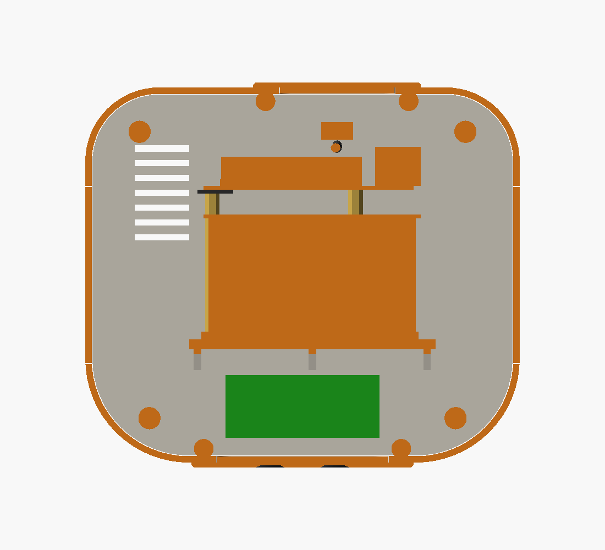
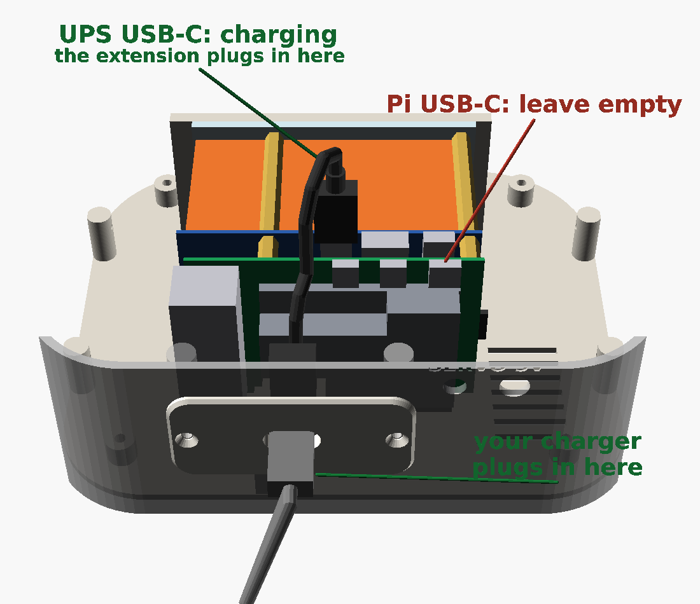

# LittleBot enclosure – version 2 ("companion")

The second design, inspired by the companion-robot reference picture:
- a round helmet head with LED-ring ears, a black visor around the screen and the camera in a pod on top;
- a rounded torso with a chest speaker grille, a microphone and two jointed-looking arms;
- a **mobility-ready base**: wheel wells, a front sensor / light-bar plate, the Pi on its battery, and a servo power input.

The parts:
- Raspberry Pi 5 (4 GB; every RAM size has the same board) with the official Active Cooler, **on a Waveshare UPS HAT (E)** (4 × 21700 cells, powers the Pi through pogo pins), lying on its side **in the base**;
- MPI3508 3.5" HDMI screen **in the head on its own**, held by the visor and a screen clamp: an HDMI cable, a micro-USB power cable and 6 touch wires run up the neck to it;
- InnoMaker U20CAM-1080P USB camera;
- Adafruit 3367 mini USB mic and Adafruit 3369 mini USB speaker;
- 3 × MG90S servos and a PCA9685.

The base also has room for the later phases: ESP32, TB6612FNG, TT gear motors + wheels, HC-SR04 distance sensor, LED strips and a battery.

| Front | Back | Exploded |
|---|---|---|
|  |  |  |

| Side | Side section | Plan section (z = 150 mm) |
|---|---|---|
|  |  |  |

| The base from above (cut at z = 45 mm): PCA9685 at the front, the mounting wall, then the UPS (clear plate, cells, board) and the Pi with its cooler; the charging socket at the back | Where the charger goes: the extension's plug in the **UPS's** USB-C (not the Pi's), its cable up through the cable hole and back down behind the cooler to the socket behind the rear plate's slot (base and torso hidden) |
|---|---|
|  |  |

**Overall size:** 340 mm tall (about 35 cm, like the reference), base 176 × 152 mm, head 150 × 132 × 120 mm.
- All parts fit a 220 × 220 × 250 mm bed.
- Everything prints **without supports** except the head: its visor seat needs a few supports from the bed (see *Material and settings*).
- All parts come from one parametric OpenSCAD file.

v1 (`../enclosure/`) is smaller and simpler (212 mm, 11 parts). v2 is bigger, more of a character, and ready for the wheels.

## Files

| File | What |
|---|---|
| `littlebot_v2.scad` | the parametric model (all dimensions at the top) |
| `stl/*.stl` | ready-to-slice parts, already in print orientation |
| `checks.scad`, `run_checks.sh` | 72 automated interference and finger-pinch checks (head ±60°, arms −90…+100°) and a self-test that must find an overlap. A result with no volume (parts designed to touch) passes |
| `build.sh`, `stl_tools.py` | rebuild the STLs and images. Report per part: size, watertight, number of separate bodies, bed fit, overhang area |
| `assembly_video/` | `./make_video.sh` renders a video (about 2½ minutes) of the assembly order below: every printed part in place, electronics as blocks, **every screw** driven in with its size, and **every cable** drawn along its route with its name. The screws and cable routes come from the model (`hardware.json`, written by `build.sh`): `assembly_video/build/LittleBot_assembly.mp4` |
| `make_plates.py` → `plates/`, `pack_plates.py` → `plates_256/` | the parts grouped into print jobs: 9 for a 220 mm bed, 6 for a 256 mm bed (Bambu Lab) |

### What has been verified (by the scripts, not by a real print yet)

- **Every STL:** watertight, a single solid body, fits the bed, and has only small overhangs (screw-hole tops, short bridges). Large overhangs were found and removed.
- **`run_checks.sh`:** no part collides with any electronics dummy or other part.
  - The screen and what plugs into it (a right-angle HDMI plug, the micro-USB power plug, the touch wires) fit in the head without touching the head, the visor or the screen clamp (`screen_vs_head`).
  - The Pi + UPS stack and everything plugged into it (HDMI, USB-A and USB-C plugs up through the cable hole into the torso, a finger on the UPS switch, the Pi's USB plugs, the jumper plugs on the GPIO header), the PCA9685 and the charging socket fit the base, the new floor, the plates and the torso, and don't run into each other (`electronics_vs_base`, `ups_internal`). The stack's sizes are estimates from photos – see *Measure before you print*.
  - The charging cable, from its plug in the UPS's USB-C up through the cable hole and back down behind the cooler to its socket, clears every part (`charge_cable_clear`).
  - Every other cable has a route too (HDMI, screen power and touch wires up the neck to the screen; the camera cable down the neck to the Pi; speaker, mic, servos and the I2C jumpers), and each route clears the printed parts and the other electronics (`cables_body`, `cables_head`). Measured along the routes: HDMI about 19 cm, screen power 24 cm, touch 31 cm, camera 41 cm, servo leads 21–22 cm, I2C jumpers 15 cm, before slack.
  - The head turns ±60° (the servo's full range) without touching anything.
  - The arms move over −90…+100° without touching anything.
  - Over that arm range the arms stay **≥ 12 mm** from the head and the base.
  - 110° fails on purpose: the arm comes closer than 12 mm to the head.
- **Not verified:** real-world fit. Clearances depend on your printer and the actual parts – see *Measure before you print*.

## Print it in 9 jobs (build plates)

The robot can't be printed as one piece:
- It's 340 mm tall, taller than most printers.
- The electronics have to go inside.
- The head and arms have to move.

Instead, `plates/` groups the parts into **9 ready-made build plates**, one STL per print job. Each fits a 220 × 220 mm bed, and the parts on each plate share a colour:

| Plate | Parts | Filament |
|---|---|---|
| `01_base.stl` | base | main colour |
| `02_torso.stl` | torso | main colour |
| `03_head.stl` | head + camera pod | main colour |
| `04_floor.stl` | floor + 2 well covers | main colour |
| `05_back_cap.stl` | head back cap + screen clamp | main colour |
| `06_arms.stl` | both arms + torso back cover | main colour |
| `07_small_parts.stl` | neck coupler, both gears, servo frame, camera bracket, rear plate | main colour, print slowly for the gears |
| `08_visor.stl` | visor (with the four posts for the screen clamp) | **black** |
| `09_glow.stl` | both ears + front plate | **white / natural / translucent** |
| later: `10_mobile_floor.stl`, `11_sonar_plate.stl` | wheel-phase floor, HC-SR04 plate | |

Each plate is a single STL with several separate bodies. Most slicers can split it back into objects if you want different settings per part, such as more infill for the gears.

### On a 256 mm bed (Bambu Lab A1 / P1S / P2S / X1C): 6 jobs

`plates_256/` packs the same parts onto **6 plates** (made by `pack_plates.py`):

| Plate | Parts | Filament |
|---|---|---|
| `01_main.3mf` | base, both arms, servo frame | main colour, brim on the **base** only |
| `02_main.3mf` | head, Pi carrier (no longer used), well cover, neck coupler, rear plate, camera bracket | main colour, brim on the **head** only, supports for the head (below) |
| `03_main.3mf` | torso, head back cap, torso back cover, ring gear, camera pod | main colour, brim on the **torso** only |
| `04_main.3mf` | floor (for the Pi + UPS), screen clamp, well cover, pinion | main colour |
| `05_black.3mf` | visor | **black** |
| `06_glow.3mf` | both ears + front plate | **white / natural / translucent** |

Plates 01–03 were printed before the Pi and the UPS moved into the base (2026-10-30). `pack_plates.py` keeps them exactly as they were (`PRINTED`), so the change only touched plates 04 and 05; the Pi carrier on plate 02 is simply not used.

- **Brim on the tall part only, never on the whole plate.** The tall parts, base (72 mm), head (100 mm) and torso (125 mm), are at least 20 mm from every edge with room for an 8 mm brim. The other parts are only 5 mm from the edge, so a plate-wide brim runs off the plate there, lifts, and the nozzle catches it: that failed a P2S three times in PLA. In Bambu Studio leave the plate's brim off (**Others → Brim type: No-brim**), then right-click the tall part → **Add settings → Others** → Brim type **Outer brim only**, Brim width **8 mm**. After slicing, check in the Preview tab that no brim reaches an edge. **Don't press Arrange (A)**: it moves parts.
- **Why not more room at the edges?** Every part 8 mm or more from the edges needs a seventh plate; 6 plates need the flat parts close to the edge, which is fine without a brim (they have big, flat footprints).
- **Fewer isn't possible:** the base, floor, head and head back cap are each too big to share a 256 mm plate with one another, so the main colour needs 4 plates. All of it on one plate would need a bed of about 465 × 465 mm.
- **Colours stay on separate plates, even with an AMS.** On a mixed plate the printer swaps filament on every layer where both colours are printing: up to 33 mm high for the visor, which means hundreds of swaps, hours of extra time and a lot of purged filament. With an AMS, just load all three colours and it switches between plates for you. If your main colour is white or natural, the ears and front plate can be printed in it too.
- **3MF, one object per part:** each part keeps its name, so in Bambu Studio you can click the **ring gear** and **pinion** and add per-object settings (5 walls, 50 % infill, slower), and give the **head** its supports (on build plate only). If Bambu Studio says the file "is not from Bambu Lab", choose to load the geometry.
- The layout keeps 10 mm between parts, 5 mm from the edges (20 mm for tall parts), and keeps the 18 × 28 mm front-left corner free, which the X1 and P1 printers reserve.
- For another bed size: `python3 pack_plates.py 300` (writes `plates_300/`). The wheel-phase parts stay in `plates/`.

## Parts to print

| STL | Qty | Notes |
|---|---|---|
| `base.stl` | 1 | prints top-down; its walls form a **skirt** the robot stands on (no feet to come off) |
| `base_floor.stl` | 1 | stationary floor, 3 mm above the table inside the skirt: the **mounting wall** the Pi + UPS stack hangs on (by the UPS's own 4 bottom screws), the rail its clear plate stands on, the PCA9685 standoffs (front), the charging-socket holder (behind the rear plate's slot), vents beside the cooler, columns up to the base's corner pillars and the well-cover bosses |
| `well_cover.stl` | **2** | close the wheel wells until the wheels are fitted |
| `front_blank.stl` | 1 | front plate: two "headlight" dimples + **light bar** (1 mm skin over an LED-strip pocket) |
| `rear_usb.stl` | 1 | rear plate with a 16 × 8 mm slot for the power / charging cable (`rear_blank.stl` if you don't need it) |
| `torso.stl` | 1 | prints top-down; open rear (closed by `torso_back`) |
| `torso_back.stl` | 1 | rear cover with vent slots |
| `coupler.stl`, `ring_gear.stl`, `pinion.stl`, `servo_frame.stl` | 1 each | geared neck. Same principle as v1, module 1.25, 36:24 teeth |
| `head.stl` | 1 | prints face down; vent slots on the side (viewer's left) and under the face |
| `head_back.stl` | 1 | back cap with a dot grille |
| `visor.stl` | 1 | print in **black**: the frame around the screen, glass locating ribs and four posts that carry the screen clamp |
| `screen_clamp.stl` | 1 | screws onto the visor posts and presses the screen's four PCB tabs into the visor; hooks under the lower tabs, so the screen sits on it and can't slide down |
| `ear_left.stl`, `ear_right.stl` | 1 each | mirror images; LED-ring pocket behind a 1 mm skin |
| `camera_pod.stl` | 1 | the camera housing on top of the head |
| `camera.stl` | 1 | tilting camera bracket inside the pod (slotted holes for 26–28.5 mm board-hole spacing) |
| `arm_left.stl`, `arm_right.stl` | 1 each | print flat side (the side facing the body) down |
| later: `base_floor_mobile.stl`, `shelf.stl`, `front_sonar.stl` | 1 each | wheel phase: wheel slots + motor/caster grids, the old battery-bay shelf, HC-SR04 plate (**not updated for the UPS yet**) |

**Material and settings:**
- **Material:** PETG (tougher, copes better with the Pi's warmth) or PLA+.
- **Settings:** 0.2 mm layers, 3 perimeters, 15–25 % infill. For the gears: 5 perimeters / 50 %, printed slowly.
- **Supports:** only for the **head**, and only from the bed. It prints face down, and the ledge the visor rests on, with its four screw tabs, starts 3 mm above the bed with nothing under it (Bambu Studio warns about a "floating cantilever"). In the slicer, give the head alone: support on, **On build plate only** on. That fills just the 3 mm visor recess (hidden behind the visor; pull it out with pliers) and nothing inside the head. Every other part: no supports. Give the tall parts (base, head, torso) an 8 mm brim, on those parts only (see the 256 mm plates below), and wash the plate (dish soap and water) before a long print.
- **Colours:** the ears and the front plate glow only when printed in **white, natural or translucent** filament; dark filament hides the LEDs. Print the visor in black.
- **Filament:** the stationary build is about 940 cm³ of plastic (about 1.2 kg PETG at 100 % infill). Normal infill uses noticeably less: plan on about 1 kg of the main colour plus a little black and natural.

## Hardware (bill of materials)

| Item | Qty | Use |
|---|---|---|
| M3 × 12 pan head | 4 + 4 + 4 | floor → base (from below, heads in pockets); the Pi + UPS stack → mounting wall (through the wall and the clear plate into the UPS's brass standoffs, replacing its short bottom screws; use × 10 if they bottom out); torso back cover (through its lip: it fits lip outwards, so its countersinks face in) |
| M3 × 10 countersunk | 8 + 4 | well covers, front/rear plates |
| M3 × 10 pan head | 4 + 3 + 2 + 2 | torso → base (from inside the base), head → neck, servo frame, camera pod → head |
| M3 × 20 pan head | 4 | ears (from inside the head) |
| M3 × 30 countersunk | 4 | head back cap (through the cap's bosses) |
| M2.5 × 12 | 3 | ring gear → neck spigot (from below) |
| M2.5 × 8 pan head | 4 | screen clamp → visor posts |
| M2.5 × 6 | 4 + 4 | visor → head (from inside); PCA9685 → floor standoffs |
| M2 × 8 | 2 | camera bracket pivots (snug = adjustable friction) |
| M2 × 6 + nuts | 4 | camera board → bracket |
| servo screws (in the servo bags) | | servo tabs, horns |
| PTFE tape or a drop of silicone grease | – | neck bearing ring |
| 1 mm foam tape, 2 small zip ties | | glass gasket on the visor's back, speaker gasket, speaker cradle |
| **Waveshare UPS HAT (E)** + 4 × 21700 Li-ion cells (branded, protected, matched) | 1 | the robot's battery and the Pi's power (pogo pins) |
| micro-HDMI → HDMI cable, **50 cm**, thin and flexible, with a **right-angle HDMI plug** that sends the cable away from the glass (or an HDMI ribbon kit) | 1 | Pi in the base → screen in the head, up through the neck (straight micro-HDMI plug at the Pi) |
| USB-A → micro-USB cable, 50 cm (a right-angle micro-USB plug helps) | 1 | the UPS's USB-A output → the screen's power socket |
| male-to-female jumper wires, about 40 cm (e.g. three 20 cm wires joined, joints taped, kept out of the neck) | 6 (7) | touch: Pi pins 19, 21, 22, 23, 26 and ground (20) → the same pins in the screen's socket (and pin 1 → pin 1 if touch needs it) |
| female-to-female jumper wires, 20 cm | 4 + 4 | Pi pins 1, 3, 5, 6 → the PCA9685's I2C pins at one end (VCC, SDA, SCL, GND); its other end → the UPS's battery-data (I2C) cable. Two plugs can't share a Pi pin, so the UPS chains on through the PCA9685 |
| USB-C extension, male → female, **20 cm** (15–30 cm works), rated 3 A / 60 W or more with USB-PD (e.g. one sold as "USB 3.1 / 100 W"); a straight, slim plug (moulding about 12 × 7 mm) and a socket end about 13 × 7 × 18 mm | 1 | **charging:** its plug goes into the **UPS's USB-C** (never the Pi's), its socket zip-ties into the holder behind the rear plate's slot, and the charger plugs in there (see *The Pi and the UPS in the base*) |
| USB-A extension cable, male → female, 30–50 cm (socket end no bigger than about 18 × 9.5 mm) | 1 | Adafruit mini USB mic in the chest → Pi in the base |
| **later:** 5.5 × 2.1 mm panel DC jack (8 mm hole) + mini toggle (6 mm hole) | 1 + 1 | separate 5 V servo supply ("SERVO 5V" on the back) |
| **later:** 2 × 12-LED WS2812 rings (37 mm OD / 23 mm ID), ≤ 5 mm-wide addressable LED strip ~55 mm | | ears + light bar |
| **later:** TT gear motors + 65 mm wheels, 2 ball casters, HC-SR04, ESP32, TB6612FNG | | wheel phase |

No longer needed since the Pi moved into the base: the micro-HDMI → HDMI "U" adapter, the USB-C power cable up the neck, the shelf and the ballast (the UPS's cells sit at the very bottom now).

## Where everything goes

| Area | What's there |
|---|---|
| **Head** | **Screen:** the MPI3508 on its own (see *The screen in the head*). The glass sits in locating ribs on the back of the black visor, on 1 mm foam, HDMI socket pointing **down**; the **screen clamp** screws onto the visor's four posts and presses the screen's four PCB tabs forward, and its lower fingers hook under the lower tabs. **Plugs:** a right-angle HDMI plug under the screen (its cable goes back, then down to the neck), the micro-USB power plug at the screen's wide-border end (viewer's left), the touch wires in socket pins 19–26. **Ears:** LED-ring pockets; the wires go into the head through a hole under each ring. **Back cap:** the 4 screws locate it. **Camera:** in the top pod on a tilting bracket. Its cable drops into the head through a small hole, passes behind the screen clamp and goes down the neck to the Pi. |
| **Neck** | Same geared turntable as v1. The head screws onto a coupler that turns on a hollow spigot (26 mm cable bore). A 36-tooth ring gear under the torso top is driven by a 24-tooth pinion in front of it, so the servo never carries the head and lifting by the head can't pull the shaft out. **Head = 0.67 × servo angle**: the servo's full range gives about ±60°, and all of it is collision-free. Up the bore: the HDMI cable, the screen's power cable, the touch wires and (down) the camera cable; leave slack for the head to turn. |
| **Torso** | **Front:** speaker behind the pill-shaped chest grille (it matches the speaker's oval front, so both drivers are uncovered), in a cradle with zip-tie slots; the Adafruit mini USB mic lies flat in a sleeve behind the small holes (viewer's left), holes facing out, its plug pointing to the middle where the extension cable's socket plugs on. **Top:** head servo on its frame, gear guard, one arm servo per side on a rib (spline through the side wall). **Middle:** two columns support the top plate. Cables run between them: from the neck down to the base, and the speaker and mic cables down to the Pi. With the torso's back cover off, the UPS's switch is right below, in the cable hole. |
| **Base** | **Pi + UPS** (see *The Pi and the UPS in the base*): on its side, hanging on the floor's mounting wall, its port edge up under the cable hole to the torso. **Front:** PCA9685 on four M2.5 standoffs on the floor; sensor / light-bar plate. **Rear:** the charging socket behind the rear plate's slot (a USB-C extension from the UPS's USB-C); the servo-supply jack + switch. **Sides:** two wheel wells (covered for now). **Air:** vent slots in the floor beside the cooler's exhaust; the cable hole lets warm air up into the torso and out of its back cover. |

All openings for sound, the mic and cooling are 3 mm or smaller. The camera aperture stays 17 mm with the lens right behind it. The cable slot is 16 × 8 mm, in a 4.6 mm plate.

## The screen in the head

The MPI3508 has no mounting holes. It sits in the visor and is held there from behind:
- **Ribs:** the glass drops into a frame of 3 mm locating ribs on the back of the visor, on 1 mm foam tape; the lower rib is 0.3 mm under the glass.
- **Screen clamp:** screws onto the visor's four posts (4 × M2.5 × 8, oversized holes so the glass can settle first) and presses the four 2.3 × 10.5 mm tabs of the screen's PCB (beyond its long edges, at 10–20.5 and 64.5–75 mm from the wide-border end) into the visor.
- **It can't slide down:** the two lower fingers end in hooks 0.3 mm under the lower tabs. If the screen drops at all, it lands on the clamp's hooks and the visor's lower rib at the same time.
- **Cables:** the screen's HDMI socket points down, about 37 mm above the head's floor, so the HDMI cable needs a **right-angle plug**; its cable goes back and down to the neck. Power comes into the micro-USB socket at the wide-border end (viewer's left), from the UPS's USB-A output.
- **Touch** runs over 6 wires from the Pi's header to the same pins in the screen's socket: 19, 21, 23, 26 (SPI), 22 (pen interrupt) and 20 (ground); add pin 1 (3.3 V) only if touch doesn't respond. The touch controller is read at 50 kHz, so 40 cm of wire is fine. Settings: `docs/DISPLAY_SETUP.md` section 5.
- The visor's lower-left post moved up 5 mm (clear of the micro-USB plug) and its upper-right post moved to the other side of the upper-right finger.

## The Pi and the UPS in the base

The Pi 5 sits on the Waveshare UPS HAT (E) as Waveshare intends (its pogo pins power the Pi; set `PSU_MAX_CURRENT=5000`, `docs/POWER.md` section 8.1). The whole stack lies on its side in the base:
- **Mounting:** the clear plate faces the front and hangs on the floor's 4 mm **mounting wall** by the UPS's own four bottom screws (M3 × 12 through the wall and the plate into the brass standoffs, on the Pi's 58 × 49 mm hole pattern). Its lower edge stands on a 2 mm rail, so the boards hang clear of the floor.
- **Port edge up:** the Pi's micro-HDMI and the UPS's switch, USB-A and USB-C are on the same long edge, which sits right under the 64 × 30 mm cable hole to the torso. The plugs go up through the hole.
- **The Pi's USB-A / Ethernet end** points to the robot's left (+x); the camera, speaker and mic plug in there.
- **The GPIO header** is on the lower edge: 20 cm female-to-female jumpers to the PCA9685 (front of the floor; the UPS's battery-data cable chains on at its other end), and the touch wires, which go up through the cable hole.
- **Servo leads** come down the cable hole and lie flat over the top of the clear plate (about 3.5 mm of room under the base's top) to the PCA9685, whose servo pins face the stack: head servo on channel 0, left arm 1, right arm 2. The route uses about 22 cm of a 25 cm MG90S lead; if yours are shorter, add a short servo extension.
- **The floor sits lower** than before (3 mm above the table, inside the skirt) to make room for the stack on its side: about 64 mm between the floor and the base's top.
- **Charging** goes into the **UPS's USB-C**, never the Pi's own USB-C, which stays empty. A 20 cm USB-C extension brings it to the back of the robot:
  - **Its plug** goes into the UPS's USB-C: on the UPS board (the blue board between the cells and the Pi), beside the Pi's second micro-HDMI port, about 42 mm from the SD-card end. The Pi's own USB-C is on the Pi itself, in the corner by the SD card: leave it empty.
  - **Its cable** goes up through the cable hole, turns over and comes back down behind the cooler: about 11 cm from plug to socket.
  - **Its socket** zip-ties into the holder on the floor, right behind the rear plate's 16 × 8 mm slot. **The charger plugs in there**, from the back.
  - Why not a hole straight onto the UPS's port: it sits on the edge that has to face up into the torso (the HDMI and screen-power cables plug in right beside it), so no outside wall is anywhere near it. With the extension, no printed part has to change.
  - `images/charging.png` and step 9 of the video show it; `charge_cable_clear` checks the cable's path.
- **The switch** is under the cable hole: take the torso's back cover off to reach it. Leaving it on and shutting down from the dashboard is the plan (software to come).
- **Only the photos tell the stack's size so far:** check the *MEASURE* values below before printing the floor.

## Checked against your parts (2026-10-23)

The robot itself reports the screen as `MPI3508` (EDID), the camera as `U20CAM-1080P`, the speaker as `UACDemoV1.0` (Jieli) and the mic as `USB PnP Sound Device` (C-Media). These match the parts below.

| Part | Dimensions used in the model | Source (checked 2026-10-23) |
|---|---|---|
| MPI3508 3.5" HDMI screen | glass 85.51 × 56.0; touch panel 84.36 × 55.0; backlight 84.96 × 55.5; **active area 73.44 × 48.96**, borders 8.35 (wide, HDMI-down left) / 3.72 / 3.52 / 3.52, so the AA is **2.32 mm** off-centre; stack 7.32; **no mounting holes** – the PCB has four 2.3 × 10.5 mm tabs beyond the long edges at 10–20.5 and 64.5–75 mm; 2 × 13 socket 13.54 tall, pin 1 at 8.88 / 1.82 mm; full-size HDMI socket centred 33.0 mm from the wide-border end, opening 1.70 mm in from the glass edge, 6.7 mm deep; 3.5 mm jack at 53.68 mm, sticks out 1.79 mm; micro-USB power in at the wide-border end | lcdwiki "LCM outline MPI3508", drawn 2025-08-18: [MPI3508-size.pdf](https://www.lcdwiki.com/res/MPI3508/MPI3508-size.pdf), [product page](http://www.lcdwiki.com/3.5inch_HDMI_Display-B) |
| Raspberry Pi 5 | 85 × 56 board, PCB about 1.4; M2.5 holes Ø2.7 at 3.5 / 61.5 × 3.5 / 52.5 (58 × 49); header body 7.13–57.93 × 50.02–55.0, pin 1 at (8.40, 51.24), plastic 2.5, pins 8.57; USB-C at 11.2, micro-HDMI at 25.8 and 39.2; USB stack 15.8 tall, overhanging the edge by 3; microSD at 22.7–33.7 on the underside | [Raspberry Pi 5 mechanical drawing](https://datasheets.raspberrypi.com/rpi5/raspberry-pi-5-mechanical-drawing.pdf) (dimensions read from the PDF's vectors) |
| Official Active Cooler | 63.5 × 42.5, 13.7 overall; push pins at (3, 3) and (61, 40) from its corner = the Pi's Ø3 holes at (3.5, 9.5) and (61.5, 46.5); fan 30 × 30; top about 12 above the Pi PCB (estimate, see above) | [Active Cooler product brief](https://datasheets.raspberrypi.com/cooling/raspberry-pi-active-cooler-product-brief.pdf) (Jan 2026) |
| InnoMaker U20CAM-1080P | 32 × 32 board, 4 holes Ø2.2 (spacing not published); M12 lens on a holder with 18 mm screw spacing; 5-pin cable connector on the lens side at the bottom edge; 1 m cable; FOV 130° D / 103–106° H | [InnoMaker product page](https://www.inno-maker.com/product/u20cam-1080p/), [user manual](https://github.com/INNO-MAKER/U20CAM-1080P-S1), [U20CAM case drawing](https://github.com/INNO-MAKER/U20CAM-CASE) |
| Adafruit 3369 mini USB stereo speaker | 84.0 × 43.0 × 32.0, oval front grille over 2 drivers, 1168 mm cable | [Adafruit 3369](https://www.adafruit.com/product/3369) |
| Adafruit 3367 mini USB mic | 22.2 × 18.3 × 7.0 | [Adafruit 3367](https://www.adafruit.com/product/3367) |
| MG90S servo | A 32.5 (spline top), B 22.8 (body), C 28.4 (boss top), D 12.4 (width), E 32.1 (across tabs), F 18.5 (tab top) | [TowerPro MG90S](https://www.towerpro.com.tw/product/mg90s-3/) |
| PCA9685 (Adafruit 815 layout) | 62.2 × 25.4 board, 4 holes Ø2.5 at 3.30 / 59.18 × 3.30 / 22.35 (55.88 × 19.05) | [Adafruit 815](https://www.adafruit.com/product/815), [fab print](https://learn.adafruit.com/16-channel-pwm-servo-driver/downloads) |
| Waveshare UPS HAT (E) | board 88 × 56 (the only published size); 4 × 21700 cells (21 × 70 mm); pogo pins to the Pi; switch, USB-A (5 V out) and USB-C (charging, up to 40 W) on one long edge, under the Pi's micro-HDMI ports; the rest (clear plate 90 × 58 × 3, 46 mm of cells, 10 mm to the Pi, port positions) **estimated from photos** | [Waveshare wiki](https://www.waveshare.com/wiki/UPS_HAT_(E)), product photos |

## What changed (2026-10-30): the Pi and a UPS in the base

Plates 01–03 were already printed and are unchanged (the build checks every part against them); only plates 04 and 05 changed.
- **The Pi moved into the base**, on a Waveshare UPS HAT (E), lying on its side. The screen stays in the head, connected by cables, so touch needs 6 wires.
- **New floor** (`base_floor`, plate 04): lower, with the mounting wall, the PCA9685 standoffs (the shelf is no longer used), the charging-socket holder and vents.
- **New screen clamp** (`screen_clamp`, plate 04) instead of the Pi carrier, with hooks so the screen can't slide down.
- **Visor** (plate 05): two posts moved, clear of the micro-USB plug and the clamp's upper-right finger.
- **Checks:** the head and base checks now cover the screen with its cables and the stack with its plugs (69 checks, 70 with the charging cable below). `run_checks.sh` counts a zero-volume result (parts that only touch) as a pass, as it always meant to; newer OpenSCAD reports those touches as facets.
- **Screws and cables in the video** (no printed part changed): every screw (82) is driven in at its step with its size, and every cable is drawn along its route, which the model now holds and checks (72 checks). While routing them, three instructions were corrected: the camera cable now goes in with the other head cables (plugged into the Pi before the floor goes in; it couldn't be plugged in afterwards); the UPS's battery-data cable chains on through the PCA9685 (two plugs can't share a Pi pin); and the torso back cover takes **pan-head** M3 × 12, since it only fits lip outwards, which leaves its countersinks on the inside.
- **Charging cable** (later the same day; no printed part changed): the USB-C extension is now in the model, from its plug in the UPS's USB-C to its socket behind the rear plate's slot. It is checked against every part (`charge_cable_clear`), drawn in `images/charging.png` with the UPS's and the Pi's USB-C labelled, and has its own step in the video.

## What changed (2026-10-23)

- **The Pi moved from the torso into the head, under the screen.** The torso's Pi spine and standoffs are gone, the head holds the stack, and the cables run up the neck instead of the HDMI cable running down.
- **Screen mounting:** the four clamp tabs and their bosses are gone. The screen has no holes, so the stack hangs on the Pi's four M2.5 holes via the new `pi_carrier` and four posts on the visor. The carrier holes are oversized (3.4 mm for M2.5), so the glass can settle in the visor ribs before you tighten.
- **Visor window:** centred on the active area with the corrected 2.32 mm offset (was 3.03). Window margin 0.5 mm (was 1.0), so the window is 74.44 × 49.96 mm. The drawing's black mask is only about AA + 0.9 mm, and a 1 mm margin could show the edge of the LCD frame.
- **Glass locating ribs:** 3 mm deep (was 2), so they reach past the 1.2 mm touch panel onto the LCD glass. 1 mm foam gasket between the glass and the visor.
- **Head vents:** slots in the side on the viewer's left (cooler exhaust) and under the face (intake), 2.5 mm wide.
- **HDMI:** the 90° adapter route is replaced by a U adapter right below the stack.
- **Camera bracket:** diagonal slots for 26–28.5 mm board-hole spacing (InnoMaker doesn't publish it), cut-outs for the lens holder's screw ears and the 5-pin connector on the lens side.
- **MG90S:** spline height 32.0 → 32.5, width 12.2 → 12.4, boss 28.5 → 28.4, tabs 32.2 → 32.1 (TowerPro drawing). The neck frame and arm ribs follow automatically.
- **PCA9685:** four M2.5 standoffs on the shelf at the Adafruit 815 hole pattern (55.88 × 19.05). There was none before.
- **Chest grille:** pill-shaped (about 70 × 33 mm) instead of a round 51 mm, to match the speaker's oval front.

## Measure before you print (assumed values)

These values come from drawings, listings or estimates. Check each with calipers, change it at the top of `littlebot_v2.scad`, then run `./build.sh && ./run_checks.sh`.

| Parameter | Default | How to measure |
|---|---|---|
| `lcd_aa_offset` | 2.32 | Screen on, white picture. Measure the black border from the glass edge to the lit area at both short ends (expect 8.35 and 3.72). The offset is (wide − narrow) / 2. With the HDMI socket pointing down, the wide border should be on the **left**; if it's on the right, use −2.32 |
| **`ups_plate`** | 90 × 58 × 3 | the UPS's clear base plate: length, width (across the boards) and thickness. **The width decides whether the stack fits on its side** (the base has about 64 mm, the rail 2 mm) |
| **`ups_body`** | 46 | from the clear plate's inner face to the underside of the UPS board (the cells and their holders) |
| **`ups_pi_gap`** | 10 | from the UPS board's top face to the underside of the Pi (the brass standoffs) |
| **`ups_ports`** | 12.5 / 28 / 42 | the UPS's switch, USB-A and USB-C: centre, measured from the Pi's microSD-card end. They must sit inside the cable hole (`stk_x0` moves the whole stack) |
| `cooler_h` | 12.0 | Cooler fitted: height from the Pi PCB to the top of the fan housing / fins |
| `usbc_sock` | 13 × 7 × 18 | the female end of your USB-C extension (width, height, length) |
| `charge_plug` | 12.2 × 6.8 × 18 | your USB-C extension's plug moulding (width, thickness, length). It sits 14 mm from the screen-power cable's USB-A plug, so keep both slim |
| `pi_pcb_t` | 1.4 | Pi PCB thickness at an edge (the drawing shows 1.4; some boards are 1.6) |
| `cam_hole_sp` | 26…28.5 | Centre-to-centre of the camera board's M2 holes (measure edge-to-edge of two holes + one hole diameter). The bracket slots cover 26–28.5 |
| `cam_board_y` | 26 | lens length: board front to the front of the lens, after focusing (the lens screws in and out) |
| `sv_*` | MG90S drawing | clones differ – measure one servo: `sv_spline_h` (bottom → spline top), `sv_tab_z` (bottom → underside of the tabs), `sv_hole_sp` (tab holes) |
| `horn_plate_t` | 1.6 | thickness of the horn's arms. Trim the head-servo horn to **≤ 12.5 mm radius** (pinion pocket) and the arm horns to ≤ 15 mm |
| `pca_holes` | Adafruit 815 | if your PCA9685 is a clone, measure its hole centres (most copy 55.88 × 19.05) |
| speaker drivers | – | the chest grille assumes the two drivers are behind the middle 70 × 33 mm of the speaker's front. If they're further out, increase `spk_grille_hw` |
| `spk_w/h/d`, `mic_l/w/t` | 84 × 43 × 32, 22.2 × 18.3 × 7.0 | Adafruit's listed sizes |
| `bat_*`, `sonar_sp`, HC-SR04 holes | | only for the later phases |

## Test-print these first

1. **`visor` + `screen_clamp`** (about 2 h together) – the most important fit:
   - put the screen in the visor's ribs, on the foam, and screw the clamp onto the posts;
   - check the clamp's fingers press on the tabs and the lower hooks sit just under them;
   - check the window shows the whole lit area and no frame;
   - plug in your HDMI cable (right-angle plug), the micro-USB power cable and the touch wires.
2. **Measure the Pi + UPS stack** (table above) before printing the floor; change the values, `./build.sh base_floor` and `./run_checks.sh`.
3. **`camera`** bracket with the camera board: check the screw slots, lens holder and connector.
4. `ring_gear` + `pinion` – check they mesh.
5. `servo_frame` with one servo.
6. `rear_usb` – check that your plug fits the slot.

Then commit to the long prints: head, torso and base.

## Assembly order (stationary phase)

1. **Neck:** stick PTFE tape on the coupler's bearing ring and drop the coupler into the torso top. From inside, screw the ring gear onto its spigot (3 × M2.5 × 12).
2. **Head servo:**
   1. Fit the trimmed horn into the pinion's pocket and fix it with 2 small screws.
   2. Set the servo to 90°, with the coupler's mark pointing forward.
   3. Slide the pinion up into mesh with the ring gear.
   4. Screw the frame to the pillars (2 × M3 × 10), and the servo tabs to the frame.
3. **Arm servos:** from inside, push each servo through its rib window so the round boss pokes out of the side-wall hole. Screw the tabs to the rib.
4. **Speaker** into the chest cradle (foam ring towards the grille, 2 zip ties through the rib slots, cable out through a rib window). **Mic:** plug it into the extension cable and slide the dongle into its sleeve, holes facing the chest. Run both cables down to the base.
5. **Floor, with the electronics on it** (outside the robot, where you can reach everything):
   1. Pi + Active Cooler onto the UPS as Waveshare shows (the UPS kit's 4 screws into its brass standoffs); cells in, in the V1–V2–V3–V4 order.
   2. Swap the UPS's four bottom screws for M3 × 12 and screw the stack to the mounting wall through the wall and the clear plate (port edge up, the Pi's USB end to the left as seen from the front).
   3. PCA9685 onto its standoffs (4 × M2.5 × 6), servo pins towards the stack. Jumpers from Pi pins 1, 3, 5, 6 (3.3 V, SDA, SCL, GND) round the stack's SD-card end to the PCA9685's I2C pins (VCC, SDA, SCL, GND) at the end nearer them; the UPS's battery-data cable goes on the same pins at its other end.
   4. **Charging cable:** plug the USB-C extension into the **UPS's** USB-C (on the blue UPS board, beside the Pi's second micro-HDMI port), **not** the Pi's own USB-C (on the Pi, in the corner by the SD card). Zip-tie its socket into the holder, opening to the back. Leave the cable standing up in a loop above the plug: it goes up through the cable hole with the other cables.
   5. Plug in what goes up to the head: the micro-HDMI cable (Pi), the screen's power cable (UPS USB-A), the 6 touch wires (Pi pins 19, 21, 22, 23, 26 and 20) and the camera's cable (unplugged from the camera; its USB plug into one of the Pi's USB ports: the video shows which). They'll go up through the cable hole.
6. **Torso onto the base:**
   1. Feed the HDMI cable, the screen's power cable, the touch wires and the camera cable up through the base's cable hole, the torso and the neck bore, and leave them hanging out of the neck. The speaker, mic and servo cables come down through the same hole.
   2. Fix the torso with 4 × M3 × 10 from inside the base, up into the torso's corner wedges.
   3. Plug the speaker and mic into the Pi's USB ports and the servos into the PCA9685 (head 0, left arm 1, right arm 2), then fit the **floor** (4 × M3 × 12 from below). The video shows where each cable runs.
   4. Push in the **well covers** from outside (4 screws each) and fit the **front and rear plates** (2 screws each; the rear plate's slot lines up with the charging socket). Plug the charger into the slot once to check that it goes all the way in and the UPS charges.
   5. Check the UPS switch is on, then close the torso back cover, lip outwards (4 × M3 × 12 pan head).
7. **Head:**
   1. Stick 1 mm foam tape around the window on the back of the visor and screw the visor into the face seat (4 × M2.5 × 6 from inside).
   2. Screen into the visor's ribs (glass first, HDMI socket down), then the screen clamp onto the four posts (4 × M2.5 × 8). Tighten while pressing the screen gently forward.
   3. Ears: 2 × M3 × 20 each from inside; fit the LED rings later.
   4. Camera board onto the bracket, the bracket into the pod (2 × M2 × 8), the pod onto the head (2 × M3 × 10 from inside). Its cable is already in the robot and comes up the neck next.
   5. Hold the head over the neck and plug in what comes up it: the HDMI (right-angle plug), the screen's power, the touch wires and the camera's 5-pin plug (behind the clamp, up through the opening under the camera pod). Lower the head onto the coupler and screw it on (3 × M3 × 10 from inside; the uneven pattern only fits one way). Leave slack for the head to turn ±60°, tie the rest down.
   6. Close the back cap (4 × M3 × 30 countersunk).
8. **Arms:** set the arm servos to their calibrated neutral, screw the horn into the arm's pocket (2 small screws), press the arm onto the spline and drive the centre screw through the hole in the arm.

## Later: the wheel phase (prepared, not finished)

**Not updated for the Pi + UPS in the base yet:** the mobile floor still has the old battery bay and shelf, and its motors would sit where the stack is. It needs a redesign before the wheel phase.

1. Print `base_floor_mobile` (wheel slots + M3 motor grid + front/rear caster grids) and `front_sonar`.
2. Leave the well covers off.
3. **Motors:** TT gear motors with **65 mm wheels**. Bolt them to the floor grid (x 40–50 mm from the centre line, y 46–106 mm).
   - **Motor brackets are not designed yet**, because they depend on your exact motors.
   - Mount them so the wheels stick out about **8 mm below the skirt** (wheel centre ≈ 24.5 mm above the table). The checks confirm a 65 × 27 mm wheel at that height fits the well with about 1 mm to spare.
4. **Casters:** two ball casters on the caster grids, height ≈ 18 mm from the floor underside to the table.
5. **Battery:** a power bank ≤ 98 × 66 × 28 mm, held by a strap through the floor slots, charged through the rear slot.
   - A Pi 5 wants 5 V / 5 A. Most power banks give 5 V / 3 A, which limits the Pi's USB power – see `docs/POWER.md`.
   - Servos and motors need their **own** supply through the rear jack and switch.
6. **Electronics:** ESP32 + TB6612FNG on the shelf next to the PCA9685. The HC-SR04 on `front_sonar` runs on 5 V, so its echo pin needs a level shifter or divider for the ESP32's 3.3 V input.
7. **LEDs:** the light bar and ear LEDs can run from the ESP32 (or the Pi), at low brightness.
8. **Not included yet:** a LiDAR / ToF sensor (e.g. a VL53L1X behind a hole in the front plate) and a bigger battery. Both need new plate or bay variants.

## Safety notes (important – this is for a baby)

* Use LittleBot **only under supervision**. Software tests don't establish physical toy safety (see `HARDWARE_ARRIVAL_CHECKLIST.md`, phase 12).
* **Small parts:**
  - No small parts can come off from outside: there are no feet (the base skirt stands on the table), and every screw is internal, recessed or countersunk.
  - The LEDs sit behind 1 mm printed skins.
  - The screen clamp, the Pi, the UPS and the camera bracket are enclosed.
  - The smallest outside parts are the ears (52 mm) and the plates.
* **Arm range:**
  - Keep the software limits for the arm servos within **−90…+100°** of arm movement (+ = forwards/up). Over that range the arm keeps a constant 3 mm gap to the torso and stays ≥ 12 mm from the head and base, so there's no closing finger gap.
  - Above about 110° it comes within 12 mm of the head.
  - Keep physical motion disabled until `docs/MOTION_SAFETY.md` is complete.
* **Stability:** the UPS's four cells (about 300 g) sit at the very bottom of the base and the head is lighter without the Pi, so the robot is much steadier than before. Tip-test it anyway. Never place LittleBot where it could fall onto the child.
* **Heat:** the Pi and the UPS share the base. Check after 30 minutes of use, with a video playing, that the base is only warm, `vcgencmd measure_temp` stays below about 75 °C and `vcgencmd get_throttled` stays at 0x0. Never cover the floor's vents (don't stand it on a soft surface).
* **Wheel phase:** wheels can pinch fingers and catch hair. Keep speeds very low, add wheel guards if the wells are open, and keep it on the floor (never on a table).
* **Batteries:** the UPS HAT (E) holds four loose 21700 Li-ion cells: use branded, protected, matched cells, put them in the right way round (V1–V4 order) and never use a damaged or swollen one. They are enclosed in the base, behind screws. Never charge it unattended, and not on a soft surface (`docs/POWER.md`).
* **Prints:** check the finished prints for sharp edges and layer splits, and sand any burrs. PETG is less brittle than PLA if it's dropped. Inspect regularly for cracks, especially the arms, neck and ears.
* The lower edges of the front and rear windows print as bridges. Any sag is hidden behind the plates.
