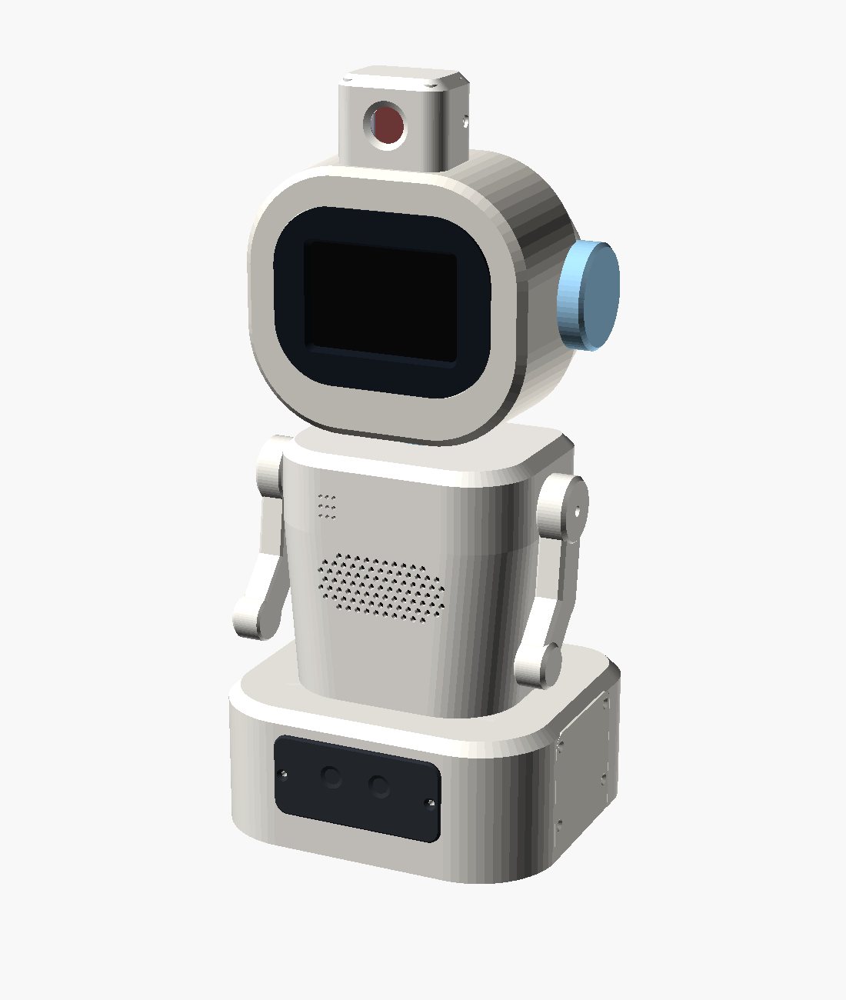
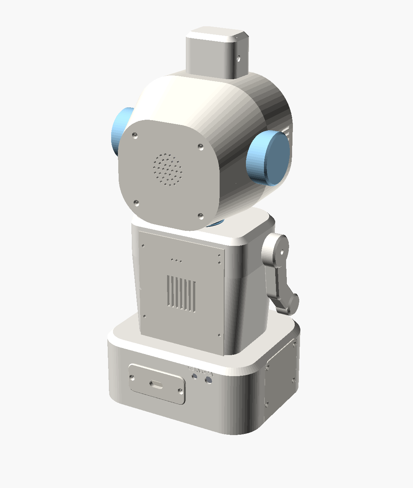
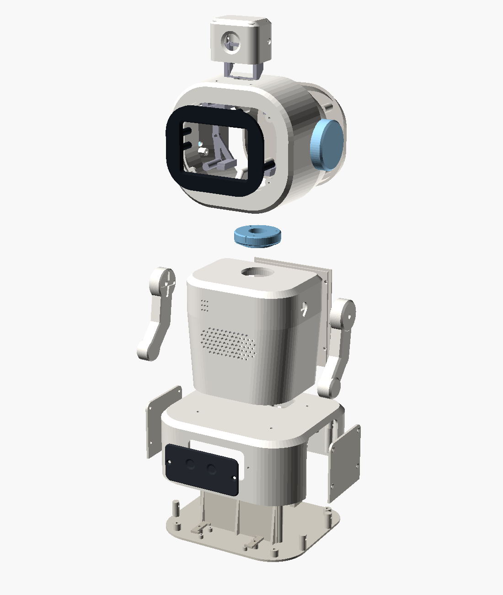
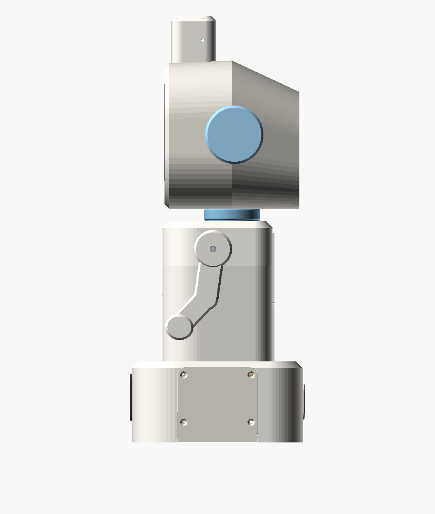
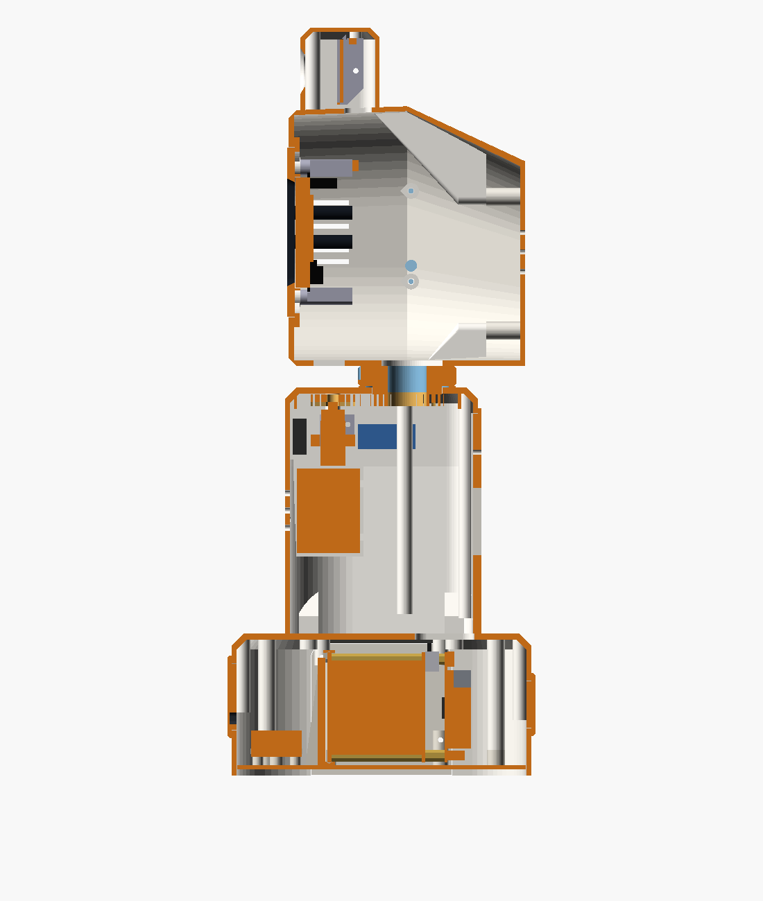
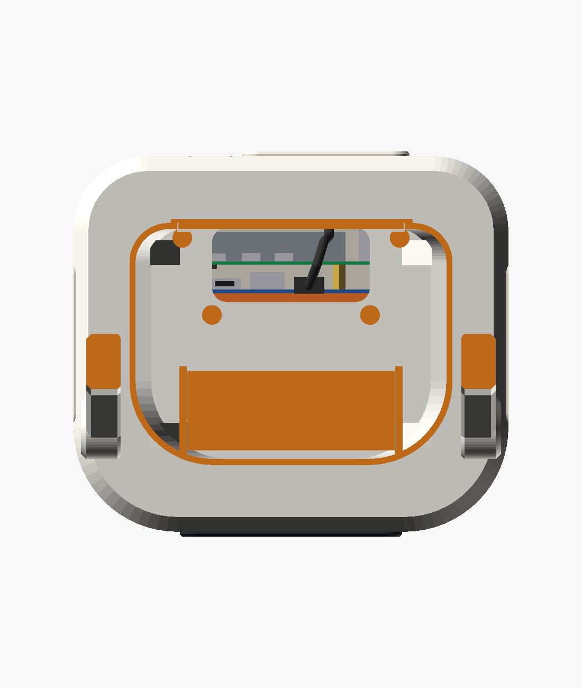
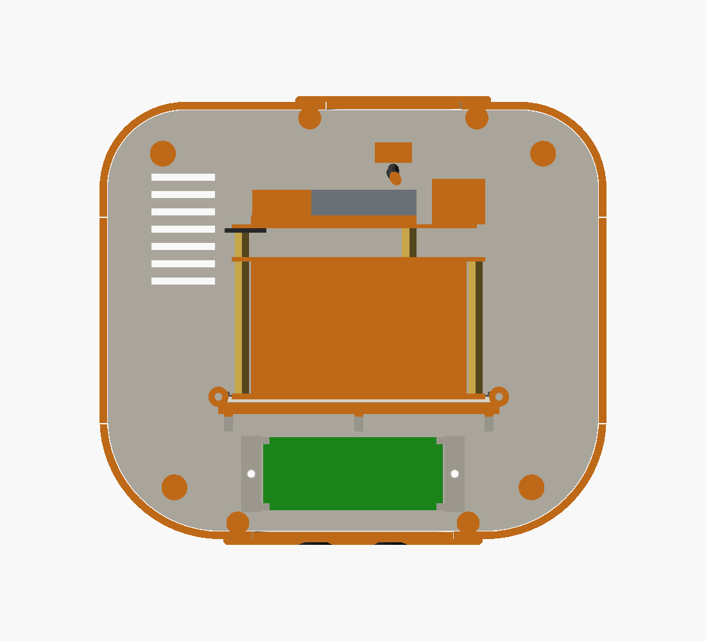
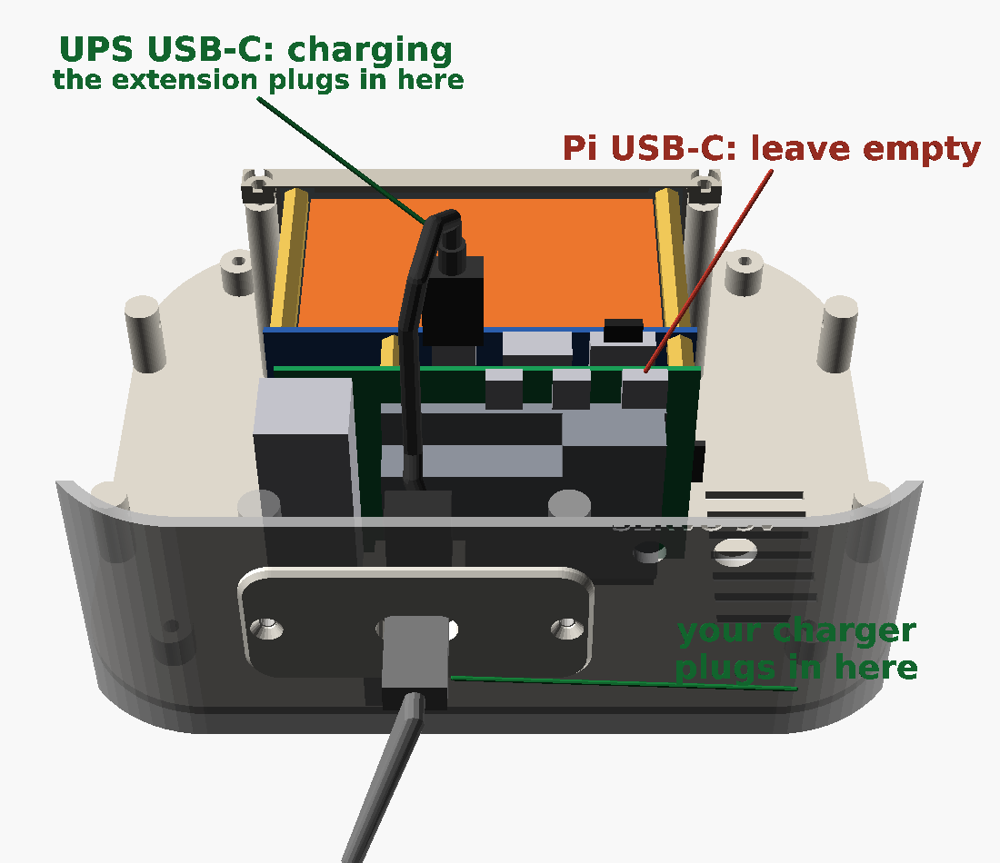
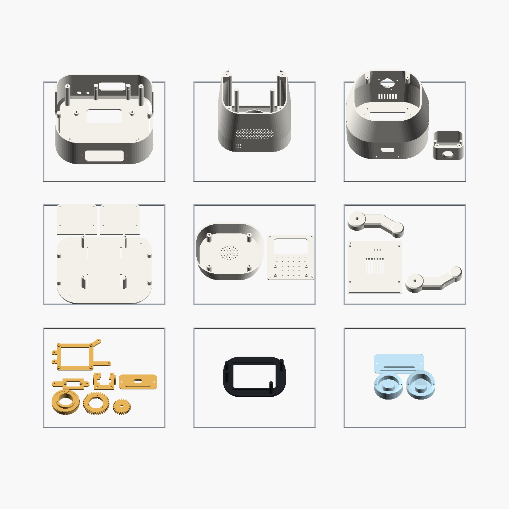
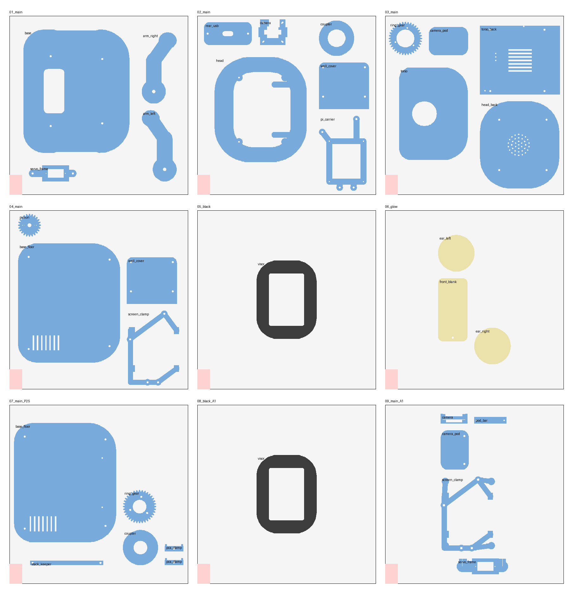

# LittleBot enclosure – version 2 ("companion")

The second design, inspired by the companion-robot reference picture:
- a round helmet head with LED-ring ears, a black visor around the screen and the camera in a pod on top;
- a rounded torso with a chest speaker grille, a microphone and two jointed-looking arms;
- a **mobility-ready base**: wheel wells, a front sensor / light-bar plate, the Pi on its battery, and a servo power input.

The parts:
- Raspberry Pi 5 (4 GB; every RAM size has the same board) with the official Active Cooler, **on a Waveshare UPS HAT (E)** (4 × 21700 cells, powers the Pi through pogo pins), lying on its side **in the base**;
- MPI3508 3.5" HDMI screen **in the head on its own**, held by the visor and a screen clamp: an HDMI cable, a micro-USB power cable and 6 touch wires run up the neck to it;
- InnoMaker U20CAM-1080P USB camera;
- Adafruit 3367 mini USB mic and Adafruit 3369 mini USB speaker;
- 3 × MG90S servos and a PCA9685.

**Screws: one kit.** Since 2026-11-03 every screw is an M3 button head from a single kit (four lengths: 10, 12, 20 and 30 mm), and nothing is drilled or forced into a smaller hole: see *Hardware* and *What changed (2026-11-03)*.

The base also has room for the later phases: ESP32, TB6612FNG, TT gear motors + wheels, HC-SR04 distance sensor, LED strips and a battery.

| Front | Back | Exploded |
|---|---|---|
|  |  |  |

| Side | Side section | Plan section (z = 150 mm) |
|---|---|---|
|  |  |  |

| The base from above (cut at z = 45 mm): the PCA9685 at the front between its two clamps, the floor's wall, then the UPS (clear plate standing in the floor's groove, cells, board) and the Pi with its cooler; the charging socket at the back | Where the charger goes: the extension's plug in the **UPS's** USB-C (not the Pi's), its cable up through the cable hole and back down behind the cooler to the socket behind the rear plate's slot (base and torso hidden) |
|---|---|
|  |  |

**Overall size:** 340 mm tall (about 35 cm, like the reference), base 176 × 152 mm, head 150 × 132 × 120 mm.
- All parts fit a 220 × 220 × 250 mm bed.
- Everything prints **without supports** except the head: its visor seat needs a few supports from the bed (see *Material and settings*).
- All parts come from one parametric OpenSCAD file.

v1 (`../enclosure/`) is smaller and simpler (212 mm, 11 parts). v2 is bigger, more of a character, and ready for the wheels.

## Files

| File | What |
|---|---|
| `littlebot_v2.scad` | the parametric model (all dimensions at the top) |
| `stl/*.stl` | ready-to-slice parts, already in print orientation |
| `checks.scad`, `run_checks.sh`, `screw_check.py` | 118 automated checks and a self-test that must find an overlap: interference and finger pinch (head ±60°, arms −90…+100°); the Pi + UPS stack with clear plates from 1.4 to 3.2 mm thick and 55 to 58 mm tall and with longer or shorter standoffs; and **every screw**: none runs into plastic beyond its pilot hole, each one cuts enough thread, and no head hits a part, a board or a cable. A result with no volume (parts designed to touch) passes |
| `build.sh`, `stl_tools.py` | rebuild the STLs and images. Report per part: size, watertight, number of separate bodies, bed fit, overhang area |
| `assembly_video/` | `./make_video.sh` renders a video (about 2½ minutes) of the assembly order below: every printed part in place, electronics as blocks, **every screw** driven in with its size, and **every cable** drawn along its route with its name. The screws and cable routes come from the model (`hardware.json`, written by `build.sh`): `assembly_video/build/LittleBot_assembly.mp4` |
| `make_plates.py` → `plates/`, `pack_plates.py` → `plates_256/`, `bambu_project.py` | the parts grouped into print jobs: 9 for a 220 mm bed; for a 256 mm bed (Bambu Lab) the 6 plates already printed and the **3 to print again** for the one-kit change, also as Bambu Studio projects for the **P2S** and the **A1** |

### What has been verified (by the scripts, not by a real print yet)

- **Every STL:** watertight, a single solid body, fits the bed, and has only small overhangs (screw-hole tops, short bridges). Large overhangs were found and removed.
- **`run_checks.sh`:** no part collides with any electronics dummy or other part.
  - The screen and what plugs into it (a right-angle HDMI plug, the micro-USB power plug, the touch wires) fit in the head without touching the head, the visor or the screen clamp (`screen_vs_head`).
  - The Pi + UPS stack and everything plugged into it (HDMI, USB-A and USB-C plugs up through the cable hole into the torso, a finger on the UPS switch, the Pi's USB plugs, the jumper plugs on the GPIO header), the PCA9685 and the charging socket fit the base, the floor, its stack keeper and PCA9685 clamps, the plates and the torso, and don't run into each other (`electronics_vs_base`, `ups_internal`, `stack_mount`).
  - The same again for the stack's unknowns: a clear plate 1.4 mm thick and 55 mm tall, one 3.2 mm thick and 58 mm tall (the V-grooves and the keeper take both), long standoffs of 44 or 50 mm instead of 46, short ones of 14 instead of 10, and both 2 mm longer. Waveshare publishes the board (88 × 56, its holes and ports: the model uses its drawing) but not the standoffs – see *Measure before you print*.
  - **Screws:** every M3 screw and servo screw, at the length the hardware list gives, runs only through clearance holes, pilot holes and air: none would have to cut into plastic beyond its pilot hole (`screws_forced`). Each one cuts at least 3.9 mm of thread in a pilot hole (most 5–16 mm; the servo screws 3 mm, the arm ribs' thickness) (`screw_check.py`), and no screw head touches a part, a board or a cable (`screw_heads`).
  - The charging cable, from its plug in the UPS's USB-C up through the cable hole and back down behind the cooler to its socket, clears every part (`charge_cable_clear`).
  - Every other cable has a route too (HDMI, screen power and touch wires up the neck to the screen; the camera cable down the neck to the Pi; speaker, mic, servos and the I2C jumpers), and each route clears the printed parts and the other electronics (`cables_body`, `cables_head`). Measured along the routes: HDMI about 20 cm, screen power 24 cm, touch 32 cm, camera 37 cm, servo leads 21–22 cm, I2C jumpers 15 cm, before slack.
  - The head turns ±60° (the servo's full range) without touching anything.
  - The arms move over −90…+100° without touching anything.
  - Over that arm range the arms stay **≥ 12 mm** from the head and the base.
  - 110° fails on purpose: the arm comes closer than 12 mm to the head.
- **Not verified:** real-world fit. Clearances depend on your printer and the actual parts – see *Measure before you print*.

## Print it in 9 jobs (build plates)

The robot can't be printed as one piece:
- It's 340 mm tall, taller than most printers.
- The electronics have to go inside.
- The head and arms have to move.

Instead, `plates/` groups the parts into **9 ready-made build plates**, one STL per print job. Each fits a 220 × 220 mm bed, and the parts on each plate share a colour:

| Plate | Parts | Filament |
|---|---|---|
| `01_base.stl` | base | main colour |
| `02_torso.stl` | torso | main colour |
| `03_head.stl` | head + camera pod | main colour |
| `04_floor.stl` | floor + 2 well covers | main colour |
| `05_back_cap.stl` | head back cap + screen clamp | main colour |
| `06_arms.stl` | both arms + torso back cover | main colour |
| `07_small_parts.stl` | neck coupler, both gears, servo frame, camera bracket, rear plate, stack keeper, 2 PCA9685 clamps | main colour, print slowly for the gears |
| `08_visor.stl` | visor (with the four posts for the screen clamp) | **black** |
| `09_glow.stl` | both ears + front plate | **white / natural / translucent** |
| later: `10_mobile_floor.stl`, `11_sonar_plate.stl` | wheel-phase floor, HC-SR04 plate | |

Each plate is a single STL with several separate bodies. Most slicers can split it back into objects if you want different settings per part, such as more infill for the gears.

### On a 256 mm bed (Bambu Lab A1 / P1S / P2S / X1C): 6 plates printed, 3 to print again

`plates_256/` (made by `pack_plates.py`) holds the **6 plates you've already printed** and the **3 plates to print now** for the one-kit change (2026-11-03). The parts they replace are simply not used.

**Print these (2026-11-03):**

| Plate | Printer | Parts | Filament |
|---|---|---|---|
| `07_main_P2S.3mf` | **P2S** | floor (the stack mount), stack keeper, 2 PCA9685 clamps, neck coupler, ring gear | main colour |
| `08_black_A1.3mf` | **A1** | visor | **black** |
| `09_main_A1.3mf` | **A1** | screen clamp, camera pod, pod bar, camera bracket (5 mm brim), servo frame | main colour |

- **P2S:** the floor is the biggest and tallest part (57 mm), so it goes on the printer whose bed doesn't move.
- **A1:** the visor first, then plate 09. **Test the fits first:** print just the **servo frame** and the **camera bracket** from plate 09 (delete the others in Bambu Studio, about 35 min) and try them: a collar slides over one of the torso's servo pillars and its pinch screw tightens it; the camera board slides down into the bracket and its two hooks click over the board's top edge. Then print the P2S plate and the rest.
- **Bambu Studio projects:** `plates_256/project/LittleBot_reprint_P2S.3mf` (plate 07, set up for the P2S) and `LittleBot_reprint_A1.3mf` (plates 08 and 09, for the A1): 0.4 nozzle, 0.20mm Standard, Bambu PLA Basic, Textured PEI Plate; Bambu Studio uses your own installed presets of those names. In the A1 project the visor is filament 1 (black) and plate 09 filament 2 (main colour): with an AMS lite map them to its slots, without one load black for the visor plate and your main colour for plate 09. Only the camera bracket gets a brim (5 mm; it stands 36 mm tall on a narrow footprint); nothing needs supports.
- **About 180 g of PLA** for the three plates. Sliced with Bambu's 0.20mm Standard speeds and accelerations (in PrusaSlicer; Bambu Studio's own figure will differ a little): plate 07 about **3 h** (102 g), plate 08 about **45 min** (20 g), plate 09 about **2 h 20 min** (57 g), plus a few minutes of warm-up and bed levelling each. The P2S plate and the two A1 plates take about the same time, so on both printers at once it's done in about 3¼ hours.
- Remake the projects with `python3 bambu_project.py plates_256/project/LittleBot_reprint_P2S.3mf plates_256/07_main_P2S.3mf` and `python3 bambu_project.py --printer A1 plates_256/project/LittleBot_reprint_A1.3mf plates_256/08_black_A1.3mf plates_256/09_main_A1.3mf`; `python3 bambu_project.py --fetch P2S` (or `A1`) refreshes their settings (`bambu_p2s_pla.json`, `bambu_a1_pla.json`) from Bambu's published profiles.

**Already printed** (kept exactly as they were, `PRINTED` in `pack_plates.py`):

| Plate | Parts | Filament |
|---|---|---|
| `01_main.3mf` | base, both arms, servo frame (old: not used) | main colour, brim on the **base** only |
| `02_main.3mf` | head, Pi carrier (not used), well cover, neck coupler (old), rear plate, camera bracket (old) | main colour, brim on the **head** only, supports for the head (below) |
| `03_main.3mf` | torso, head back cap, torso back cover, ring gear (old), camera pod (old) | main colour, brim on the **torso** only |
| `04_main.3mf` | floor (old), screen clamp (old), well cover, pinion | main colour |
| `05_black.3mf` | visor (old) | **black** |
| `06_glow.3mf` | both ears + front plate | **white / natural / translucent** |

- **Brim on the tall part only, never on the whole plate.** The tall parts, base (72 mm), head (100 mm) and torso (125 mm), are at least 20 mm from every edge with room for an 8 mm brim. The other parts are only 5 mm from the edge, so a plate-wide brim runs off the plate there, lifts, and the nozzle catches it: that failed a P2S three times in PLA. In Bambu Studio leave the plate's brim off (**Others → Brim type: No-brim**), then right-click the tall part → **Add settings → Others** → Brim type **Outer brim only**, Brim width **8 mm**. After slicing, check in the Preview tab that no brim reaches an edge. **Don't press Arrange (A)**: it moves parts.
- **Why not more room at the edges?** Every part 8 mm or more from the edges would have needed a seventh plate; 6 plates need the flat parts close to the edge, which is fine without a brim (they have big, flat footprints).
- **Fewer isn't possible:** the base, floor, head and head back cap are each too big to share a 256 mm plate with one another, so the main colour needs 4 plates. All of it on one plate would need a bed of about 465 × 465 mm.
- **Colours stay on separate plates, even with an AMS.** On a mixed plate the printer swaps filament on every layer where both colours are printing: up to 33 mm high for the visor, which means hundreds of swaps, hours of extra time and a lot of purged filament. With an AMS, just load all the colours and it switches between plates for you. If your main colour is white or natural, the ears and front plate can be printed in it too.
- **3MF, one object per part:** each part keeps its name, so in Bambu Studio you can click the **ring gear** and **pinion** and add per-object settings (5 walls, 50 % infill, slower), and give the **head** its supports (on build plate only). If Bambu Studio says the file "is not from Bambu Lab", choose to load the geometry.
- The layout keeps 10 mm between parts, 5 mm from the edges (20 mm for tall parts), and keeps the 18 × 28 mm front-left corner free, which the X1 and P1 printers reserve.
- For another bed size: `python3 pack_plates.py 300` (writes `plates_300/`). The wheel-phase parts stay in `plates/`.

## Parts to print

| STL | Qty | Notes |
|---|---|---|
| `base.stl` | 1 | prints top-down; its walls form a **skirt** the robot stands on (no feet to come off) |
| `base_floor.stl` | 1 | stationary floor, 3 mm above the table inside the skirt: the **stack mount** (a V-groove rail the UPS's clear plate stands in, between two posts the keeper screws into, and a wall in front), the PCA9685's 4 standoffs with pins and its clamps' posts (front), the charging-socket holder (behind the rear plate's slot), vents beside the cooler, columns up to the base's corner pillars and the well-cover bosses |
| `stack_keeper.stl` | 1 | a bar with a V-groove underneath: it presses the clear plate's top edge down (2 × M3 × 20), so nothing screws into the stack |
| `pca_clamp.stl` | **2** | strips beside the PCA9685's short ends; their tongues hold its corners down (1 × M3 × 10 each) |
| `well_cover.stl` | **2** | close the wheel wells until the wheels are fitted |
| `front_blank.stl` | 1 | front plate: two "headlight" dimples + **light bar** (1 mm skin over an LED-strip pocket) |
| `rear_usb.stl` | 1 | rear plate with a 16 × 8 mm slot for the power / charging cable (`rear_blank.stl` if you don't need it) |
| `torso.stl` | 1 | prints top-down; open rear (closed by `torso_back`) |
| `torso_back.stl` | 1 | rear cover with vent slots |
| `coupler.stl`, `ring_gear.stl`, `pinion.stl`, `servo_frame.stl` | 1 each | geared neck. Same principle as v1, module 1.25, 36:24 teeth. The coupler and ring gear have a 20 mm cable bore and 3 × M3 between them; the servo frame hangs on the torso's two pillars by split collars (2 pinch screws) |
| `head.stl` | 1 | prints face down; vent slots on the side (viewer's left) and under the face |
| `head_back.stl` | 1 | back cap with a dot grille |
| `visor.stl` | 1 | print in **black**: the frame around the screen, glass locating ribs and four posts that carry the screen clamp. No screws of its own |
| `screen_clamp.stl` | 1 | screws onto the visor posts (4 × M3 × 12) and presses the screen's four PCB tabs into the visor; hooks under the lower tabs, so the screen sits on it and can't slide down. Four feet press on the head's visor tabs: tightening it clamps the visor into the head |
| `ear_left.stl`, `ear_right.stl` | 1 each | mirror images; LED-ring pocket behind a 1 mm skin |
| `camera_pod.stl` | 1 | the camera housing on top of the head; the bracket's two pivot screws go in from outside, their heads sunk into its sides; its own two screws go in from the top |
| `pod_bar.stl` | 1 | small bar under the head's roof that the pod's two screws go into (46 × 9 × 7 mm) |
| `camera.stl` | 1 | camera bracket inside the pod: the board slides down into two side slots and two springy hooks snap over its top edge (no screws in the board); the 5-pin socket on the board's back stays free |
| `arm_left.stl`, `arm_right.stl` | 1 each | print flat side (the side facing the body) down |
| later: `base_floor_mobile.stl`, `shelf.stl`, `front_sonar.stl` | 1 each | wheel phase: wheel slots + motor/caster grids, the old battery-bay shelf, HC-SR04 plate (**not updated for the UPS yet**) |

**Material and settings:**
- **Material:** PETG (tougher, copes better with the Pi's warmth) or PLA+.
- **Settings:** 0.2 mm layers, 3 perimeters, 15–25 % infill. For the gears: 5 perimeters / 50 %, printed slowly.
- **Supports:** only for the **head**, and only from the bed. It prints face down, and the ledge the visor rests on, with its four tabs, starts 3 mm above the bed with nothing under it (Bambu Studio warns about a "floating cantilever"). In the slicer, give the head alone: support on, **On build plate only** on. That fills just the 3 mm visor recess (hidden behind the visor; pull it out with pliers) and nothing inside the head. Every other part: no supports. Give the tall parts (base, head, torso) an 8 mm brim, on those parts only (see the 256 mm plates below), and wash the plate (dish soap and water) before a long print.
- **Colours:** the ears and the front plate glow only when printed in **white, natural or translucent** filament; dark filament hides the LEDs. Print the visor in black.
- **Filament:** the stationary build is about 940 cm³ of plastic (about 1.2 kg PETG at 100 % infill). Normal infill uses noticeably less: plan on about 1 kg of the main colour plus a little black and natural.

## Hardware (bill of materials)

| Item | Qty | Use |
|---|---|---|
**Screws: one kit,** the [Glarks 1021-piece M3 button-head kit](https://www.amazon.ca/dp/B0B292QDWG) (304 stainless; 25 × M3 × 10, 25 × 12, 20 × 20, 15 × 30 and more). Every screw below is an M3 button head from it. Each goes through a clearance hole into a pilot hole made for it: nothing is drilled, and no screw goes into a hole made for a smaller one (`run_checks.sh` checks all of them).

| Item | Qty | Use |
|---|---|---|
| M3 × 10 | 20 | well covers (8) and front/rear plates (4): in their countersinks the button heads sit 1.3 mm proud; torso back cover (4, through its lip: it fits lip outwards); the servo frame's collars (2 pinch screws); the PCA9685 clamps (2) |
| M3 × 12 | 20 | ring gear → coupler (3, from below); torso → base (4, from inside the base); floor → base (4, from below, heads in pockets); screen clamp → visor posts (4); head → coupler (3, from inside); camera bracket pivots (2, from outside the pod) |
| M3 × 20 | 6 | ears (4, from inside the head); the stack keeper (2) |
| M3 × 30 | 6 | head back cap (4, through the cap's bosses; the heads sit 1.3 mm proud in the countersinks); camera pod → head (2, from the top of the pod, down into the pod bar) |
| servo screws (in the servo bags) | | servo tabs, horns, the arms' centre screws |
| the UPS kit's own screws | | the Pi onto the UPS (as Waveshare assembles it; the clear plate keeps its own flush screws too) |
| PTFE tape or a drop of silicone grease | – | neck bearing ring |
| 1 mm foam tape, 2 small zip ties | | glass gasket on the visor's back, speaker gasket, speaker cradle |
| **Waveshare UPS HAT (E)** + 4 × 21700 Li-ion cells (branded, protected, matched) | 1 | the robot's battery and the Pi's power (pogo pins) |
| micro-HDMI → HDMI cable, **50 cm**, thin and flexible, with a **right-angle HDMI plug** that sends the cable away from the glass (or an HDMI ribbon kit) | 1 | Pi in the base → screen in the head, through the neck (straight micro-HDMI plug at the Pi). The neck's bore is 20 mm: feed the **micro-HDMI end down** through it; the full-size plug doesn't fit through |
| USB-A → micro-USB cable, 50 cm (a right-angle micro-USB plug helps) | 1 | the UPS's USB-A output → the screen's power socket |
| male-to-female jumper wires, about 40 cm (e.g. three 20 cm wires joined, joints taped, kept out of the neck) | 6 (7) | touch: Pi pins 19, 21, 22, 23, 26 and ground (20) → the same pins in the screen's socket (and pin 1 → pin 1 if touch needs it) |
| female-to-female jumper wires, 20 cm | 4 + 4 | Pi pins 1, 3, 5, 6 → the PCA9685's I2C pins at one end (VCC, SDA, SCL, GND); its other end → the UPS's battery-data (I2C) cable. Two plugs can't share a Pi pin, so the UPS chains on through the PCA9685 |
| USB-C extension, male → female, **20 cm** (15–30 cm works), rated 3 A / 60 W or more with USB-PD (e.g. one sold as "USB 3.1 / 100 W"); a straight, slim plug (moulding about 12 × 7 mm) and a socket end about 13 × 7 × 18 mm | 1 | **charging:** its plug goes into the **UPS's USB-C** (never the Pi's), its socket zip-ties into the holder behind the rear plate's slot, and the charger plugs in there (see *The Pi and the UPS in the base*) |
| USB-A extension cable, male → female, 30–50 cm (socket end no bigger than about 18 × 9.5 mm) | 1 | Adafruit mini USB mic in the chest → Pi in the base |
| **later:** 5.5 × 2.1 mm panel DC jack (8 mm hole) + mini toggle (6 mm hole) | 1 + 1 | separate 5 V servo supply ("SERVO 5V" on the back) |
| **later:** 2 × 12-LED WS2812 rings (37 mm OD / 23 mm ID), ≤ 5 mm-wide addressable LED strip ~55 mm | | ears + light bar |
| **later:** TT gear motors + 65 mm wheels, 2 ball casters, HC-SR04, ESP32, TB6612FNG | | wheel phase |

No longer needed since the Pi moved into the base: the micro-HDMI → HDMI "U" adapter, the USB-C power cable up the neck, the shelf and the ballast (the UPS's cells sit at the very bottom now).

## Where everything goes

| Area | What's there |
|---|---|
| **Head** | **Screen:** the MPI3508 on its own (see *The screen in the head*). The glass sits in locating ribs on the back of the black visor, on 1 mm foam, HDMI socket pointing **down**; the **screen clamp** screws onto the visor's four posts and presses the screen's four PCB tabs forward, its lower fingers hook under the lower tabs, and its four feet hold the visor in the head. **Plugs:** a right-angle HDMI plug under the screen (its cable goes back, then down to the neck), the micro-USB power plug at the screen's wide-border end (viewer's left), the touch wires in socket pins 19–26. **Ears:** LED-ring pockets; the wires go into the head through a hole under each ring. **Back cap:** the 4 screws locate it. **Camera:** in the top pod, the board snapped into a bracket on two M3 pivots. Its 5-pin socket is on the board's back: the cable comes out of the plug backwards, drops into the head through the opening under the pod, passes behind the screen clamp and goes down the neck to the Pi. |
| **Neck** | Same geared turntable as v1. The head screws onto a coupler that turns on a hollow spigot (20 mm cable bore since 2026-11-03, so the ring gear's screws can be M3). A 36-tooth ring gear under the torso top is driven by a 24-tooth pinion in front of it, so the servo never carries the head and lifting by the head can't pull the shaft out. **Head = 0.67 × servo angle**: the servo's full range gives about ±60°, and all of it is collision-free. Through the bore: the HDMI cable (fed micro-HDMI end down), the screen's power cable, the touch wires and the camera cable; leave slack for the head to turn. |
| **Torso** | **Front:** speaker behind the pill-shaped chest grille (it matches the speaker's oval front, so both drivers are uncovered), in a cradle with zip-tie slots; the Adafruit mini USB mic lies flat in a sleeve behind the small holes (viewer's left), holes facing out, its plug pointing to the middle where the extension cable's socket plugs on. **Top:** head servo on its frame (clamped onto two pillars), gear guard, one arm servo per side on a rib (spline through the side wall). **Middle:** two columns support the top plate. Cables run between them: from the neck down to the base, and the speaker and mic cables down to the Pi. With the torso's back cover off, the UPS's switch is right below, in the cable hole. |
| **Base** | **Pi + UPS** (see *The Pi and the UPS in the base*): on its side, its clear plate standing in a groove on the floor under the stack keeper, its port edge up under the cable hole to the torso. **Front:** PCA9685 on four pins on the floor, held by two clamps; sensor / light-bar plate. **Rear:** the charging socket behind the rear plate's slot (a USB-C extension from the UPS's USB-C); the servo-supply jack + switch. **Sides:** two wheel wells (covered for now). **Air:** vent slots in the floor beside the cooler's exhaust; the cable hole lets warm air up into the torso and out of its back cover. |

All openings for sound, the mic and cooling are 3 mm or smaller. The camera aperture stays 17 mm with the lens right behind it. The cable slot is 16 × 8 mm, in a 4.6 mm plate.

## The screen in the head

The MPI3508 has no mounting holes. It sits in the visor and is held there from behind:
- **Ribs:** the glass drops into a frame of 3 mm locating ribs on the back of the visor, on 1 mm foam tape; the lower rib is 0.3 mm under the glass.
- **Screen clamp:** screws onto the visor's four posts (4 × M3 × 12, oversized holes so the glass can settle first) and presses the four 2.3 × 10.5 mm tabs of the screen's PCB (beyond its long edges, at 10–20.5 and 64.5–75 mm from the wide-border end) into the visor.
- **The visor needs no screws** (2026-11-03): the clamp's four feet reach forward onto the backs of the head's four visor tabs (the ones the visor's screws used to go through). Tightening the clamp pulls the visor's posts back and pushes the head's tabs forward, so the head's face is held between the visor and the feet.
- **It can't slide down:** the two lower fingers end in hooks 0.3 mm under the lower tabs. If the screen drops at all, it lands on the clamp's hooks and the visor's lower rib at the same time.
- **Cables:** the screen's HDMI socket points down, about 37 mm above the head's floor, so the HDMI cable needs a **right-angle plug**; its cable goes back and down to the neck. Power comes into the micro-USB socket at the wide-border end (viewer's left), from the UPS's USB-A output.
- **Touch** runs over 6 wires from the Pi's header to the same pins in the screen's socket: 19, 21, 23, 26 (SPI), 22 (pen interrupt) and 20 (ground); add pin 1 (3.3 V) only if touch doesn't respond. The touch controller is read at 50 kHz, so 40 cm of wire is fine. Settings: `docs/DISPLAY_SETUP.md` section 5.
- The visor's lower-left post moved up 5 mm (clear of the micro-USB plug) and its upper-right post moved to the other side of the upper-right finger.

## The Pi and the UPS in the base

The Pi 5 sits on the Waveshare UPS HAT (E) as Waveshare intends (its pogo pins power the Pi; set `PSU_MAX_CURRENT=5000`, `docs/POWER.md` section 8.1). The whole stack lies on its side in the base:
- **Mounting, no screws into the stack** (2026-11-03): the UPS's clear plate faces the front and keeps its own flush screws. Its lower edge stands in a **V-groove** on the floor, between two posts; the **stack keeper** sits on its top edge with a second V-groove and screws into the posts (2 × M3 × 20). A V centres a plate of any thickness from 1.4 to 3.2 mm on the same line, and the screws take up its height (55–58 mm across the boards), so the plate's exact size doesn't matter. Tighten the keeper until the stack doesn't rock, no more.
- **The stack, from Waveshare's drawing:** the UPS board is 88 × 56 mm with six 3.0 mm holes: its four corners (3.5 mm in) and the Pi's 58 × 49 pattern. The Pi lies on it with its SD-card end over the UPS's end, so the UPS's pogo pins touch the Pi's 5 V and GND header pins from below. The long standoffs join the clear plate to the UPS board at the corners, the short ones the UPS board to the Pi. Their lengths aren't published: the model has 46 and 10 mm, and the checks pass from 44 to 50 mm and up to 14 mm (see *Measure before you print*).
- **Port edge up:** the Pi's micro-HDMI and the UPS's switch, USB-A and USB-C are on the same long edge, which sits right under the 64 × 30 mm cable hole to the torso. The plugs go up through the hole.
- **The Pi's USB-A / Ethernet end** points to the robot's left (+x); the camera, speaker and mic plug in there.
- **The GPIO header** is on the lower edge: 20 cm female-to-female jumpers to the PCA9685 (front of the floor; the UPS's battery-data cable chains on at its other end), and the touch wires, which go up through the cable hole.
- **Servo leads** come down the cable hole and lie flat over the top of the stack and its keeper (about 4 mm of room under the base's top) to the PCA9685, whose servo pins face the stack: head servo on channel 0, left arm 1, right arm 2. The route uses about 22 cm of a 25 cm MG90S lead; if yours are shorter, add a short servo extension.
- **The floor sits lower** than before (3 mm above the table, inside the skirt) to make room for the stack on its side: about 64 mm between the floor and the base's top.
- **Charging** goes into the **UPS's USB-C**, never the Pi's own USB-C, which stays empty. A 20 cm USB-C extension brings it to the back of the robot:
  - **Its plug** goes into the UPS's USB-C, marked POWER: on the UPS board (the blue board between the cells and the Pi), about 49 mm from the Pi's SD-card end, next to the UPS's USB-A (5V OUT) and its switch. The Pi's own USB-C is on the Pi itself, in the corner by the SD card: leave it empty.
  - **Its cable** goes up through the cable hole, turns over, comes back down through the hole's rear part and behind the cooler: about 10 cm from plug to socket.
  - **Its socket** zip-ties into the holder on the floor, right behind the rear plate's 16 × 8 mm slot. **The charger plugs in there**, from the back.
  - Why not a hole straight onto the UPS's port: it sits on the edge that has to face up into the torso (the HDMI and screen-power cables plug in right beside it), so no outside wall is anywhere near it. With the extension, no printed part has to change.
  - `images/charging.png` and step 9 of the video show it; `charge_cable_clear` checks the cable's path.
- **The switch** is under the cable hole: take the torso's back cover off to reach it. Leaving it on and shutting down from the dashboard is the plan (software to come).
- **What's still estimated:** the standoffs' lengths and the clear plate's thickness; the floor takes the range above. Check them against *Measure before you print* before printing the floor.

## Checked against your parts (2026-10-23; the UPS and the camera 2026-11-03)

The robot itself reports the screen as `MPI3508` (EDID), the camera as `U20CAM-1080P`, the speaker as `UACDemoV1.0` (Jieli) and the mic as `USB PnP Sound Device` (C-Media). These match the parts below.

| Part | Dimensions used in the model | Source (checked 2026-10-23) |
|---|---|---|
| MPI3508 3.5" HDMI screen | glass 85.51 × 56.0; touch panel 84.36 × 55.0; backlight 84.96 × 55.5; **active area 73.44 × 48.96**, borders 8.35 (wide, HDMI-down left) / 3.72 / 3.52 / 3.52, so the AA is **2.32 mm** off-centre; stack 7.32; **no mounting holes** – the PCB has four 2.3 × 10.5 mm tabs beyond the long edges at 10–20.5 and 64.5–75 mm; 2 × 13 socket 13.54 tall, pin 1 at 8.88 / 1.82 mm; full-size HDMI socket centred 33.0 mm from the wide-border end, opening 1.70 mm in from the glass edge, 6.7 mm deep; 3.5 mm jack at 53.68 mm, sticks out 1.79 mm; micro-USB power in at the wide-border end | lcdwiki "LCM outline MPI3508", drawn 2025-08-18: [MPI3508-size.pdf](https://www.lcdwiki.com/res/MPI3508/MPI3508-size.pdf), [product page](http://www.lcdwiki.com/3.5inch_HDMI_Display-B) |
| Raspberry Pi 5 | 85 × 56 board, PCB about 1.4; M2.5 holes Ø2.7 at 3.5 / 61.5 × 3.5 / 52.5 (58 × 49); header body 7.13–57.93 × 50.02–55.0, pin 1 at (8.40, 51.24), plastic 2.5, pins 8.57; USB-C at 11.2, micro-HDMI at 25.8 and 39.2; USB stack 15.8 tall, overhanging the edge by 3; microSD at 22.7–33.7 on the underside | [Raspberry Pi 5 mechanical drawing](https://datasheets.raspberrypi.com/rpi5/raspberry-pi-5-mechanical-drawing.pdf) (dimensions read from the PDF's vectors) |
| Official Active Cooler | 63.5 × 42.5, 13.7 overall; push pins at (3, 3) and (61, 40) from its corner = the Pi's Ø3 holes at (3.5, 9.5) and (61.5, 46.5); fan 30 × 30; top about 12 above the Pi PCB (estimate, see above) | [Active Cooler product brief](https://datasheets.raspberrypi.com/cooling/raspberry-pi-active-cooler-product-brief.pdf) (Jan 2026) |
| InnoMaker U20CAM-1080P | 32 × 32 board, 4 corner holes Ø2.2 with clear pads (the board is held by its edges now); M12 lens on a holder with 18 mm screw spacing; the **5-pin cable socket (1.25 mm pitch, vertical) is on the back**, 6.7 mm left of centre (seen from the front) and 3 mm above the lower edge (your photos, 2026-11-03); 1 m cable; FOV 130° D / 103–106° H | [InnoMaker product page](https://www.inno-maker.com/product/u20cam-1080p/), [user manual](https://github.com/INNO-MAKER/U20CAM-1080P-S1), [U20CAM case drawing](https://github.com/INNO-MAKER/U20CAM-CASE) |
| Adafruit 3369 mini USB stereo speaker | 84.0 × 43.0 × 32.0, oval front grille over 2 drivers, 1168 mm cable | [Adafruit 3369](https://www.adafruit.com/product/3369) |
| Adafruit 3367 mini USB mic | 22.2 × 18.3 × 7.0 | [Adafruit 3367](https://www.adafruit.com/product/3367) |
| MG90S servo | A 32.5 (spline top), B 22.8 (body), C 28.4 (boss top), D 12.4 (width), E 32.1 (across tabs), F 18.5 (tab top) | [TowerPro MG90S](https://www.towerpro.com.tw/product/mg90s-3/) |
| PCA9685 (Adafruit 815 layout) | 62.2 × 25.4 board, 4 holes Ø2.5 at 3.30 / 59.18 × 3.30 / 22.35 (55.88 × 19.05) | [Adafruit 815](https://www.adafruit.com/product/815), [fab print](https://learn.adafruit.com/16-channel-pwm-servo-driver/downloads) |
| Waveshare UPS HAT (E) | board 88 × 56, six Ø3.0 holes: the corners 3.5 mm in and the Pi's 58 × 49 pattern (23 mm from a corner hole); on its port edge, from the Pi's SD-card end: switch 15.2 (13.2 wide, its knob 4.8 mm past the edge), USB-A 5V OUT 32.45 (13.9 wide), USB-C POWER 49.35 (8.9 wide); pogo pins under the Pi's header pins 2/4/6; clear plate about the board's size and thickness, its screws flush (your measurement); 4 × 21700 cells (21 × 70 mm); **not published:** the standoffs (model: 46 mm plate → UPS, 10 mm UPS → Pi) | Waveshare's outline drawing and product photos (sent 2026-11-03), [Waveshare wiki](https://www.waveshare.com/wiki/UPS_HAT_(E)) |

## What changed (2026-11-06): the camera pod screws from the top

The pod's two screws went in from inside the head, up through its roof: there's no room in there to turn a key with any force. Now they go in **from the top of the pod** (2 × M3 × 30, heads 21 mm down two 6.4 mm holes), through the head's existing holes, into a small printed **pod bar** held up under the roof. Inside the head you only hold the bar; all the turning is from outside. Reprint the **camera pod** and print the **pod bar** (with the camera bracket: `plates_256/project/LittleBot_camera_pod_fix_A1.3mf`, A1). The head doesn't change. The screws cut 6.2 mm of thread in the bar.

## What changed (2026-11-03): one M3 kit for every screw

All six 256 mm plates were printed. This change prints three plates again (07–09) and needs **only the Glarks M3 kit**: no M2 or M2.5 screws, no nuts, nothing drilled, and no screw goes into a hole made for a smaller one.
- **Pi + UPS:** no longer screwed to the floor (its standoffs take M2.5 only). The new floor holds the clear plate in a V-groove and the new **stack keeper** presses its top edge down (2 × M3 × 20): any plate 1.4–3.2 mm thick and 55–58 mm tall fits. The UPS keeps the screws Waveshare put in it. The model now follows Waveshare's drawing: its holes, the corner standoffs, and the switch, USB-A and USB-C about 3–7 mm further from the SD-card end than estimated before. The stack sits 2 mm further left and 1.5 mm further forward, which gives the Pi's USB plugs and the charging cable more room at the back.
- **PCA9685:** its holes are 2.5 mm, so no screws in it: it sits on four pins and two **PCA clamps** hold its corners (1 × M3 × 10 each).
- **Neck:** the coupler and ring gear have a 20 mm cable bore (was 26), which leaves room for **M3 × 12** ring-gear screws (were M2.5). The HDMI cable's full-size plug no longer fits through, so its **micro-HDMI end is fed down** through the neck.
- **Visor:** no screws of its own (its four needed M2.5). The **screen clamp** has four feet that press on the head's visor tabs from behind; its 4 screws (now **M3 × 12**) hold the screen and the visor.
- **Camera:** the board is held by its edges in the new **bracket** (two slots, two springy hooks), so its 2.2 mm holes stay empty, and its 5-pin socket, which is on the back of the board (your photos), stays free. The bracket pivots on **2 × M3 × 12** from outside the **pod**, heads sunk into the pod's sides; the pod's own screws are now M3 × 12 (their old pilot holes were 0.8 mm too short for M3 × 10). The pod goes on after the head, once the camera cable is plugged in.
- **Servo frame:** the torso's two pillars are solid, so the frame's old screws had nothing to go into. The new frame **clamps onto them** with two split collars (2 × M3 × 10 pinch screws).
- **Screw checks** (new): every screw at its listed length is checked against the parts as assembled; none would have to cut into plastic beyond its pilot hole, each cuts enough thread (at least 3.9 mm), and no head hits a part, a board or a cable. This found two old mistakes, corrected here: the **torso → base** screws are now **M3 × 12** (M3 × 10 reached only 2 mm into the torso), and the **torso back cover** takes **M3 × 10** (M3 × 12 ran 1.4 mm past its pilot holes).
- **Checks:** 118 (the stack mount, the servo frame on the torso, the screws, and the stack with thinner, thicker, shorter and taller plates and longer or shorter standoffs).

## What changed (2026-10-30): the Pi and a UPS in the base

Plates 01–03 were already printed and are unchanged (the build checks every part against them); only plates 04 and 05 changed.
- **The Pi moved into the base**, on a Waveshare UPS HAT (E), lying on its side. The screen stays in the head, connected by cables, so touch needs 6 wires.
- **New floor** (`base_floor`, plate 04): lower, with the mounting wall, the PCA9685 standoffs (the shelf is no longer used), the charging-socket holder and vents.
- **New screen clamp** (`screen_clamp`, plate 04) instead of the Pi carrier, with hooks so the screen can't slide down.
- **Visor** (plate 05): two posts moved, clear of the micro-USB plug and the clamp's upper-right finger.
- **Checks:** the head and base checks now cover the screen with its cables and the stack with its plugs (69 checks, 70 with the charging cable below). `run_checks.sh` counts a zero-volume result (parts that only touch) as a pass, as it always meant to; newer OpenSCAD reports those touches as facets.
- **Screws and cables in the video** (no printed part changed): every screw (82) is driven in at its step with its size, and every cable is drawn along its route, which the model now holds and checks (72 checks). While routing them, three instructions were corrected: the camera cable now goes in with the other head cables (plugged into the Pi before the floor goes in; it couldn't be plugged in afterwards); the UPS's battery-data cable chains on through the PCA9685 (two plugs can't share a Pi pin); and the torso back cover takes **pan-head** M3 × 12, since it only fits lip outwards, which leaves its countersinks on the inside.
- **Charging cable** (later the same day; no printed part changed): the USB-C extension is now in the model, from its plug in the UPS's USB-C to its socket behind the rear plate's slot. It is checked against every part (`charge_cable_clear`), drawn in `images/charging.png` with the UPS's and the Pi's USB-C labelled, and has its own step in the video.

## What changed (2026-10-23)

- **The Pi moved from the torso into the head, under the screen.** The torso's Pi spine and standoffs are gone, the head holds the stack, and the cables run up the neck instead of the HDMI cable running down.
- **Screen mounting:** the four clamp tabs and their bosses are gone. The screen has no holes, so the stack hangs on the Pi's four M2.5 holes via the new `pi_carrier` and four posts on the visor. The carrier holes are oversized (3.4 mm for M2.5), so the glass can settle in the visor ribs before you tighten.
- **Visor window:** centred on the active area with the corrected 2.32 mm offset (was 3.03). Window margin 0.5 mm (was 1.0), so the window is 74.44 × 49.96 mm. The drawing's black mask is only about AA + 0.9 mm, and a 1 mm margin could show the edge of the LCD frame.
- **Glass locating ribs:** 3 mm deep (was 2), so they reach past the 1.2 mm touch panel onto the LCD glass. 1 mm foam gasket between the glass and the visor.
- **Head vents:** slots in the side on the viewer's left (cooler exhaust) and under the face (intake), 2.5 mm wide.
- **HDMI:** the 90° adapter route is replaced by a U adapter right below the stack.
- **Camera bracket:** diagonal slots for 26–28.5 mm board-hole spacing (InnoMaker doesn't publish it), cut-outs for the lens holder's screw ears and the 5-pin connector on the lens side.
- **MG90S:** spline height 32.0 → 32.5, width 12.2 → 12.4, boss 28.5 → 28.4, tabs 32.2 → 32.1 (TowerPro drawing). The neck frame and arm ribs follow automatically.
- **PCA9685:** four M2.5 standoffs on the shelf at the Adafruit 815 hole pattern (55.88 × 19.05). There was none before.
- **Chest grille:** pill-shaped (about 70 × 33 mm) instead of a round 51 mm, to match the speaker's oval front.

## Measure before you print (assumed values)

These values come from drawings, listings or estimates. Check each with calipers, change it at the top of `littlebot_v2.scad`, then run `./build.sh && ./run_checks.sh`.

| Parameter | Default | How to measure |
|---|---|---|
| `lcd_aa_offset` | 2.32 | Screen on, white picture. Measure the black border from the glass edge to the lit area at both short ends (expect 8.35 and 3.72). The offset is (wide − narrow) / 2. With the HDMI socket pointing down, the wide border should be on the **left**; if it's on the right, use −2.32 |
| **the stack's depth** | 76.8 | **one measurement before printing the floor:** with the Pi on the UPS, from the clear plate's outside face to the top of the Pi's USB ports. **75 to 81 mm fits** (the checks pass over that range). It is `ups_plate_t` + `ups_body` + 1.6 + `ups_pi_gap` + 1.4 + 15.8: shorter and the UPS's USB-C plug reaches the cable hole's front edge, longer and the Pi's USB plugs reach the base's back corner pillar |
| `ups_body`, `ups_pi_gap` | 46, 10 | the long standoffs (clear plate → UPS board) and the short ones (UPS board → Pi): Waveshare doesn't publish them |
| `ups_plate`, `ups_plate_t` | 88 × 56, 2 | the clear plate (about the board's size and thickness, you said). The floor takes up to 90 mm long, 55–58 mm across the boards, 1.4–3.2 mm thick |
| `ups_ports` | 15.2 / 32.45 / 49.35 | the UPS's switch, USB-A and USB-C, from Waveshare's drawing (centres from the Pi's SD-card end): nothing to measure |
| `cooler_h` | 12.0 | Cooler fitted: height from the Pi PCB to the top of the fan housing / fins |
| `usbc_sock` | 13 × 7 × 18 | the female end of your USB-C extension (width, height, length) |
| `charge_plug` | 12.2 × 6.8 × 18 | your USB-C extension's plug moulding (width, thickness, length). It sits 14 mm from the screen-power cable's USB-A plug, so keep both slim |
| `pi_pcb_t` | 1.4 | Pi PCB thickness at an edge (the drawing shows 1.4; some boards are 1.6) |
| `cam_pcb_t` | 1.6 | the camera board's thickness: the bracket's slots are 1.9 mm wide. A thinner board rattles a little: a strip of tape on its edges takes that up |
| `cam_conn` | −6.7, 3.1 | the 5-pin socket on the board's back (from your photos): its centre from the board's middle (as seen from the front) and from its lower edge. The bracket leaves the whole lower middle of the back free |
| `cam_board_y` | 26 | lens length: board front to the front of the lens, after focusing (the lens screws in and out) |
| `sv_*` | MG90S drawing | clones differ – measure one servo: `sv_spline_h` (bottom → spline top), `sv_tab_z` (bottom → underside of the tabs), `sv_hole_sp` (tab holes) |
| `horn_plate_t` | 1.6 | thickness of the horn's arms. Trim the head-servo horn to **≤ 12.5 mm radius** (pinion pocket) and the arm horns to ≤ 15 mm |
| `pca_holes` | Adafruit 815 | if your PCA9685 is a clone, measure its hole centres (most copy 55.88 × 19.05) |
| speaker drivers | – | the chest grille assumes the two drivers are behind the middle 70 × 33 mm of the speaker's front. If they're further out, increase `spk_grille_hw` |
| `spk_w/h/d`, `mic_l/w/t` | 84 × 43 × 32, 22.2 × 18.3 × 7.0 | Adafruit's listed sizes |
| `bat_*`, `sonar_sp`, HC-SR04 holes | | only for the later phases |

## Test-print these first

1. **`servo_frame` + `camera`** (from plate 09, about 35 min on the A1): slide a collar over one of the torso's two servo pillars and tighten its pinch screw (M3 × 10): it should grip; slide the camera board down into the bracket: both hooks should click over its top edge and the board shouldn't rattle.
2. **`visor` + `screen_clamp`** (plates 08 and 09) – the most important fit:
   - put the visor into the head's face, the screen into the visor's ribs on the foam, and screw the clamp onto the posts;
   - check its four feet reach the head's visor tabs and tightening pulls the visor snugly into its seat;
   - check the clamp's fingers press on the screen's tabs and the lower hooks sit just under them;
   - check the window shows the whole lit area and no frame;
   - plug in your HDMI cable (right-angle plug), the micro-USB power cable and the touch wires.
3. **Measure the Pi + UPS stack's depth** (table above, 75–81 mm) before printing the floor.
4. `ring_gear` + `pinion` – check they mesh.
5. `rear_usb` – check that your plug fits the slot.

## Assembly order (stationary phase)

1. **Neck:** stick PTFE tape on the coupler's bearing ring and drop the coupler into the torso top. From inside, screw the ring gear onto its spigot (3 × M3 × 12).
2. **Head servo:**
   1. Fit the trimmed horn into the pinion's pocket and fix it with 2 small screws.
   2. Drop the servo into the servo frame's pocket and screw its tabs to the frame (2 servo screws). Press the pinion's horn onto the spline and set the servo to 90°, with the coupler's mark pointing forward.
   3. From below, push the whole thing up: the pinion slides into mesh with the ring gear and the frame's two collars slide over the torso's two pillars, until the frame touches the pillars' ends.
   4. Tighten the collars' pinch screws (2 × M3 × 10).
3. **Arm servos:** from inside, push each servo through its rib window so the round boss pokes out of the side-wall hole. Screw the tabs to the rib.
4. **Speaker** into the chest cradle (foam ring towards the grille, 2 zip ties through the rib slots, cable out through a rib window). **Mic:** plug it into the extension cable and slide the dongle into its sleeve, holes facing the chest. Run both cables down to the base.
5. **Floor, with the electronics on it** (outside the robot, where you can reach everything):
   1. Pi + Active Cooler onto the UPS as Waveshare shows (the UPS kit's screws into its brass standoffs); cells in, in the V1–V2–V3–V4 order. The clear plate keeps its own screws.
   2. Stand the stack's clear plate in the floor's groove, between the two posts: plate to the front, port edge up, the Pi's USB end to the left as seen from the front. Put the **stack keeper** on the plate's top edge and screw it into the posts (2 × M3 × 20): turn both screws until the stack doesn't rock, no tighter.
   3. PCA9685 onto the floor's 4 pins, servo pins towards the stack; a **PCA clamp** over each end, its tongues on the board's corners (1 × M3 × 10 each). Jumpers from Pi pins 1, 3, 5, 6 (3.3 V, SDA, SCL, GND) round the stack's SD-card end to the PCA9685's I2C pins (VCC, SDA, SCL, GND) at the end nearer them; the UPS's battery-data cable goes on the same pins at its other end.
   4. **Charging cable:** plug the USB-C extension into the **UPS's** USB-C (on the blue UPS board, marked POWER, next to its 5V OUT USB-A), **not** the Pi's own USB-C (on the Pi, in the corner by the SD card). Zip-tie its socket into the holder, opening to the back. Leave the cable standing up in a loop above the plug: it goes up through the cable hole with the other cables.
   5. Plug in what goes up to the head: the screen's power cable (UPS USB-A), the 6 touch wires (Pi pins 19, 21, 22, 23, 26 and 20) and the camera's cable (unplugged from the camera; its USB plug into one of the Pi's USB ports: the video shows which). They'll go up through the cable hole. Not the HDMI cable yet.
6. **Torso onto the base:**
   1. **HDMI first, from the top:** the neck's bore (20 mm) is too narrow for the screen end, so feed the cable's small **micro-HDMI end down** through the neck, out of the bottom of the torso and down through the base's cable hole, and plug it into the Pi's HDMI port nearer its USB-C (HDMI0). The screen end stays above the neck.
   2. Feed the screen's power cable, the touch wires and the camera cable up through the base's cable hole, the torso and the neck bore, and leave them hanging out of the neck. The speaker, mic and servo cables come down through the same hole.
   3. Fix the torso with 4 × M3 × 12 from inside the base, up into the torso's corner wedges.
   4. Plug the speaker and mic into the Pi's USB ports and the servos into the PCA9685 (head 0, left arm 1, right arm 2), then fit the **floor** (4 × M3 × 12 from below). The video shows where each cable runs.
   5. Push in the **well covers** from outside (4 × M3 × 10 each) and fit the **front and rear plates** (2 × M3 × 10 each; the rear plate's slot lines up with the charging socket). Plug the charger into the slot once to check that it goes all the way in and the UPS charges.
   6. Check the UPS switch is on, then close the torso back cover, lip outwards (4 × M3 × 10).
7. **Head:**
   1. Lay the head face down on a soft cloth. Stick 1 mm foam tape around the window on the back of the visor and put the visor into the face seat from the front. It has no screws: the clamp holds it.
   2. Screen into the visor's ribs (glass first, HDMI socket down), then the screen clamp onto the four posts (4 × M3 × 12), its four feet on the head's visor tabs. Tighten evenly while pressing the screen gently forward: the clamp pulls the visor into its seat.
   3. Ears: 2 × M3 × 20 each from inside; fit the LED rings later.
   4. **Camera, off the robot:** slide the camera board down into the bracket's two slots (lens to the front, its 5-pin socket at the bottom of its back) until both hooks click over its top edge. Put the bracket into the pod from below and screw it in from outside the pod (2 × M3 × 12, one each side): snug, so it holds its angle.
   5. Hold the head over the neck and plug in what comes up it: the HDMI (right-angle plug), the screen's power and the touch wires. Pass the camera cable up through the head and out of the opening in its top. Lower the head onto the coupler and screw it on (3 × M3 × 12 from inside; the uneven pattern only fits one way). Leave slack for the head to turn ±60°, tie the rest down.
   6. **Camera onto the head:** plug the camera cable into the socket on the back of the board (reach in through the pod's open bottom) and set the pod onto the head. Drop an M3 × 30 into each of the two holes in the pod's top. Through the open back, hold the **pod bar** up flat against the head's roof under the two screws with a fingertip, and turn the screws in from the top with a 2 mm hex key (the heads sit 21 mm down). Once the first one catches, the bar hangs on it; swing it under the second. Cut the bar's threads on the bench first (turn an M3 into each hole and back out), so nothing inside needs force.
   7. Close the back cap (4 × M3 × 30).
8. **Arms:** set the arm servos to their calibrated neutral, screw the horn into the arm's pocket (2 small screws), press the arm onto the spline and drive the centre screw through the hole in the arm.

## Later: the wheel phase (prepared, not finished)

**Not updated for the Pi + UPS in the base yet:** the mobile floor still has the old battery bay and shelf, and its motors would sit where the stack is. It needs a redesign before the wheel phase.

1. Print `base_floor_mobile` (wheel slots + M3 motor grid + front/rear caster grids) and `front_sonar`.
2. Leave the well covers off.
3. **Motors:** TT gear motors with **65 mm wheels**. Bolt them to the floor grid (x 40–50 mm from the centre line, y 46–106 mm).
   - **Motor brackets are not designed yet**, because they depend on your exact motors.
   - Mount them so the wheels stick out about **8 mm below the skirt** (wheel centre ≈ 24.5 mm above the table). The checks confirm a 65 × 27 mm wheel at that height fits the well with about 1 mm to spare.
4. **Casters:** two ball casters on the caster grids, height ≈ 18 mm from the floor underside to the table.
5. **Battery:** a power bank ≤ 98 × 66 × 28 mm, held by a strap through the floor slots, charged through the rear slot.
   - A Pi 5 wants 5 V / 5 A. Most power banks give 5 V / 3 A, which limits the Pi's USB power – see `docs/POWER.md`.
   - Servos and motors need their **own** supply through the rear jack and switch.
6. **Electronics:** ESP32 + TB6612FNG on the shelf next to the PCA9685. The HC-SR04 on `front_sonar` runs on 5 V, so its echo pin needs a level shifter or divider for the ESP32's 3.3 V input.
7. **LEDs:** the light bar and ear LEDs can run from the ESP32 (or the Pi), at low brightness.
8. **Not included yet:** a LiDAR / ToF sensor (e.g. a VL53L1X behind a hole in the front plate) and a bigger battery. Both need new plate or bay variants.

## Safety notes (important – this is for a baby)

* Use LittleBot **only under supervision**. Software tests don't establish physical toy safety (see `HARDWARE_ARRIVAL_CHECKLIST.md`, phase 12).
* **Small parts:**
  - No small parts can come off from outside: there are no feet (the base skirt stands on the table), and every screw is inside the robot or sunk into it. The button heads on the side covers, the front and rear plates and the back cap sit 1.3 mm proud in their countersinks (round, smooth heads); the camera pod's two pivot screws are sunk into its sides.
  - The LEDs sit behind 1 mm printed skins.
  - The screen clamp, the Pi, the UPS, the stack keeper, the PCA9685 and its clamps and the camera bracket are enclosed.
  - The smallest outside parts are the ears (52 mm) and the plates.
* **Arm range:**
  - Keep the software limits for the arm servos within **−90…+100°** of arm movement (+ = forwards/up). Over that range the arm keeps a constant 3 mm gap to the torso and stays ≥ 12 mm from the head and base, so there's no closing finger gap.
  - Above about 110° it comes within 12 mm of the head.
  - Keep physical motion disabled until `docs/MOTION_SAFETY.md` is complete.
* **Stability:** the UPS's four cells (about 300 g) sit at the very bottom of the base and the head is lighter without the Pi, so the robot is much steadier than before. Tip-test it anyway. Never place LittleBot where it could fall onto the child.
* **Heat:** the Pi and the UPS share the base. Check after 30 minutes of use, with a video playing, that the base is only warm, `vcgencmd measure_temp` stays below about 75 °C and `vcgencmd get_throttled` stays at 0x0. Never cover the floor's vents (don't stand it on a soft surface).
* **Wheel phase:** wheels can pinch fingers and catch hair. Keep speeds very low, add wheel guards if the wells are open, and keep it on the floor (never on a table).
* **Batteries:** the UPS HAT (E) holds four loose 21700 Li-ion cells: use branded, protected, matched cells, put them in the right way round (V1–V4 order) and never use a damaged or swollen one. They are enclosed in the base, behind screws. Never charge it unattended, and not on a soft surface (`docs/POWER.md`).
* **Prints:** check the finished prints for sharp edges and layer splits, and sand any burrs. PETG is less brittle than PLA if it's dropped. Inspect regularly for cracks, especially the arms, neck and ears.
* The lower edges of the front and rear windows print as bridges. Any sag is hidden behind the plates.
