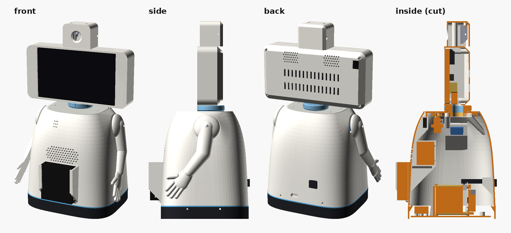

# LittleBot v3 "Bell"

A smooth bell-shaped body on a dark base ring, a head the shape of its 7" touch screen (52Pi / GeeekPi
EP-0177) turning on v2's geared neck, a camera pod on the head, and one-piece arms with hands.



- **Few, big parts:** 9 printed parts on 4 plates of a Bambu Lab A1 (256 mm).
- **Everything from v2 that works is reused as printed:** the floor with the Pi 5 + UPS, the stack keeper, the PCA9685 clamps, the neck coupler, ring gear, pinion and servo frame, and the camera bracket.
- **Nothing touches the screen's glass.** The screen hangs on its own 4 corner standoffs, screwed from behind. A bezel, flush with the head's front, closes the head around the glass but stays 0.6 mm off its edges and never covers it, so touch works right to the edge. The head's back cover comes off on its own (4 screws) to reach everything inside.
- **Every plug hides inside the head:**
  - flat-ribbon HDMI with an angled plug;
  - right-angle USB-C;
  - the HDMI coupler with your original cable's plug, which clips onto the head's floor.
- **Wheels later:** the dark base ring and v2's floor are the only parts a wheeled version replaces. The body's sides stay clear inside for the wheels.

## Files

| File | What |
|---|---|
| `littlebot_v3.scad` | the model (it includes `../enclosure_v2/littlebot_v2.scad` for the reused parts) |
| `LittleBot_v3_A1.3mf` | **the Bambu Studio project: 4 plates, colours, supports and brims set** |
| `LittleBot_v3_assembled.3mf` | the whole robot assembled and coloured, to look at (not to print) |
| `stl/*.stl` | each part on its own, already in its print orientation |
| `plates_v3.png` | top view of the 4 plates |
| `checks_v3.scad`, `run_checks_v3.sh` | 50 checks (`OPENSCAD=... ./run_checks_v3.sh`), all passing: interference, finger pinch, the bezel never within 0.3 mm of the glass, and room behind the screen to push each plug in |
| `make_v3_project.py` | packs `stl/` onto the plates and writes the project |
| `make_v3_assembly.py` | writes the assembled 3MF from `stl/assembled/` (see below) |
| `concepts/` | the concept the design follows |

Re-make the STLs after changing the model. Run from this folder:

```bash
for w in body ring neck_plate head_frame head_back pod arm_left arm_right ups_slider; do openscad -o stl/$w.stl -D 'part="print"' -D "which=\"$w\"" littlebot_v3.scad; done
```

```bash
python3 make_v3_project.py
```

The assembled 3MF (28 parts, made by `assy_v3()`):

```bash
mkdir -p stl/assembled; for w in ring ring_band body neck_plate ups_slider arm_left arm_right head_frame head_back pod camera_bracket floor floor_clips coupler gears servo_frame servos pi_ups pca speaker mic aa_box charge_socket screen screen_plugs face eyes camera; do openscad -o stl/assembled/$w.stl -D 'part="assy"' -D "which=\"$w\"" littlebot_v3.scad; done
```

```bash
python3 make_v3_assembly.py
```

## Printing (Bambu Lab A1, PLA, 0.20 mm Standard, Textured PEI plate)

Filament slots: **1 white**, **2 dark grey**, **3 light blue**. Bambu Studio maps them to your AMS slots when you print.

| Plate | Colour | Parts (orientation) | Notes |
|---|---|---|---|
| 1 | white | **body** (upright), **left arm** (inside the body's footprint, flat), **camera pod** (top down) | 5 mm brim on the body only. Lift the body off; the arm stays on the plate. |
| 2 | white | **head frame** (face down), **head back cover** (back face down) | **Tree supports, from the build plate only,** on the head frame: they go under its 4 screen bosses, inside the screen opening. Pull them out with pliers. |
| 3 | dark → blue → dark | **base ring** (upright), **UPS switch slider** (top down) | The plate switches to blue at 22 mm and back to dark at 24 mm: that's the accent line. If Bambu Studio's preview doesn't show the blue band, right-click the ring → *Add height range modifier* → 22–24 mm → filament 3. |
| 4 | white | **right arm** (flat), **neck plate** (top face down) | |

Every part was checked for overhangs in its print orientation. Only the head frame needs supports. The rest is short bridges: the shoulder-servo slots (33 mm), the slider tunnel and the cable sleeves.

## What to buy (on top of v2)

| Item | Why |
|---|---|
| CY "Ultra Slim Angled HDMI Male to Straight HDMI Male FPC flat cable" (20 cm) **+ an HDMI female-female coupler** | The angled plug goes into the screen; the coupler takes your original micro-HDMI–HDMI cable, all inside the head. If the ribbon leaves the angled plug towards the glass, just fold it back flat. |
| Right-angle USB-C (screen end) to USB-A (Pi end) **data** cable, 3 ft | The screen's power + touch. Turn the L-plug so the cable goes backwards. |
| 4×AA holder with switch (≈ 65 × 70 × 20 mm) + 4 NiMH AA cells | Servo power, in the front cradle. Red → PCA9685 V+, black → GND. |

The screen's 4 corner screws are **M2.5 × 6 from the UPS kit's leftovers**, or M3 × 6 from the kit if the standoffs turn out to be M3.

## Screws and nuts (all M3 button heads from the kit unless noted)

| Where | Screws | Into |
|---|---|---|
| Base ring → v2 floor | 4 × M3 × 12, through the ring's sides | the floor's 4 well-cover posts (holes threaded by v2's covers) |
| Body → base ring | 4 × M3 × 10, through the body's front (under the AA box) and back | nuts dropped into slots in the ring's 4 tabs |
| Neck plate → body | 4 × M3 × 8, from the top | nuts dropped into the body's 4 ledge bosses |
| Ring gear → coupler; servo frame collars | as v2 (3 × M3 × 12; 2 × M3 × 10) | v2's threaded holes |
| Head frame → coupler | 3 × M3 × 12, down through the head's floor | the coupler's v2 holes |
| Screen → head frame | 4 × M2.5 × 6 (or M3 × 6), from behind | the screen's own corner standoffs |
| Back cover → head frame | 4 × M3 × 12, from behind | nuts slid into the frame's 4 corner bosses |
| Camera pod → head frame | 2 × M3 × 12, down the pod's two wells | nuts slid into the bosses under the head's roof (from behind, cover off) |
| Camera bracket pivots | 2 × M3 × 12 through the pod's sides | the bracket (v2) |
| Arm servos | their own screws, from outside through the shoulder slot | the shoulder seats |
| Arms | the servo horn's screws + 1 spline screw each | (swap an arm: 1 screw) |

M3 nuts: 4 (ring tabs) + 4 (neck plate) + 4 (back cover) + 2 (pod) = **14**.

## Assembly order

1. **Neck plate (on the bench):**
   - Put v2's coupler down through the plate's hole and screw the ring gear to it from below.
   - Hang the servo frame (with the head servo and pinion) on the plate's two pillars.
   - Mesh the gears with the servo centred and the coupler's 290° screw hole pointing forwards, as in v2.
2. **Arm servos:** slide each in from outside through its shoulder slot and screw its tabs.
3. **Body onto the base ring:**
   - Drop the 4 nuts into the ring's tab slots.
   - Lower the body onto the ring's lip.
   - Fit 4 × M3 × 10.
4. **UPS slider:** push it in from outside through the slot in the body's back, fork first.
5. **v2 floor:**
   - Turn the robot upside down so the floor rests on the ring's stops.
   - Fit 4 × M3 × 12 through the ring's sides.
   - Turn it upright, then work the slider so the switch's knob sits between its tines. The flared fork finds the knob either way.
6. **Neck plate in:**
   - Thread the cables up first (each USB-A plug, then the micro-HDMI end).
   - Drop 4 nuts into the ledge bosses.
   - Set the plate in and fit 4 × M3 × 8.
7. **Head:**
   - Coupler screws: 3 × M3 × 12 down through the frame's floor. The front one is under the screen, so fit them before the screen.
   - Screen: in from the front through the bezel, with nothing plugged in yet, then 4 corner screws from behind.
   - Plug in from behind: the angled ribbon HDMI, the right-angle USB-C, and the coupler with the original cable in its clips. Each end of the head has room for a plug plus its push-in travel.
   - Camera pod: its 2 nuts go in from behind, then 2 screws from the top.
   - Back cover: 4 × M3 × 12.
8. **Arms:** fit the horn on each arm, push it onto its spline at the neutral angle, and fit the spline screw.
9. **AA box:** slide it down into the front cradle, switch facing out. Its leads go through the slot under it, to the PCA9685.

**Arm range:** −90° to **+95°**. Set 95° as the arms' maximum in calibration. At 100° a raised arm comes within 12 mm of the head when the head is turned 60°.

## Measure before printing the head

| Parameter | Default | What to measure |
|---|---|---|
| `scr_standoff_h` | 3 mm | how far the screen's corner standoffs stand off its board |
| `scr_holes` | 4.7 mm from the sides, 5.15 mm from top and bottom | the corner standoffs' centres, from 52Pi's drawing (±0.5 mm) |
| `spk_box_h` | 9 mm | how far the screen's speaker boxes stand off its board |
| `bat` | 65 × 70 × 20 mm | your AA holder: width, height, thickness |

## Known

- The AA box cradle stands about 23 mm proud of the front, because the box is 20 mm thick. Recessing it would mean moving the speaker. Say if you want it.
