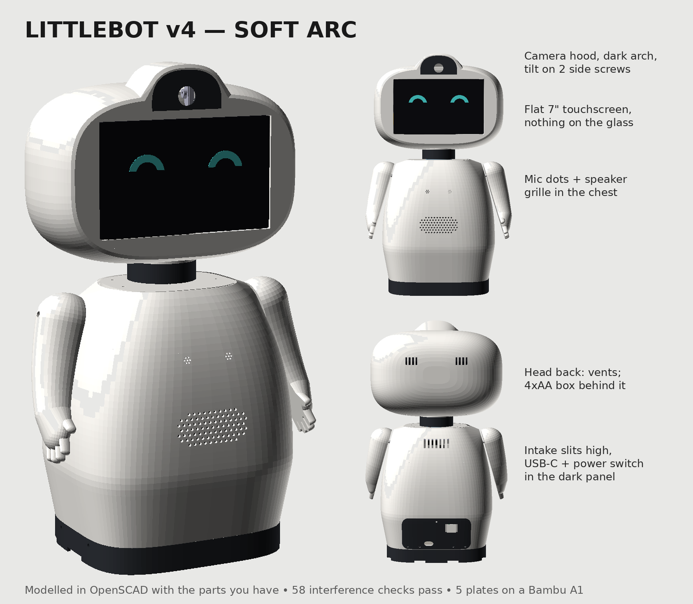
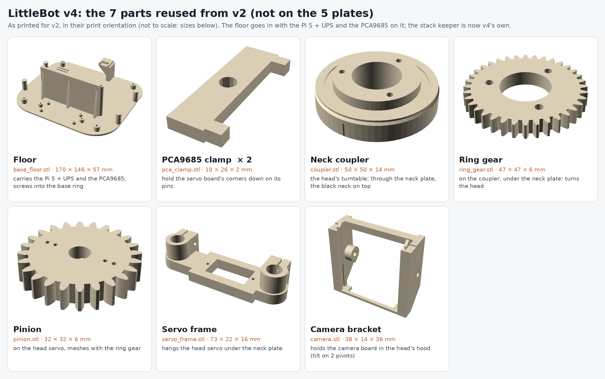
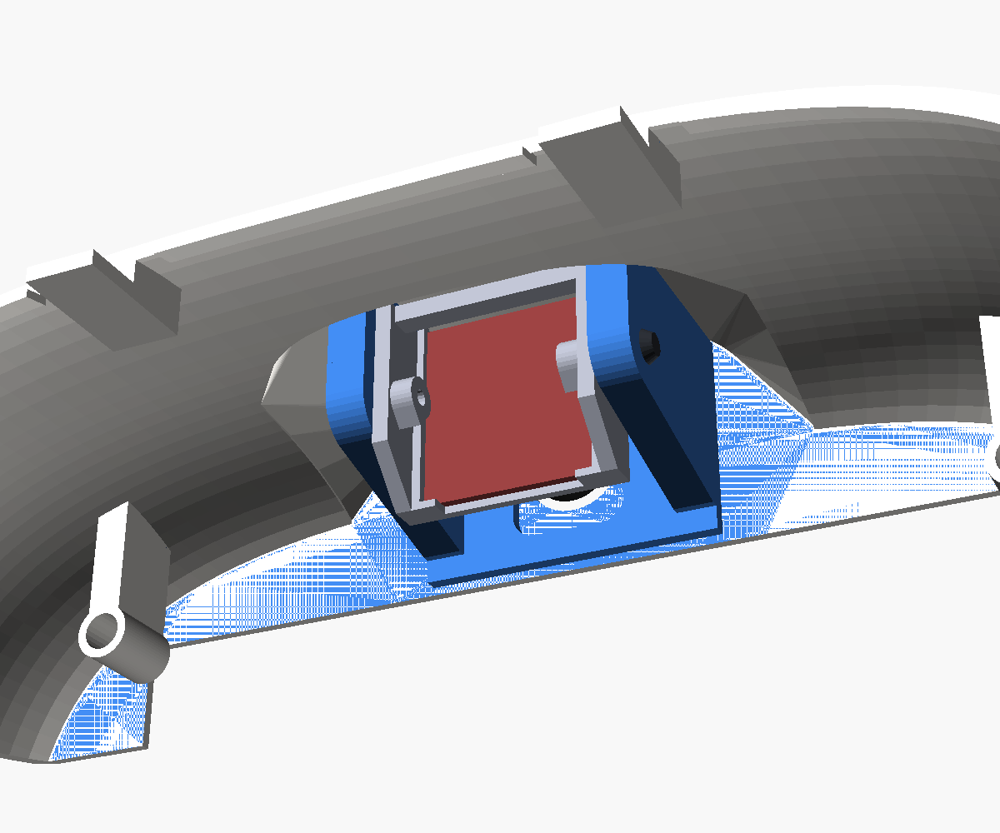
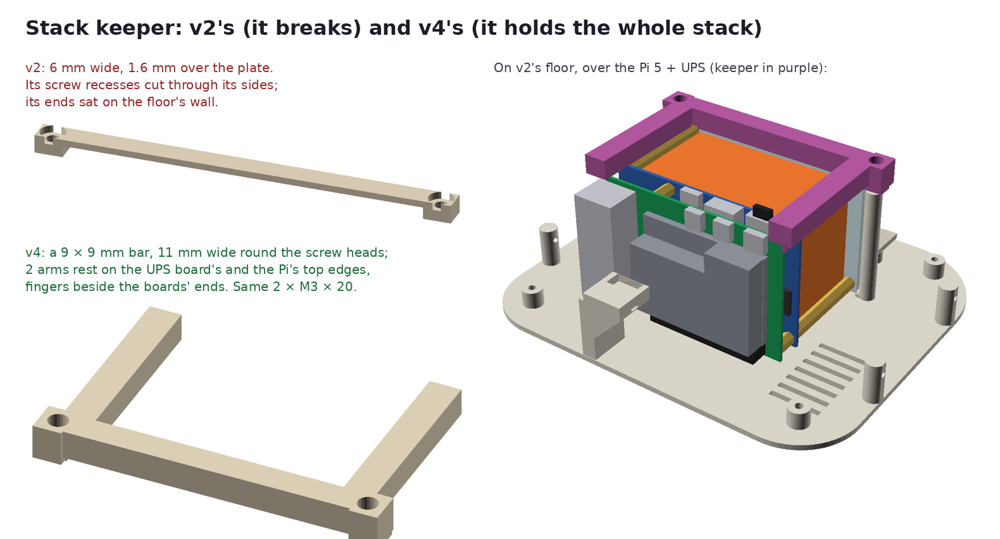
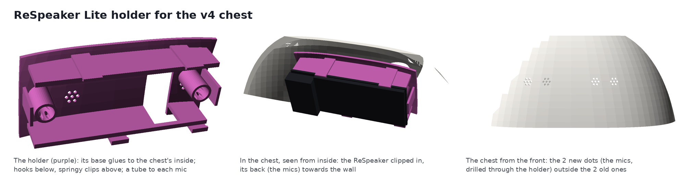

# LittleBot v4 "Soft Arc"

The Soft Arc concept, built from the parts you already have:
- a round head around the 7" touch screen (52Pi EP-0177), with a camera hood and a dark arch on top;
- a black neck;
- a smooth egg of a body on a dark base;
- chunky one-piece arms with hands.



To look like the concept, v4 is bigger than v3: 437 mm tall, the head 242 × 158 × 131 mm, the body 208 × 182 mm. v2's neck parts are unchanged, but the whole neck stands 45 mm higher, so the body can be a taller egg.

## What goes where, and why

| Where | What | Why |
|---|---|---|
| Head | A superellipsoid (round every way) with its front cut flat for the face, and a soft bevel round the face | The concept's round head. The screen sits in the flat face, 0.6 mm off the glass's edges all round: nothing touches or covers the glass. |
| Head, top | The camera hood with a dark arch printed into the face | The head frame's first 8 layers use the 2nd filament. v2's camera bracket hangs between 2 cheeks (walls fused to the face and the roof) on 2 pivot screws, driven from inside the head, so the tilt is adjustable. |
| Head, inside | The HDMI ribbon plug, the right-angle USB-C and the HDMI coupler | All hidden. Each end of the head has room to push a plug in from behind. |
| Head, back half | The 4×AA servo box, standing behind the neck, lid backwards | Take the back off (2 screws from under the head) to swap the cells. The box balances the screen's weight. Its leads go down the neck to the PCA9685. |
| Head, back | 2 × 4 slits, as the concept | Vents. |
| Neck | A black puck on v2's coupler, under the head | It turns with the head and raises it 8 mm, so the black neck shows. |
| Chest | 4 dots of 7 small holes (the ReSpeaker Lite's 2 mics behind the outer pair), and a speaker grille | The ReSpeaker Lite sits in a holder glued inside the chest, its mics facing out. The USB speaker sits behind the grille, facing forward. |
| Back, high | 7 intake slits | Fresh air in. |
| Back, low | A dark panel with the USB-C charging socket and the UPS power switch | The switch's white tab stands 5 mm out of the panel: push it left or right. |
| Base (inside) | Pi 5 + UPS on v2's floor | The Pi's fan blows down through the floor's vents and out through the notches under the base. |
| Arms | Shoulder, arm and hand in one smooth piece | They splay out 16° and stand clear of the body. Each hand has 4 fingers and a thumb at the front. |

Reused as printed (not on the plates):
- **from v2:** the floor (Pi 5 + UPS), the PCA9685 clamps, the coupler, the ring gear, the pinion, the servo frame and the camera bracket;
- **from v3:** the neck plate, if you printed it (v4's is identical): then skip plate 5.



Everything else is new. That includes the base ring (v3's shape, with its 4 screw tabs moved to the back), the UPS slider (13 mm longer than v3's, so its tab reaches out through the dark panel) and the stack keeper (much stronger than v2's: below).

## Files

| File | What |
|---|---|
| `littlebot_v4.scad` | the model (it includes `../enclosure_v3/littlebot_v3.scad`, which includes v2) |
| `LittleBot_v4_A1.3mf` | **the Bambu Studio project: 5 plates, colours, supports and brims set** |
| `LittleBot_v4_extras_A1.3mf` | one plate: the ReSpeaker Lite's holder, the glue-in camera cradle (only for a head frame printed before 10 Nov 2026) and v4's stack keeper |
| `LittleBot_v4_assembled.3mf` | the whole robot assembled and coloured, to look at (not to print) |
| `stl/*.stl` | each part on its own, in its print orientation (`head_inlay` is the head frame's dark arch; `camera_cradle` only for a head frame printed before 10 Nov 2026) |
| `plates_v4.png` | top view of the 5 plates |
| `plates_v4_extras.png` | top view of the extras plate (mic holder, camera cradle, stack keeper) |
| `checks_v4.scad`, `run_checks_v4.sh` | 68 checks (`OPENSCAD=... ./run_checks_v4.sh`), all passing. They cover interference, the arms' sweep and finger pinch with the head turned, the glass never touched, room to push each plug in, the slider, the AA box in the head, the speaker and mic, the dark panel, the camera's pivot screws (a clear path in, and they reach the bracket), the glue-in camera cradle, the stack keeper (it fits, and its arms rest on the boards) and the ReSpeaker's holder (on the chest's inside round the old mic sleeve, the board clear of everything). |
| `LittleBot_v4_assembly.mp4` | **the assembly video** (4 minutes): every part, screw, nut and cable going in, in the order below, each screw turned in by its tool with its size on a tag |
| `assembly_video/` | re-makes the video (`OPENSCAD=... ./make_video.sh`). The screws, nuts, cable routes and part positions come from the model (`video4.scad`). |
| `export_v4.sh`, `make_v4_project.py`, `make_v4_assembly.py` | re-make the STLs, the project and the assembled 3MF |

Re-make everything after changing the model. Run from this folder:

```bash
OPENSCAD=openscad ./export_v4.sh
```

```bash
python3 make_v4_project.py
```

```bash
python3 make_v4_assembly.py
```

## Printing (Bambu Lab A1, PLA, 0.20 mm Standard, Textured PEI plate)

Filament slots: **1 white**, **2 dark grey**.

| Plate | Colour | Parts (orientation) | Notes |
|---|---|---|---|
| 1 | white | **body** (upright), **both arms** (flat, inside the body's footprint), **UPS slider** | 5 mm brim on the body. |
| 2 | white + dark | **head frame** (face down) | The dark arch is part of the same print: its first 8 layers switch filament where the arch is. **Tree supports from the build plate**, under the screen's 4 bosses. |
| 3 | white | **head back** (rim down) | **Tree supports from the build plate**, inside its dome. |
| 4 | dark | **base ring** (upright), **black neck** (top down), **port panel** (upright, as it sits), **stack keeper** (top face down) | 3 mm brims on the panel and the keeper. |
| 5 | white | **neck plate** (top face down) | Skip it if you printed v3's: it's the same part. |

## What to buy

Nothing new. You already have, from v3's list:
- the angled ribbon HDMI cable + an HDMI coupler;
- the right-angle USB-C cable;
- the 4×AA holder with a switch, and 4 NiMH AA cells.

Because everything is 45 mm taller than v3, a few leads have to reach further:
- **AA box leads:** extend them by about 45 cm of 2-core wire, from the head down the neck to the PCA9685. A spare servo extension lead works.
- **Servo leads:** the 3 servo leads run about 4 cm further than in v3. If yours don't reach the PCA9685, add 15 cm servo extension leads.

## Screws and nuts (M3 button heads from the kit unless noted)

| Where | Screws | Into |
|---|---|---|
| Base ring → v2 floor | 4 × M3 × 12, through the ring's sides | the floor's 4 posts |
| Body → base ring | 4 × M3 × 12, through the dark panel and the body's back, just above the ring | nuts dropped into the ring's 4 tabs |
| Dark panel, top | 1 × M3 × 8 | a pilot hole in a boss inside the back |
| Neck plate → body | 4 × M3 × 8, from the top | nuts dropped into the body's 4 ledge bosses |
| Ring gear → coupler; servo frame collars | as v2 (3 × M3 × 12; 2 × M3 × 10) | v2's threaded holes |
| Black neck → coupler | 3 × M3 × 12, down through the puck (heads sunk) | the coupler's own holes |
| Head → black neck | 3 × M3 × 10, down through the head's floor | pilot holes in the puck |
| Screen → head frame | 4 × M2.5 × 6 (or M3 × 6), from behind, down the 4 wells | the screen's corner standoffs |
| Head back → head frame | 2 × M3 × 12, from under the head | the frame's 2 bosses (2 tabs hold the back's top) |
| Camera bracket | 2 × M3 × 12, from inside the head (2 mm L-key), through the 2 cheeks | the bracket's pivots |
| Arm servos, arms | as v3 | |

In total: 18 × M3 × 12, 5 × M3 × 10, 5 × M3 × 8 and 8 M3 nuts (v2's neck screws included).

## Assembly order

1. **Neck plate, on the bench (as v3):**
   - Put v2's coupler through the plate.
   - Screw the ring gear to it from below.
   - Hang the servo frame with the head servo and pinion, and mesh the gears with the servo centred.
2. **Black neck:** screw the puck onto the coupler (3 × M3 × 12).
3. **In the body:**
   - Arm servos: slide each in from outside through its shoulder slot and screw its tabs.
   - Speaker: push it into its ribs behind the grille.
   - Mic: the ReSpeaker Lite in its holder (see *The mic* below).
4. **Body onto the base ring:**
   - Drop 4 nuts into the ring's tabs and lower the body onto the ring's lip.
   - Slider: push it in from outside through the slot in the back, fork first.
   - Dark panel: hold it on and fit the 4 × M3 × 12 along its bottom, then 1 × M3 × 8 at its top.
5. **v2 floor:**
   - Turn the robot upside down and fit 4 × M3 × 12 through the ring's sides.
   - Turn it upright and work the slider so the switch's knob sits in its fork.
6. **Neck plate in:**
   - Thread the cables up first: HDMI, USB-C, camera USB, and the AA box's leads.
   - Drop 4 nuts into the ledge bosses.
   - Set the plate in and fit 4 × M3 × 8.
7. **Head:**
   - Head onto the puck: 3 × M3 × 10 down through its floor.
   - Screen: in through the face, then 4 corner screws from behind.
   - Plug in from behind: the ribbon HDMI, the right-angle USB-C, and the coupler with the original cable in its clips.
   - Camera:
     - clip the board into v2's bracket;
     - set the bracket between the 2 cheeks from below, lens forwards;
     - fit the 2 pivot screws from inside the head, through the cheeks (2 mm L-key);
     - set the tilt and tighten.
   - AA box: stand it between its rails behind the neck, lid backwards, with its leads down the neck.
   - Back: hook its 2 slots over the frame's tabs, swing it down and fit 2 × M3 × 12 from under the head.
8. **Arms:** fit the horn on each arm, push it onto its spline at the neutral angle, and fit the spline screw.

**Arm range:** −90° to **+95°**, checked with the head turned ±60°.

### Head frame printed before 10 Nov 2026: the glue-in camera cradle

That head frame held the camera bracket on 2 small holders that touch the roof by a sliver only (they wobble and break), and its screws had no way in. Don't reprint the head frame for it:

1. Snap the 2 holders off with pliers and trim what's left flush.
2. Print `LittleBot_v4_extras_A1.3mf` (the cradle, v4's stack keeper and the mic holder on one plate), or just `stl/camera_cradle.stl`: white, plate down, no supports, about 22 g.
3. On the bench: clip the camera into v2's bracket and set the bracket between the cradle's 2 cheeks, lens through the window. Fit 2 × M3 × 12 from outside the cheeks into its pivots, set the tilt and snug them.
4. Scuff the cradle's plate and the inside of the face above the screen. Glue the plate flat onto the face (CA gel or 2-part epoxy), with the lens centred in the face's lens hole. Then plug the 5-pin cable into the board's back.

The tilt stays adjustable: the 2 screws are reached from behind, with the head's back off.



### The stack keeper is v4's own

v2's keeper was a 1.6 mm bar (0.6 mm over its V-groove) so it fitted under v2's base. Its screw recesses were wider than the bar, and its ends sat 0.65 mm into the floor's front wall, so tightening the screws bent it: it broke. v4 has room above the stack: a 9 × 9 mm bar, 11 mm wide round the screw heads, clear of the wall. Two arms reach back over the stack's ends and rest on the UPS board's and the Pi's top edges (clear of their ports, the standoffs and the switch slider), so the Pi end can't rock, and 3 fingers beside the boards' ends stop the stack sliding along its plate. It goes on the same floor with the same 2 × M3 × 20 (the heads sit 9 mm down: a 2 mm hex key). It's on plate 4 and in `LittleBot_v4_extras_A1.3mf`; print it top face down. If the Pi end still moves, a strip of foam tape under each arm takes up the play.



### The mic: a ReSpeaker Lite in a holder

The mic is a Seeed ReSpeaker Lite (USB, 2 mics, 82 × 34 mm), not v2's Adafruit USB mic: the chest's old mic pocket is too small for it. Its holder (`stl/mic_holder.stl`, in `LittleBot_v4_extras_A1.3mf`) glues to the inside of the chest and fits round the old pocket, so nothing has to be cut off. The board lies across the chest with its back (the mics' side) towards the wall and its USB-C towards the robot's left (+x, the Pi's USB end). Rigid hooks hold its lower edge and springy clips its upper edge; they touch only the bare 0.6 mm strip along its edges. A tube runs from each mic to its dot. Sizes are from Seeed's 3D model of the board (v1.1).

1. Print the holder: base down, **tree supports from the build plate** under its curved base (set in the 3MF), about 12 g.
2. **Body printed before 10 Nov 2026** (it has only the 2 old dots): push a toothpick through the middle hole of the right dot, from outside. Fit the holder over it from inside, its cut-out round the old mic pocket, and glue its base to the wall (CA gel or 2-part epoxy; scuff both faces first). When it's set, drill the 2 new dots from inside through the holder's guide holes (14 holes, 1.5 or 1.6 mm drill), down the 2 tubes.
   **Body printed since:** it has the 2 new dots already. Line the holder up with toothpicks through them, glue it, nothing to drill.
3. Plug a USB-C data cable into the board first (a 30–50 cm USB-C to USB-A cable to a Pi USB port). Then hook the board's lower edge under the 2 hooks, back towards the wall, and press its upper edge in until the 2 clips click over it.



## Measure before printing

| Parameter | Default | What to measure |
|---|---|---|
| `scr_standoff_h` | 3 mm | how far the screen's corner standoffs stand off its board |
| `scr_holes` | from 52Pi's drawing | the corner standoffs' centres (±0.5 mm) |
| `bat` | 65 × 70 × 20 mm | your AA holder: width, height, thickness (its rails in the head follow it) |

## Known

- The camera's 2 pivot screws are inside the head: reach them from behind with the back off. They're what makes the tilt adjustable.
- The neck plate shows as a flat oval round the neck on top of the body. v2's neck parts drop in from the top, so the opening is the plate's size.
- 5 plates rather than 4: the bigger head's back and the neck plate no longer fit on one plate.
- The head frame is 242 mm wide on the A1's 256 mm bed: centre it if you move it.
