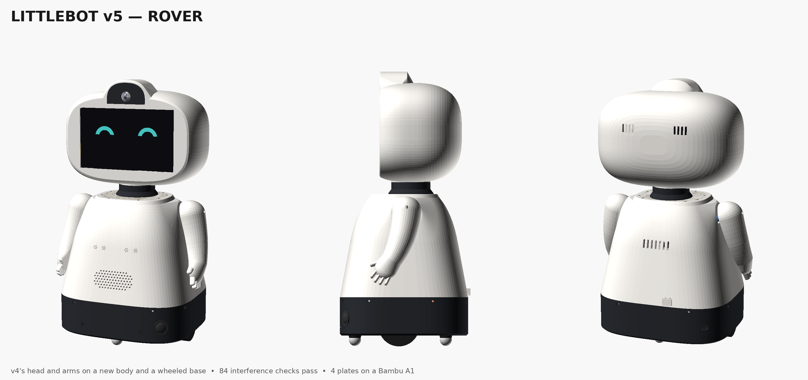
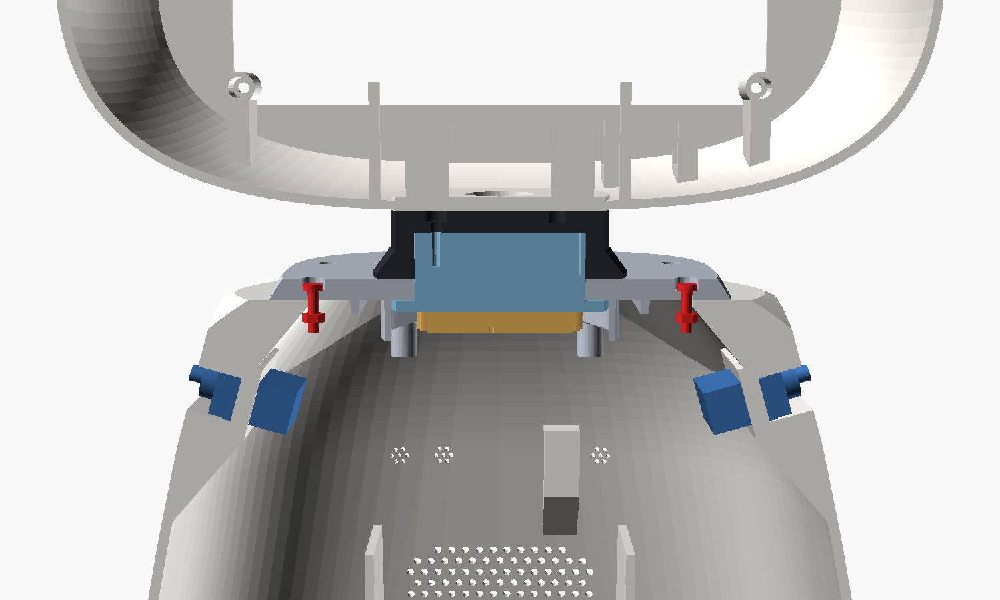
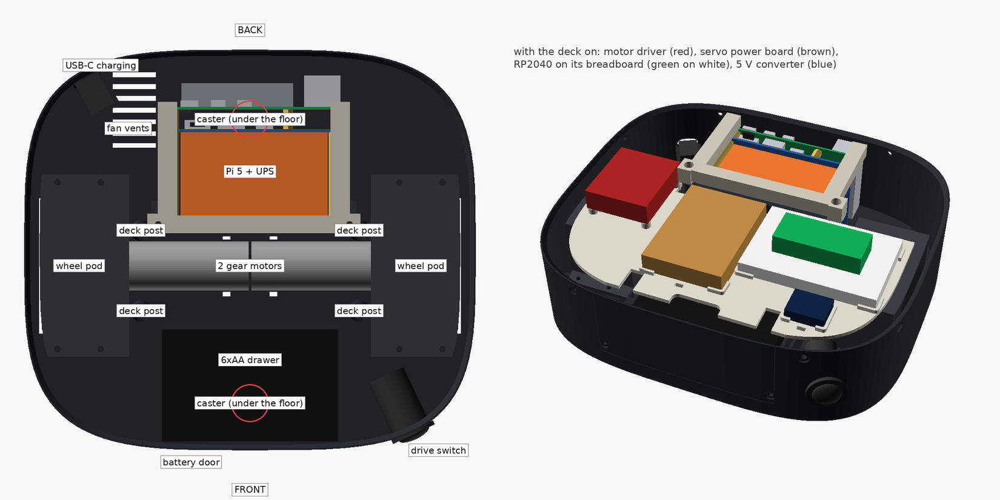
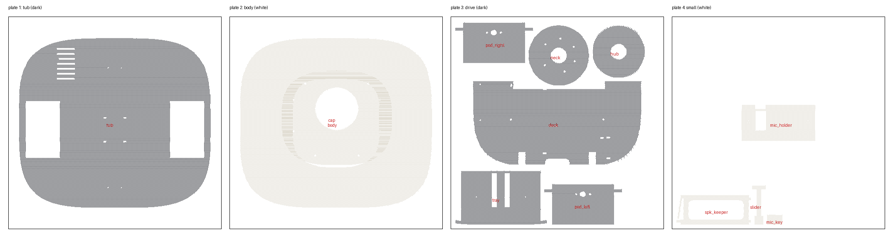

# LittleBot v5 "Rover"

v4's head and arms on a new body and a wheeled base. Two things drove it:
- **wheels:** two gear motors, two ball casters, their battery and their electronics need a base built for them;
- **strength:** v4's body held the neck and head on 4 thin bosses, and its base ring by 4 screws at the back. v5 bolts every joint through thick plastic into a nut that the part itself holds.

Same height as v4 (437 mm). The base is 230 × 204 mm (v4: 186 × 160), with 17 mm of ground clearance.

## What changed, and why

| Where | v4 | v5 | Why |
|---|---|---|---|
| Top of the body | a 3 mm plate inside the opening, on 4 thin bosses; its 4 nuts sat *above* the bosses, so nothing held the plate down | a 6 mm cap over the whole top, 8 screws down into nuts inside a solid collar that is part of the body's wall | the head's weight and any pull on it go into the wall all round, not into 4 prongs |
| Neck bearing | a 50 mm flange on the 3 mm plate | a 62 mm flange under the cap and a 72 mm foot on top of it | the head rocks less; lifting the robot by its head pulls the flange against the cap, not on screws |
| Head to neck | 3 screws into holes in the black neck | 3 screws (M3 × 20) through the black neck into nuts in the hub | a real clamp, and it can be undone many times |
| Body to base | 4 screws at the back, a lip at the front | 8 screws all round into nuts in a tongue that plugs 10 mm into the base | the body can't rock on the base |
| Base | a ring round v2's floor | a tub: 3.5 mm floor, 3 mm walls 61 mm high | it carries the motors, the casters and both batteries |
| Body shape | an egg, narrow at the bottom | a bell: v4's egg above the shoulders, a straight line down to the base | room for the wheels, and a wider stance |
| Wall | 2.6 mm | 3.0 mm | |
| Servo battery | 4×AA box in the head, leads down the neck | none: one 6×AA drawer in the base feeds the wheels and the servos | less weight up high, one pack to charge |
| Servo driver | PCA9685 | the RP2040 drives the servos and the wheels | one board fewer |
| Mic, speaker | dots at 187 mm, speaker at 128 mm | dots at 166 mm, speaker at 116 mm | they moved down, below the new collar |

## The base

| Where | What | Notes |
|---|---|---|
| Middle, both sides | **Wheel pods.** Each motor (JGA25-370 with encoder) screws by its face to a pod's plate; the pod covers the wheel and screws down onto 2 ridges in the tub | Motor, coupler and wheel go on at the bench. The wheels show only under the floor. |
| Front and rear, on the centre line | **Ball casters** (Pololu 3/4" metal), in square recesses under the floor | They stand 0.8 mm off a flat floor, so the wheels always carry the robot and it can't hang up on the casters. Add the caster's own thin spacer if it rocks too much. |
| Behind the motors | **Pi 5 + UPS**, on v2's V-groove mount and v4's keeper | The same mount as before, 19 mm higher (over the rear caster's screws). |
| In front of the motors | **6×AA drawer.** Its front is the battery door | 2 screws, then it slides out on its leads. |
| Front, beside the door | **Drive switch** (a 20 mm round rocker), in the tub's wall | It switches the 6×AA pack: wheels and servos. The Pi has its own switch at the back. |
| Over the motors | **Deck**, on 4 posts: RP2040 on its breadboard, motor driver, servo power board, 5 V converter | Wired at the bench, then 4 screws. |
| Back, left corner | **USB-C charging socket** for the UPS (the extension cable, as v4) | Square to the wall. |
| Back of the body, low | **UPS switch slider** | As v4's, shorter. |

The motors' tails rest in 2 saddles with zip-tie slots. The Pi's fan blows down through the floor's vents; fresh air comes in through the slits on the back.

## Files

| File | What |
|---|---|
| `littlebot_v5.scad` | the model (it includes `../enclosure_v4/littlebot_v4.scad`, and through it v3 and v2) |
| `LittleBot_v5_A1.3mf` | **the Bambu Studio project: 4 plates, colours, brims and the one support set** |
| `LittleBot_v5_assembled.3mf` | the whole robot assembled and coloured, to look at (not to print) |
| `stl/*.stl` | each new part on its own, in its print orientation |
| `plates_v5.png` | top view of the 4 plates |
| `checks_v5.scad`, `run_checks_v5.sh` | 84 checks (`OPENSCAD=... ./run_checks_v5.sh`), all passing: nothing overlaps; the drawer slides out; the body goes on over everything in the base; the neck goes in from the top; every screw's path is clear and every nut has plastic in front of it; the arms' sweep and finger pinch with the head turned; the slider; the mic holder and the speaker keeper |
| `export_v5.sh`, `make_v5_project.py`, `make_v5_assembly.py` | re-make the STLs, the project and the assembled 3MF |
| `pics_v5.scad`, `make_pics_v5.sh` | re-make this page's pictures |

## What you keep, what you print

**Keep, as printed:**
- from v4: the head (frame and back), both arms, the stack keeper;
- from v2: the ring gear, the pinion, the servo frame, the camera bracket.

**No longer used:** v4's body, base ring, neck plate, black neck, port panel and slider; v2's floor, coupler and PCA9685 clamps; v4's mic holder, key and speaker keeper (the new body needs its own: the mic sits lower).

**Print (Bambu Lab A1, PLA, 0.20 mm Standard, Textured PEI plate; slots: 1 white, 2 dark grey):**

| Plate | Colour | Parts (orientation) | Notes |
|---|---|---|---|
| 1 | dark | **tub** (floor down) | 230 × 204 mm: centre it. No supports: the casters' recesses bridge. |
| 2 | white | **body** (upright, tongue down), and inside its footprint the **cap** (top face down) | 5 mm brim on the body. No supports: the collar under the cap is 45° underneath, and the speaker's ribs start on the plate. |
| 3 | dark | **deck** (flat), **drawer** (tray down, door standing), **both wheel pods** (plate down), **black neck** (top down), **hub** (flange down) | 3 mm brim on the drawer. The deck and the hub can be any colour: they don't show. |
| 4 | white | **mic holder** and **key**, **speaker keeper**, **slider** | Tree supports from the build plate under the mic holder only, as v4. |

## What to buy

The list from before stands (2 × JGA25-370 6 V / 170 RPM kits with 65 mm wheels, 6×AA holder, RP2040 core board, Cytron MDD3A, DFRobot DFR0753 5 V converter, breadboard, 2 × Pololu 3/4" ball casters, perfboard, pin headers, 5 A fuse and holder, wire, 22 kΩ and 10 kΩ resistors). Three things to add or pin down:

- **the switch:** SparkFun's round rocker with a blue LED (COM-11155; RobotShop RB-Spa-2450): on/off, 16 A at 12 V, snaps into a 20.2 mm hole. The tub has that hole. Its LED lights from 5 V; leave its third tab unconnected if you don't want the light.
- **M3 nuts:** 19 (8 body, 8 cap, 3 head). v4 used 8.
- **3 × M3 × 20** for the head (the stack keeper already uses 2).

Not needed any more: the PCA9685 and both 4×AA holders.

## Screws and nuts

| Where | Screws | Into |
|---|---|---|
| Motors → wheel pods | 4 × M3 × 8 (2 each), from the wheel's side | the gearbox's own threaded holes (4.5 mm deep: nothing longer than 8) |
| Wheel pods → tub | 8 × M3 × 12 (4 each), down through the pods' flanges | holes in the tub's ridges |
| Casters → tub | the casters' own 4 × #2-56 screws, from below | their nuts, on top of the seats inside the tub |
| Stack keeper | 2 × M3 × 20, as v4 | the mount's 2 bosses |
| Deck → tub | 4 × M3 × 8 | the 4 posts |
| Motor driver → deck | 4 × M3 × 8 | the deck's 4 short posts |
| Battery door | 2 × M3 × 10, through its lower corners | the 2 posts behind it |
| Body → tub | 8 × M3 × 10, through the tub's rim | 8 nuts in the body's tongue |
| Cap → body | 8 × M3 × 12, from the top, heads sunk | 8 nuts in the collar |
| Ring gear → hub | 3 × M3 × 12, from below, as before | holes in the hub |
| Servo frame collars | 2 × M3 × 10, as before | |
| Black neck → hub | 3 × M3 × 12, heads sunk | holes in the hub's top |
| Head → neck | 3 × M3 × 20, down through the head's floor and the black neck | 3 nuts in the hub's side slots |
| Screen, head back, camera, ReSpeaker, servos, horns, arms | as v4 | |

In total for the new parts: 22 × M3 × 12, 12 × M3 × 10, 12 × M3 × 8, 5 × M3 × 20, 19 M3 nuts.

## Assembly order

1. **Wheel pods, at the bench (×2):**
   - Push the motor's boss through the pod's plate from the inside, its 2 threaded holes level.
   - Fit 2 × M3 × 8 from the wheel's side.
   - Push the coupler onto the shaft and tighten its grub screw on the shaft's flat. Fit the wheel and its centre screw.
2. **Tub:**
   - Casters: from below, into their recesses; nuts on top.
   - Pods: lower each in, wheel through the floor, and fit 4 × M3 × 12. Zip-tie each motor's tail to its saddle.
   - Pi + UPS: stand its plate in the groove and fit the keeper (2 × M3 × 20).
   - Charging cable: plug in the UPS's USB-C marked POWER; socket zip-tied into the holder at the back's left corner.
3. **Deck, at the bench:** breadboard with the RP2040 (it sticks down), motor driver on its 4 posts (4 × M3 × 8), servo power board and 5 V converter (zip ties). Wire them. Then onto the tub's 4 posts (4 × M3 × 8), and connect the motors and encoders.
4. **Drawer and switch:** snap the switch into its hole in the tub's front wall, from outside. Screw or stick the AA holder into the tray. Wire holder → fuse → switch, with enough slack for the drawer to slide out. Slide the drawer in and fit 2 × M3 × 10.
5. **Body, upside down on the bench:** drop a nut into each of the 8 slots in the tongue's edge (a dab of tape keeps them in). Arm servos, speaker and its keeper, mic holder with its key and the ReSpeaker: as v4.
6. **Body onto the tub:** push the slider in through the back first, fork inwards. Lower the body: its tongue goes inside the rim, the slider's fork over the UPS switch's knob. Fit 8 × M3 × 10 through the rim.
7. **Neck, at the bench:**
   - Hub up through the cap from below; ring gear onto the hub's flange (3 × M3 × 12 from below).
   - Slide 3 nuts into the slots in the hub's side. Black neck over the hub (its rib in the hub's groove): 3 × M3 × 12.
   - Glue the trimmed horn into the pinion, as v4. Servo frame with the head servo and pinion onto the cap's 2 pillars; mesh the gears with the servo centred.
8. **Cap onto the body:** push a nut into each of the collar's 8 slots, from inside the opening. Thread the cables up through the neck. Lower the cap in and fit 8 × M3 × 12.
9. **Head:** onto the black neck, 3 × M3 × 20 down through its floor. The rest of the head as v4, without the AA box.
10. **Arms:** as v4.

## Measure before printing

The motors, wheels, casters, AA holder, switch and boards aren't here yet. Their sizes are from drawings and listings. When they arrive, check these before printing the tub, the pods and the drawer:

| Parameter | Default | What to measure |
|---|---|---|
| `mot` | 25 × 60.7, shaft 12.1 | the motor: diameter, length without the shaft, shaft beyond the gearbox face |
| `mot_holes` | 17 mm | between the 2 threaded holes on the gearbox face |
| `wh_d`, `wh_w` | 65, 27 mm | the wheel |
| `wh_x` | to 45 mm from the gearbox face | where the wheel's outer face ends up once it is on the coupler (the pods and the floor's slots take anything up to 45 mm) |
| `cas_h` | 20.9 mm | the caster: mounting face to the ball's lowest point |
| `aa` | 90 × 57 × 16 mm | the AA holder |
| `sw_d`, `sw_fl`, `sw_len` | 20.2, 23.5, 32 mm | the switch: its hole, its flange, how far it reaches behind the wall with its tabs (only the hole is from the listing) |
| `bb`, `drv`, `perf`, `buck` | 83 × 55; 41.7 × 48.3; 50 × 70; 23 × 18 mm | the breadboard, motor driver, perfboard and converter |

The body, cap, hub, black neck and slider don't depend on any of them.

## Known

- **It is tall for its base**, like v4: about 2.8 kg, its centre of mass about 140 mm up, over the wheels' axle (estimated from the parts' volumes and listed weights). It takes a 27° tilt to tip it forwards or backwards. The firmware must ramp the speed up and down and cap it at about 0.35 m/s, so a sudden stop can't pitch it over its front caster.
- No bumper and no drop sensors: it can't see stairs or obstacles.
- The casters are 19 mm balls: they roll on hard floors and low carpet, not over door sills or play mats.
- The firmware for the RP2040 and the Pi's side of it are still to be written.
- The assembly video is still v4's.
