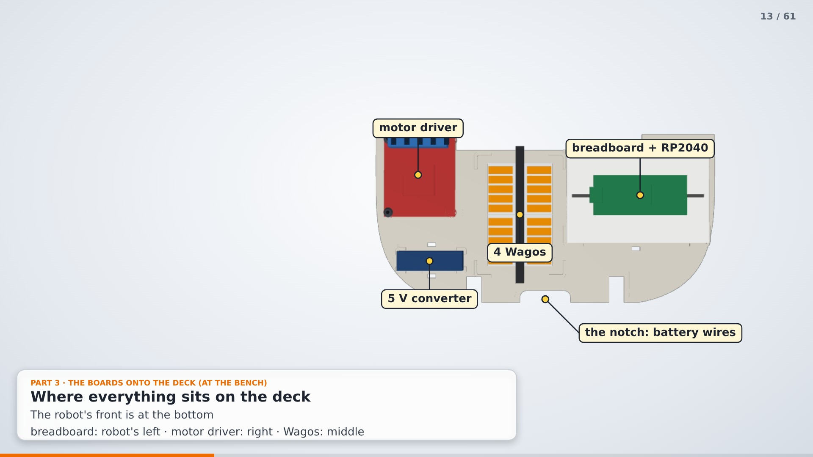
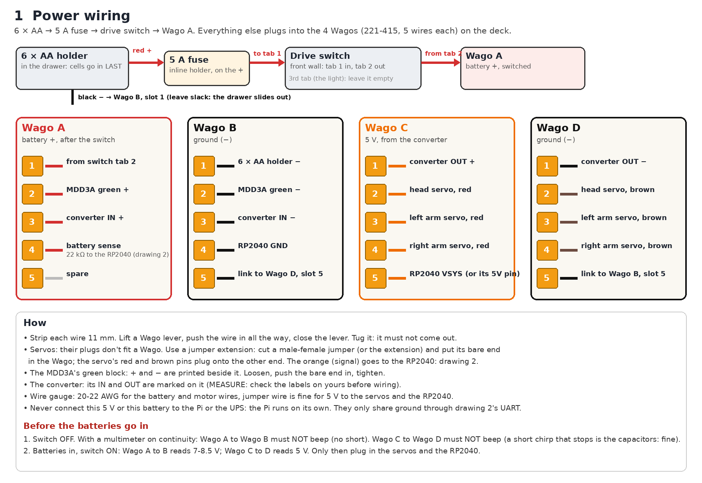
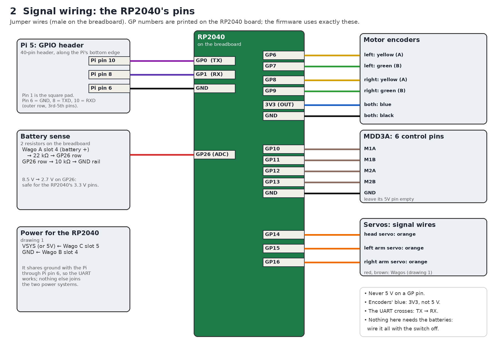
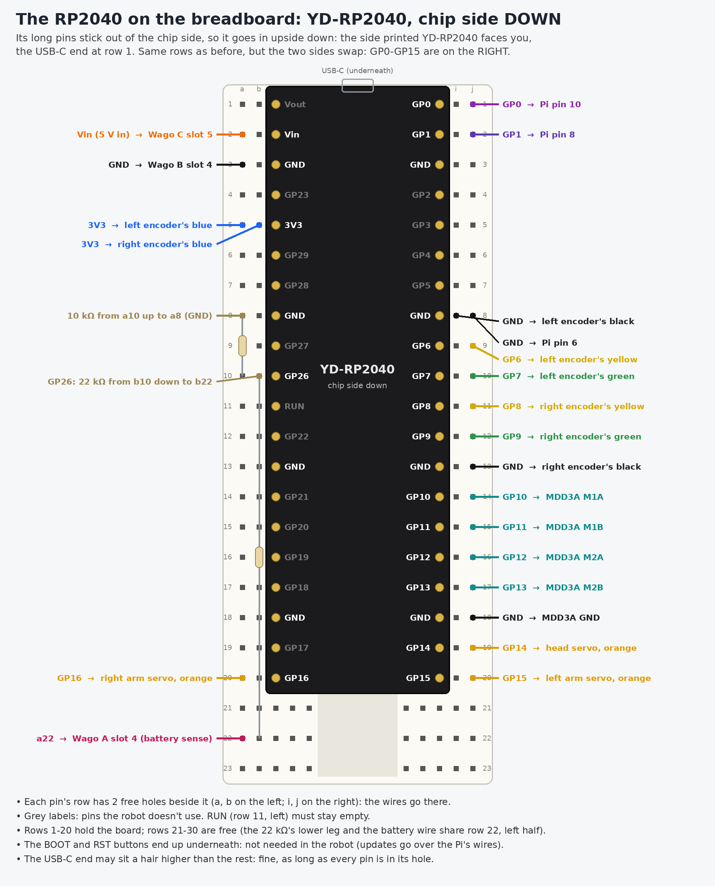
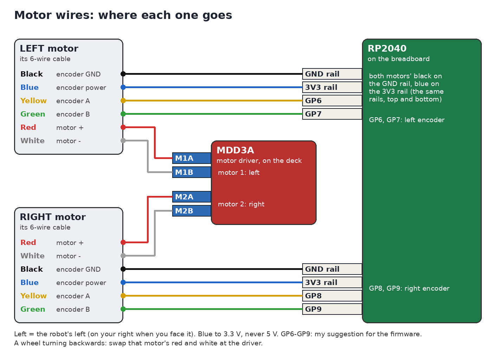

# LittleBot v5: wiring the base

**Video, with narration: [`LittleBot_v5_finish.mp4`](LittleBot_v5_finish.mp4)** (18 minutes): everything from the battery plug to the
arms, in order: the XT30 plug and fuse, the switch, the boards onto the deck, the deck onto the tub, every wire (the YD-RP2040 drawn chip
side down, as it sits), a test from the Pi, then the body, the cap, the head and the arms. The first video,
[`LittleBot_v5_wiring.mp4`](LittleBot_v5_wiring.mp4), also shows loading the RP2040's program, but draws the board chip side up.

**On the deck** ([`wiring/5_deck.png`](wiring/5_deck.png), from above, the robot's front at the bottom):

- **Breadboard:** peel the paper off its sticky back and press it into its 4 corner guides (no sticky pad: double-sided tape or hot
  glue). The RP2040's USB end points to the middle of the robot, its GP0 side to the back.
- **Motor driver:** 2 of its corner holes (the 2 nearest the middle) sit right over 2 of the tub's posts. Its 2 outer corners take
  M3 × 8 into the deck; the 2 inner ones take M3 × 16 down through the deck into the tub's posts, and hold the deck down too. The
  deck's third screw is an M3 × 8 at the back left; the front-left post is under the breadboard and stays empty.
- **Wagos:** a 2 × 2 block in the middle fence, labelled with tape: A, B on the right, C, D on the left, A and C at the front. Each
  Wago's wire holes (its clear end) face outwards: A's and B's towards the driver, C's and D's towards the breadboard. The orange
  levers' tab ends meet in the middle, back to back. Once wired, one zip tie over them through the fence's 2 slots. The 5 slots
  of a Wago are all joined inside: the slot numbers below only keep it tidy. Jumper wire is thinner than a Wago likes: strip 22 mm,
  fold the bare end in half and twist it.
- **Servo tails:** per wire, a male-to-male jumper with a male-to-female one pushed onto its end (long enough to reach up into the
  body); tape over each joint.
- **The XT30 plug:** the female half on the battery holder, the male half in the robot: its red through the 5 A fuse to a switch tab,
  its black to Wago B. The fuse sits in the bay, behind the battery door.

Three drawings, in the order you wire them. The RP2040's pins here are the ones its firmware
([`firmware/base_controller`](../../firmware/base_controller/README.md)) uses: wire exactly these.

| Drawing | What |
|---|---|
| [`wiring/1_power.png`](wiring/1_power.png) | the 6 × AA, the fuse and the drive switch, and the 4 Wagos on the deck that share out battery +, 5 V and ground |
| [`wiring/2_signals.png`](wiring/2_signals.png) | the RP2040's pins: the Pi (UART), the encoders, the motor driver's control pins, the servos' signal wires, the battery sense |
| [`wiring/3_motors.png`](wiring/3_motors.png) | each motor's 6 wires |

## 1. Power

6 × AA (in the drawer) → 5 A fuse → drive switch → Wago A. The switch has 3 tabs: with the meter on beep, use the 2 that
beep when it's ON and stay silent when it's OFF. The third tab only lights it: leave it empty.

**The battery wires: wired in for good.** The holder (DFRobot FIT0266: bare red and black leads, 150 mm) stays connected,
and the drawer slides out on its wires to change the cells:

- solder about 15 cm of extra wire onto each of the holder's leads (heat-shrink or tape over each joint): the drawer has to
  slide out about 7 cm to free all 6 cells, so the wires need about 10 cm of slack;
- the red goes to the fuse's lead (solder, insulate), the black straight to Wago B slot 1. Both run up through the hole at
  the deck's front; wire them while the deck is still out;
- the drawer goes in empty; **last:** slide it out on its wires, cells in, slide it back (the slack folds into the 21 mm
  above the holder), 2 × M3 × 10 in the door. To change the cells: switch off, 2 screws out, slide it out, swap, slide it in.

Make the joints solid and leave no bare metal: these wires bend each time. (An XT30 plug pair between the holder and these
wires would let the drawer come all the way out; it's optional.)

| Wago | Slot 1 | Slot 2 | Slot 3 | Slot 4 | Slot 5 |
|---|---|---|---|---|---|
| **A: battery +** (after the switch) | from the switch | MDD3A green + | converter IN + | 22 kΩ to the battery sense (drawing 2) | spare |
| **B: ground** | the batteries' black | MDD3A green − | converter IN − | RP2040 GND | link to Wago D |
| **C: 5 V** | converter OUT + | head servo red | left arm servo red | right arm servo red | RP2040 VSYS (or its 5V pin) |
| **D: ground** | converter OUT − | head servo brown | left arm servo brown | right arm servo brown | link to Wago B |

- Wago 221-415: strip 11 mm, lift the lever, push the wire in all the way, close it, tug it.
- The servos' plugs don't fit a Wago: put the bare end of a cut jumper (or of the extension) in the Wago and plug the servo's pins onto its other end.
- 20-22 AWG for the battery and the motors; jumper wire for the 5 V to the servos and the RP2040.
- Nothing from this battery or this 5 V goes to the Pi or the UPS. The two systems share only ground, through the UART's GND (drawing 2).

**Before the cells go in:** switch off; on continuity, Wago A to B and Wago C to D must not beep (a short chirp that stops is the capacitors). Then cells in, switch on: A to B reads 7-9.5 V, C to D reads 5 V. Switch off and take the cells out; only then wire the RP2040 and the servos.

## 2. The RP2040's pins

The board is a VCC-GND **YD-RP2040** (sold by Elecrow as "RP2040 Core Board"): the Raspberry Pi Pico's pin layout, with three labels that differ. **Vin** is VSYS (pin 39, its 5 V in), **Vout** is VBUS (pin 40, USB's 5 V), and pins 35 and 37 are GP29 and GP23 (the Pico's ADC_VREF and 3V3_EN). None of those three is used here. **Its VREF jumper** (two tiny pads marked VREF, near pin 26) ships open: bridge it with a blob of solder, or the battery reading (GP26) doesn't work. Nothing else needs it.

| Pin | Goes to | |
|---|---|---|
| GP0 (TX) | Pi pin 10 (GPIO15, RXD) | the UART to the Pi: it crosses, TX to RX. **Put these 3 jumpers on the Pi before the Pi + UPS goes into its groove under the keeper**: standing there, its header faces the wall. |
| GP1 (RX) | Pi pin 8 (GPIO14, TXD) | |
| GND | Pi pin 6 | |
| GP6, GP7 | left motor's encoder: yellow (A), green (B) | |
| GP8, GP9 | right motor's encoder: yellow (A), green (B) | |
| 3V3 (OUT) | both encoders' blue | never 5 V: the RP2040's pins take 3.3 V |
| GND | both encoders' black | |
| GP10, GP11 | MDD3A control M1A, M1B (left motor) | the MDD3A's 6-pin header; leave its 5V pin empty |
| GP12, GP13 | MDD3A control M2A, M2B (right motor) | |
| GND | MDD3A control GND | |
| GP14 | head servo, orange | the servos' red and brown go to the Wagos |
| GP15 | left arm servo, orange | |
| GP16 | right arm servo, orange | |
| GP26 (ADC0) | battery sense: Wago A slot 4 → 22 kΩ → GP26 → 10 kΩ → GND | 8.5 V reads 2.7 V |
| VSYS (labelled **Vin** on the YD-RP2040), GND | Wago C slot 5, Wago B slot 4 | its power (drawing 1) |

The Pi talks to the RP2040 over its UART (the Pi's 4 USB ports go to the speaker, the ReSpeaker, the screen and the camera). On the Pi: add `dtparam=uart0=on` to `/boot/firmware/config.txt` and reboot; the port is `/dev/ttyAMA0`. Then `python3 scripts/base_test.py ping` (from the LittleBot folder) answers `PONG littlebot-base 1`; `battery`, `center`, `wheels` and `calibrate` do the rest (see the firmware's README).

**On the breadboard ([`wiring/4_breadboard_yd.png`](wiring/4_breadboard_yd.png)):** the YD-RP2040's long pins stick out of its chip side, so it goes in **chip side down** (the side printed YD-RP2040 facing up), its USB-C end at row 1, across the middle gap. Each pin's row has 2 free holes beside it. Upside down, its sides swap compared with a Pico drawn chip side up (and with the video): **GP0-GP15 are on the right**, Vout, Vin, 3V3, GP26 and GP16 on the left. The 22 kΩ goes from GP26 (b10) down to b22, the 10 kΩ from a10 up to a8 (GND); Wago A slot 4 goes to a22. The Pi's ground goes to row 8 on the right (j8).

## 3. The motors

| Wire | Left motor (the robot's left) | Right motor |
|---|---|---|
| red (motor +) | MDD3A M1A | MDD3A M2A |
| white (motor −) | MDD3A M1B | MDD3A M2B |
| black (encoder GND) | RP2040 GND (breadboard rail) | the same |
| blue (encoder power) | RP2040 3V3 (breadboard rail) | the same |
| yellow (encoder A) | GP6 | GP8 |
| green (encoder B) | GP7 | GP9 |

A wheel that turns backwards: swap that motor's red and white at the MDD3A (or flip it in the firmware).

## Instead of the MDD3A: 2 × DRV8871

The motor kits each came with a DRV8871 board (one motor each). Two of them replace the MDD3A with no firmware change:
they take the same two signals per motor (one pulsed, the other low). They sit on the printed DRV8871 plate
(`LittleBot_v5_drv_plate_<printer>.3mf`), which goes on the MDD3A's 4 posts with its 4 screws. Each board: 2 × M3 × 8
into its posts, screw terminals towards the outer wall, POWER terminals towards the back, the 4 pins towards the Wagos.
Board 1 (M1) at the back, board 2 (M2) in front ("1 ↑ 2 ↓" on the plate between them).

| From | To |
|---|---|
| Wago A (+) | board 1 POWER ⊕; a short red on to board 2 ⊕ |
| Wago B (−) | board 1 POWER ⊖; a short black on to board 2 ⊖ |
| M1 motor red / white | board 1 MOTOR |
| M2 motor red / white | board 2 MOTOR |
| GP10 / GP11 (rows 14, 15) | board 1 IN1 / IN2 |
| GP12 / GP13 (rows 16, 17) | board 2 IN1 / IN2 |
| RP2040 GND (rows 18, 13) | board 1 GND, board 2 GND |
| VM (both boards) | nothing: it carries the battery's voltage |

The DRV8871 has no reverse-polarity protection: check ⊕/⊖ with a meter (+7 V or more) before tightening. It stops
under 6.5 V, so the wheels stop before the AAs are fully flat (the servos and the Pi keep going). After the swap, run
`base_test.py wheels` again (set `minv_l` and `minv_r` to 0 first).

